<div align="center">

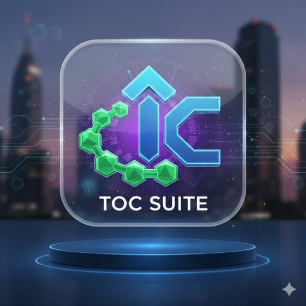

# Toc-Suite

**The Theory of Computation workbench that checks your answers for real.**
Draw, simulate and convert DFAs, NFAs, ε-NFAs, Mealy and Moore machines, PDAs and Turing machines, practise on 350+ verified exercises, and describe a language in plain English to get, or be guided towards, the exact automaton.

[](https://github.com/shiroonigami23-ui/Toc-Suite/actions/workflows/tests.yml)
[](https://github.com/shiroonigami23-ui/Toc-Suite/actions/workflows/build-library.yml)
[](https://toc-suite.netlify.app/)
[](LICENSE)


[**Open the app**](https://toc-suite.netlify.app/) ·
[Study guide (PDF)](docs/study-guide/STUDY-GUIDE.pdf) ·
[Technical guide (PDF)](docs/technical-guide/TECHNICAL-GUIDE.pdf) ·
[The journey (PDF)](docs/journey/JOURNEY.pdf) ·
[Roadmap](ROADMAP.md) ·
[Changelog](CHANGELOG.md)

<a href="docs/media/trailer.mp4"></a>

<sub>Concept trailer · <a href="docs/media/trailer.mp4">watch with sound (MP4)</a></sub>


<sub>Type <i>“binary strings where the second symbol from the end is 1”</i> → the exact minimal DFA, laid out and explained.</sub>

</div>

---

## Contents

- [Highlights](#highlights)
- [The Automata Assistant](#the-automata-assistant)
- [Studios](#studios)
- [Practice that is actually checked](#practice-that-is-actually-checked)
- [Every device, every keyboard](#every-device-every-keyboard)
- [Quick start](#quick-start)
- [Project structure](#project-structure)
- [How it works](#how-it-works)
- [Testing](#testing)
- [Deployment](#deployment)
- [Documentation](#documentation)
- [Privacy](#privacy)
- [Contributing](#contributing) · [License](#license)

## Highlights

| | |
|---|---|
| 🧠 **Automata Assistant** | English → DFA, examples → DFA, and a **guided mode** that lets you draw while it points out mistakes with the exact string that proves them. Runs fully in the browser, no API key. |
| ✅ **Exact checking** | FA answers are compared by language equivalence, not sample strings; a wrong answer gets the *shortest* counterexample. PDA and TM answers are checked on every short input (and TM tapes are compared). |
| 🔁 **Animated conversions** | ε-NFA → NFA, NFA → DFA, DFA minimisation, Moore ↔ Mealy, CFG → NPDA, regex → automaton, step by step at your chosen speed. |
| 🏋️ **353 verified exercises** | 120 FA constructions + 159 FA conversion exercises + 21 Mealy/Moore + 33 PDA + 20 TM. Every reference answer is audited by the test suite on every push. |
| 📚 **Self-maintaining library** | Machines dropped into `data/inbox/` are validated, sorted, de-duplicated and published by CI. |
| 🎓 **Classroom ready** | Assignments and quizzes with college-email identity, an instructor portal and review queue (Netlify Functions + Postgres). |
| 📱 **Phone to desktop** | Responsive layouts tested at phone, tablet, laptop and desktop sizes; shared keyboard shortcuts (press `?`). |
| ⚡ **Light** | No build step, no framework; ~0.64 MB first load uncompressed; icons are a 20 KB local subset. |

## The Automata Assistant

The assistant lives in the FA studio's side panel. Its English reader uses a small trained classifier **only** to decide what *kind* of condition each clause describes; the automaton is then built **exactly** (pattern automata, counters, product constructions, minimisation), so a sentence it understands never produces an approximate machine. It always shows how it read your sentence, with sample accepted and rejected strings.

<table>
<tr>
<td width="50%" valign="top">

**Guide me**: you draw, it watches

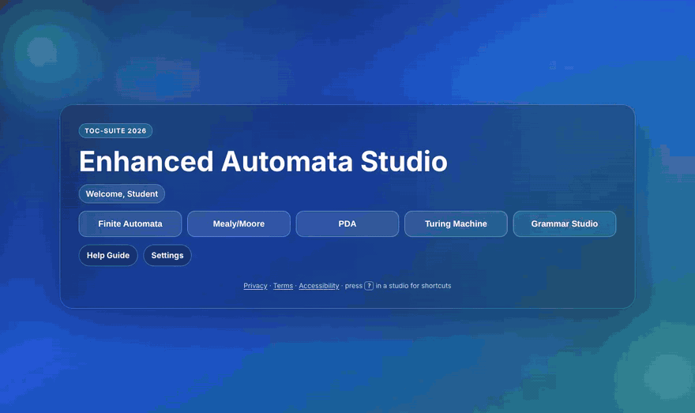

Each hint names the state, the reason and a *Test* button that runs the string proving it. Wrong states get a red ring.

</td>
<td width="50%" valign="top">

**Convert, animated**

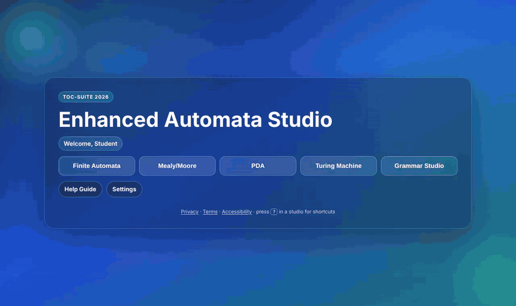

Load an NFA, choose **NFA → DFA**, and watch the subset construction build the DFA state by state.

</td>
</tr>
</table>

| You can type | It builds |
|---|---|
| `strings over {a,b} that end with abb` | 4-state minimal DFA |
| `binary numbers divisible by 3` | remainder automaton |
| `even number of a and ending in b` | product of two conditions |
| `contains aa or bb but not aba` | union, then difference |
| `L = (a+b)*abb` | regular expression, compiled |
| `only the strings ab, ba and aab` | finite language |
| `+ ab` / `- ba` (Examples tab) | smallest consistent DFA (RPNI) |

Accuracy is measured by brute force: every test description's DFA is compared with a hand-written predicate on all short strings (63/63 tuned, 25/25 unseen, and 110 of the 120 practice questions read correctly with zero disagreements).

## Studios

<table>
<tr>
<td width="50%">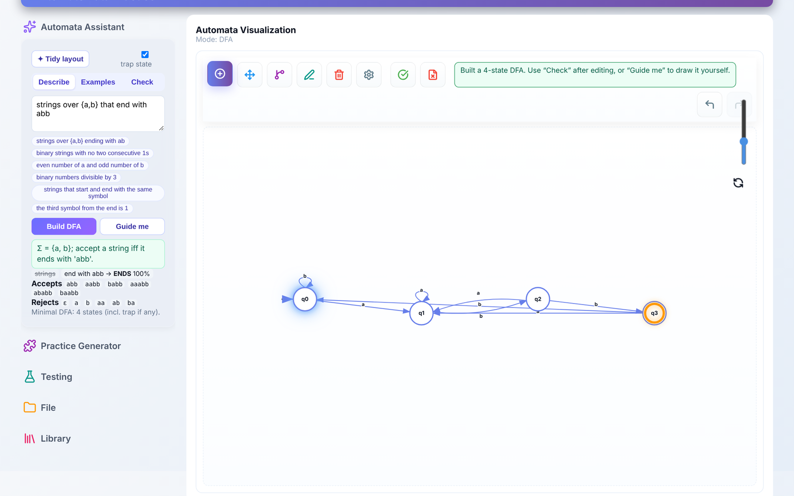<br><b>Finite automata</b>: DFA, NFA, ε-NFA; simulation with active-set highlighting; bulk tests; conversions; logic table CSV.</td>
<td width="50%">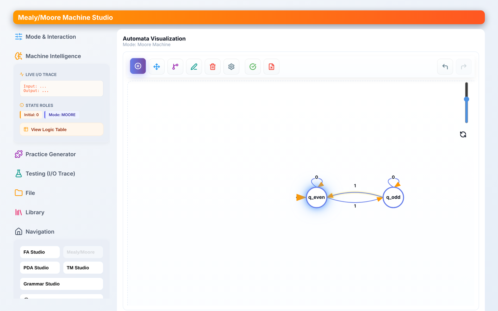<br><b>Mealy &amp; Moore</b>: outputs on states or transitions, live I/O trace, multi-character input symbols, both conversions.</td>
</tr>
<tr>
<td>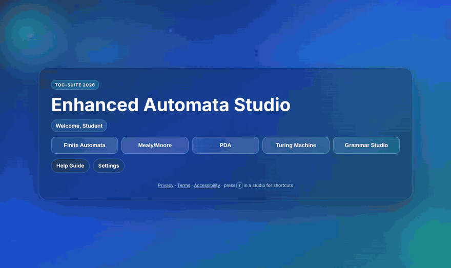<br><b>Pushdown automata</b>: live stack, NPDA breadth-first search with ε-loop pruning, final-state / empty-stack / both acceptance.</td>
<td>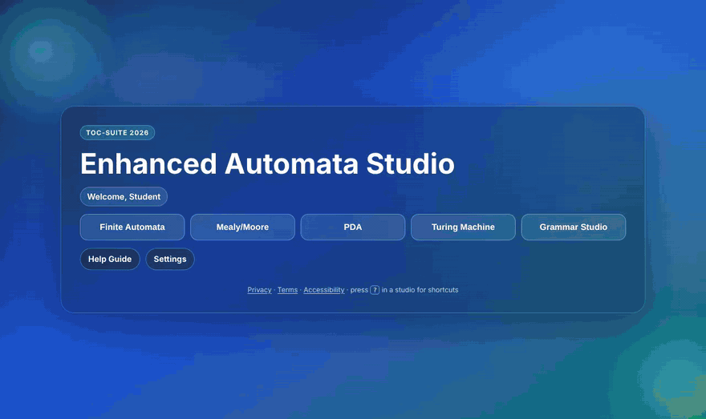<br><b>Turing machines</b>: animated tape, single-tape, multi-tape, non-deterministic and linear-bounded modes.</td>
</tr>
<tr>
<td>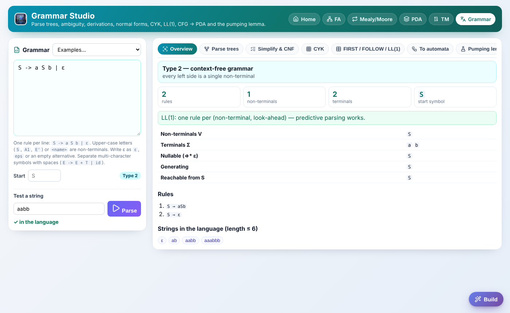<br><b>Grammar Studio</b>: CFG validation, animated CFG → NPDA, parse trees, derivations, regular and RE language bridges, pumping-lemma planner.</td>
<td>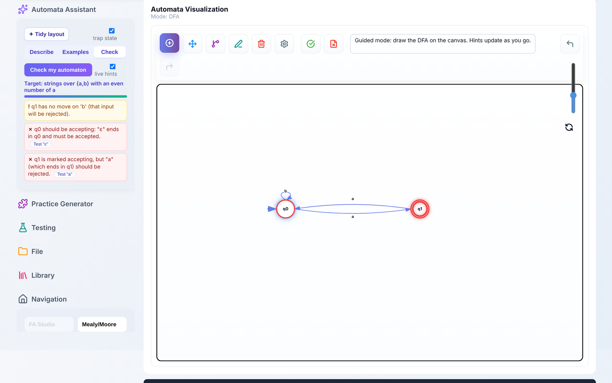<br><b>Guided mode</b>: the target stays hidden; the assistant explains which state is wrong and why.</td>
</tr>
</table>

## Practice that is actually checked

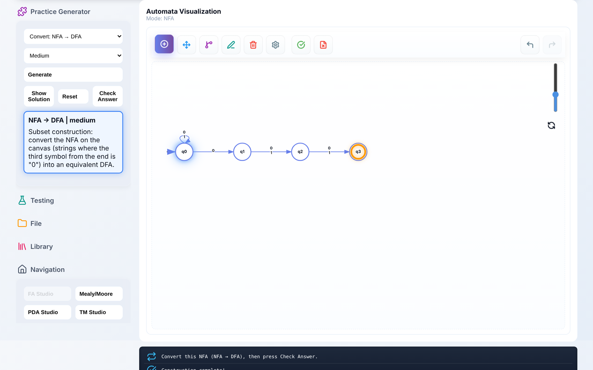

| Studio | Exercises | How your answer is checked |
|---|---|---|
| FA: build | 120 (easy → hard, DFA / NFA / ε-NFA) | exact equivalence + shortest counterexample + diagnosis |
| FA: convert | 159 (ε-NFA→NFA, NFA→DFA, DFA→min, NFA→min) | equivalence **and** shape: no ε, deterministic, minimal state count |
| Mealy / Moore | 21 + Moore↔Mealy conversion on any of them | exact output equivalence (lock-step search) |
| PDA | 33 | every string up to length 6 over the problem's alphabet |
| TM | 20 | every string up to length 5, acceptance **and** final tape |

> **Why this matters.** A November 2026 audit found that 20/120 FA, 28/33 PDA, 8/20 TM and 4/14 Mealy/Moore reference answers were wrong (for example the PDA for aⁿbⁿ accepted `aab`). All were rebuilt from independent definitions, and the test suite now re-checks every answer on every push. The full list is in Appendix D of [the journey](docs/journey/JOURNEY.pdf).

## Every device, every keyboard

<table>
<tr>
<td width="62%">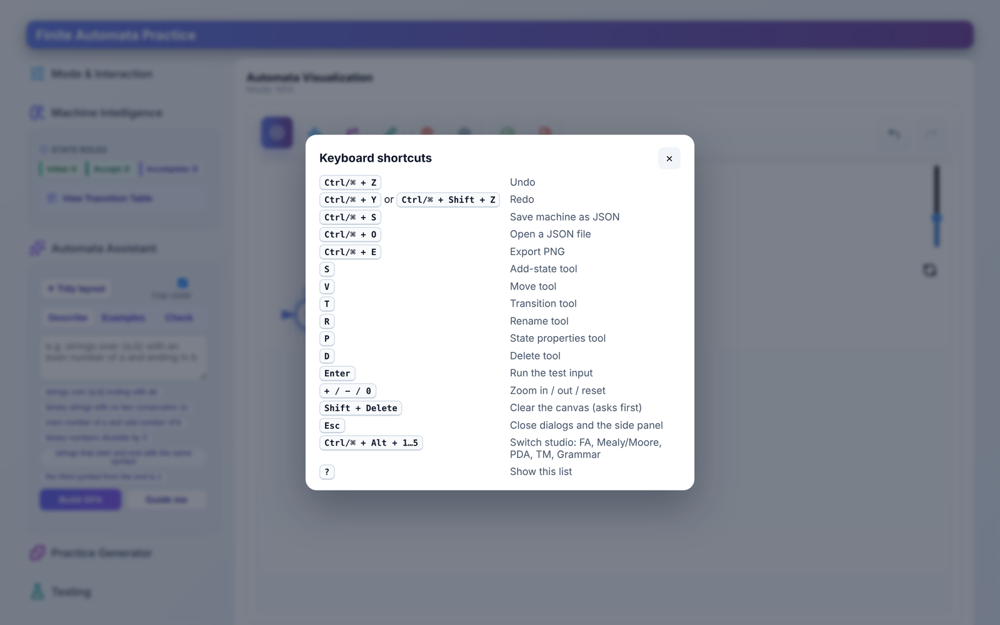</td>
<td width="19%">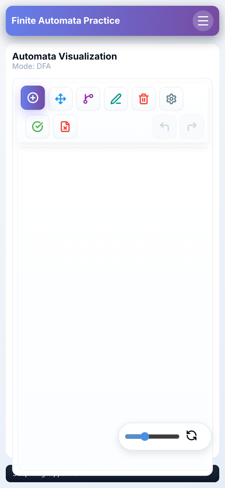</td>
<td width="19%">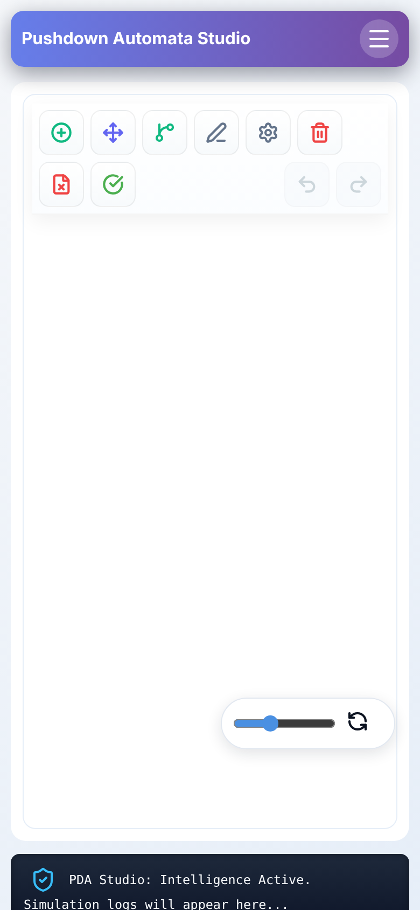</td>
</tr>
</table>

| Keys | Action | Keys | Action |
|---|---|---|---|
| `S` `V` `T` `R` `P` `D` | add state · move · transition · rename · properties · delete | `Ctrl/⌘ + Z / Y` | undo / redo |
| `Enter` | run the test input | `Ctrl/⌘ + S / O / E` | save JSON · open · export PNG |
| `+` `−` `0` | zoom in / out / reset | `Shift + Delete` | clear canvas (asks first) |
| `Esc` | close dialog / panel | `Ctrl/⌘ + Alt + 1…5` | switch studio |
| `?` | show all shortcuts | | |

Settings: theme, text size, reduced motion, **animation speed** (slow → instant), auto-resume, sharing switch, settings export/import, erase all local data.

## Quick start

```bash
git clone https://github.com/shiroonigami23-ui/Toc-Suite.git
cd Toc-Suite
python3 -m http.server 5173        # or any static server
# open http://localhost:5173
```

No install, no build. Node 20+ is only needed for the tests and tools.

## Project structure

```
Toc-Suite/
├── index.html              splash + studio shell (FA, Mealy/Moore, PDA, TM)
├── 404.html                sends pre-2026-11 URLs to their new homes
├── src/
│   ├── app/                routing, studio loader, autosave snapshots
│   ├── fa/  mm/  pda/  tm/ one folder per studio (state, renderer, ui, simulation, file, practice)
│   ├── grammar/            Grammar Studio + regex converter
│   ├── core/               verification engine, regex, RPNI, layout, diagnosis, English reader + model
│   ├── assistant/          Automata Assistant panel
│   └── shared/             utils, shortcuts, animation timing, paths, assignment client
├── data/
│   ├── practice/           practice banks (all verified by tests)
│   ├── libraries/          built library files (CI output)
│   ├── automata/  inbox/   library sources and incoming machines
│   └── templates/
├── pages/                  grammar studio, help, settings, policies, instructor portal
├── assets/                 css, icons, vendored icon subset
├── netlify/functions/      submissions, assignments, review, library push
├── tests/                  node --test suite (45 groups)
├── tools/                  model trainer, bank builders, icon + docs builders
└── docs/                   journey, study guide, technical guide, figures, screenshots
```

Old URLs such as `/grammar_studio.html` keep working through redirects in `netlify.toml` and `404.html`.

## How it works

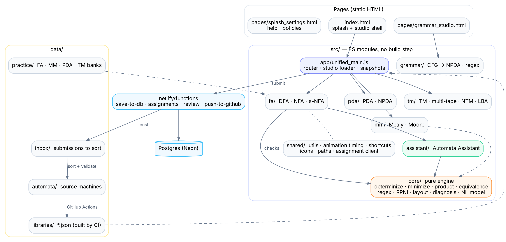

- **Shell + studios.** One page loads a studio per machine type; every studio has the same internal shape, so tools, undo/redo, saving, shortcuts and practice behave the same everywhere.
- **Pure core.** `src/core` has no DOM code: determinisation, minimisation, products, exact comparison with shortest counterexample, Thompson construction, ε-removal, RPNI, layout, diagnosis and the English reader. The same code runs in the browser and in the tests.
- **English reader.** normalise → split clauses → classify (multinomial logistic regression over uni/bigrams, 155 KB, deterministic training) → extract slots → exact primitive DFAs → product constructions → minimise → lay out. Details in the [technical guide](docs/technical-guide/TECHNICAL-GUIDE.pdf).

## Testing

```bash
npm test                 # unit, differential and data-audit tests (a few seconds)
npm run train-model      # retrain the English reader (byte-for-byte reproducible)
npm run fix-practice-bank
npm run build-docs       # rebuild the PDFs (needs pandoc + Playwright)
```

| Suite | What it proves |
|---|---|
| `fa`, `assist`, `nl`, `nl-unseen` | engine, learning, layout, diagnosis, English reader (brute-force predicates) |
| `audit-fa` | legacy simulator/conversions = engine on random machines; every FA practice + library answer; conversion practice |
| `audit-pda` | every PDA answer on every input up to length 7 |
| `audit-tm` | every TM answer on every input up to length 6, tape included |
| `audit-mm` | every Mealy/Moore answer; both conversions on random machines; exact equivalence vs brute force |

CI ([`tests.yml`](.github/workflows/tests.yml)) runs the suite on every push and fails if the committed model is stale.

## Deployment

Static hosting on Netlify (publish directory `.`). Server features use Netlify Functions; set these environment variables in Netlify (never in source):

| Variable | Used by |
|---|---|
| `DATABASE_URL` | submissions, assignments, review |
| `ARCHITECT_KEY` | instructor portal actions |
| `GITHUB_PAT`, `GITHUB_REPO` | pushing approved machines to `data/inbox/` |

`scripts/ignore-build.sh` skips deploys for data/docs-only commits. Workflows: `tests.yml`, `build-library.yml`, `generate_preview.yml`, `update_changelog.yml`, `auto_repair.yml`.

## Documentation

| Document | For | |
|---|---|---|
| **Study Guide** | students: theory, worked examples, "try it in the app" boxes | [PDF](docs/study-guide/STUDY-GUIDE.pdf) · [Markdown](docs/study-guide/STUDY-GUIDE.md) |
| **Technical Guide** | developers: architecture, data formats, engine API, testing, deployment | [PDF](docs/technical-guide/TECHNICAL-GUIDE.pdf) · [Markdown](docs/technical-guide/TECHNICAL-GUIDE.md) |
| **The Journey** | the full story: why, how, what went wrong, what's next (75 pages) | [PDF](docs/journey/JOURNEY.pdf) · [Markdown](docs/journey/JOURNEY.md) |
| **Roadmap** | step-by-step build path and next stages | [ROADMAP.md](ROADMAP.md) |

## Privacy

No ads, analytics or cookies. Settings and your canvas stay in your browser. Assignment submissions (and, unless you switch it off, ordinary saves to the class review queue) are sent to the course server. Details: [privacy, terms and accessibility](pages/policies.html).

## Contributing

Issues and pull requests are welcome. Please run `npm test` before opening a PR; new practice questions need a ground-truth entry or specification in `tests/` (see the [technical guide](docs/technical-guide/TECHNICAL-GUIDE.pdf), chapter 7).

## License

[MIT](LICENSE) © 2026 Shiro (Aryan Singh Chandel)
