# Preface {.unnumbered}

This document records how Toc-Suite came to exist, how it was built, what went wrong along the way, and what it has become. It is written for three kinds of reader. The first is a student who uses the tool and wants to know why it behaves the way it does. The second is a developer who might extend it and needs to understand the decisions behind the code. The third is me, a year or two from now, when I have forgotten why a particular folder exists or why a test checks every string up to length seven.

Toc-Suite is a browser-based workbench for Theory of Computation. It lets a student draw and simulate deterministic and non-deterministic finite automata, ε-NFAs, Mealy and Moore machines, pushdown automata and Turing machines; convert between them step by step; work with context-free grammars; practise against several hundred exercises whose answers are checked by the computer rather than by eye; and, since November 2026, describe a language in plain English and either have the automaton built or be guided while drawing it. It runs entirely in the browser, has no build step, and is deployed as a static site with a few serverless functions for classroom features.

The project has had three distinct phases. In January 2026 I built the core studios in an intense week, most of it visible in the repository history as a burst of more than a hundred commits across four days. In February and March I added the features that turned a personal tool into something a class could use: assignments, quizzes, an instructor portal and a Grammar Studio. In November 2026 I returned to the project, audited every part of it, and found that a large fraction of the stored practice answers were wrong, that several conversions had subtle bugs, and that the code had grown into a flat directory of more than ninety files. That third phase produced the verification engine, the Automata Assistant, a reorganised codebase, and the test suite that now guards all of it.

I have tried to be honest about the struggles as well as the results. Some of the most useful lessons came from mistakes: building features faster than I could check them, trusting answers because they looked right, and letting the structure of the repository drift because every individual change seemed small. The chapters on the audit are, in a sense, the centre of the book, because they explain why the later work looks the way it does.

## How this document is organised {.unnumbered}

Part I explains the motivation and gives a short map of the theory, so that the rest of the book can refer to it. Part II covers the January build of the five studios and the library pipeline. Part III covers the classroom features added in February and March. Part IV covers the November audit, the verification engine, the Automata Assistant and the restructuring. Part V reflects on the process, summarises the project in numbers, and sets out where it goes next. The appendices contain a dated timeline, a map of the repository and a glossary.

Two companion documents accompany this one. The *Toc-Suite Study Guide* explains the theory itself with worked examples that can be reproduced in the app. The *Toc-Suite Technical Guide* documents the architecture, modules and data formats for anyone who wants to modify the code. The repository's `ROADMAP.md` gives a shorter, step-by-step version of the development path described here.

<div class="pagebreak"></div>

# Part I — Beginnings {.part}

Why a student builds a tool instead of just studying, and what the subject asks of that tool.

# 1. Why Toc-Suite exists

## The problem in the classroom

Theory of Computation arrives in the third year of the B.Tech Computer Science programme at Rustamji Institute of Technology, and for many students it is the first course that feels genuinely abstract. Data structures and operating systems have obvious running examples; a finite automaton is a drawing on paper that is supposed to "accept a language", and the only way to know whether the drawing is right is to reason about every string it might ever see.

That last point was the source of most of my frustration. When I drew a DFA for "binary strings with an even number of zeros and an odd number of ones", I could test it on five or six strings in my head, but I had no way to know whether it was correct for all of them. The textbook answers were sometimes drawn differently from mine, with states named differently, a trap state included or omitted, or transitions merged on a single arrow. Comparing two drawings by eye is unreliable, and asking a teacher to check every homework drawing is not practical for a class of sixty.

The conversions were worse. The subset construction that turns an NFA into a DFA is mechanical, but it is long. A four-state NFA can produce eight or more subset states, and one wrong closure early in the table silently corrupts everything after it. Minimisation has the same character: a partition table that must be refined until it stops changing, where one missed distinction leaves two states merged that should be separate. These are exactly the procedures that a computer does perfectly and a tired student does badly at eleven at night.

## What already existed

I was not the first person to want a tool for this. JFLAP is the standard teaching tool and is excellent, but it is a Java desktop application. Installing a Java runtime on a lab machine or on a phone is a hurdle that many classmates never got past. On my phone I used an Android port of the same ideas (the repository still contains a screenshot of it from October 2025, which I kept as a reference for layout), but it was limited to finite automata and could not share work with anyone.

Several websites could draw a DFA from a regular expression or simulate an input string, but each covered only a slice of the syllabus. None of them covered the whole path from finite automata through Mealy and Moore machines, pushdown automata and Turing machines, and none could check a student's answer against a reference other than by running a handful of test strings.

## The first goal

The goal I wrote down at the start was simple: a single web page that works on a phone, covers every machine in the syllabus, can save and load machines as files, and can tell me whether my automaton is correct. "Correct" had to mean correct for every string, not for the five strings I happened to try.

That goal turned out to be harder than it sounds, and the last part of it, real correctness checking, was only fully achieved in November 2026. But it set the direction for every decision that followed: no installation, no build step, everything in the browser, and machines stored as plain JSON that a student can download, share and reload.

## From my problem to the class's tool

The second motivation arrived once the first version worked. Classmates who saw it on my phone asked for the link. Juniors preparing for the same course asked whether they could practise with it. Within a few weeks the question was no longer "can this help me study" but "can this help a class study", and that question brought new requirements: practice questions with answers, a way to submit work, and a way for an instructor to see what had been submitted. Those requirements shaped the February and March phases described in Part III.

Looking back, the project has always had these two faces. It is a tool I built for my own understanding, and it is a tool I maintain for other students. The first face explains why the code favours transparency (every conversion can be animated step by step) over cleverness. The second explains why, in November, I became so concerned with whether the reference answers were actually right.

# 2. The subject in one chapter

The rest of this book assumes a working map of the subject. This chapter gives that map briefly; the companion *Study Guide* covers it properly.

## The hierarchy of machines

Theory of Computation studies what different kinds of abstract machine can compute, and the classic organising idea is the Chomsky hierarchy. Each level of the hierarchy corresponds to a kind of grammar and a kind of machine, and each machine is strictly more powerful than the one below it.

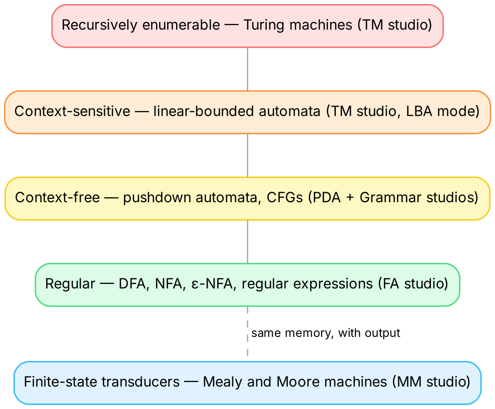{.narrow}

**Regular languages** are recognised by finite automata: machines with a fixed, finite number of states and no other memory. Deterministic finite automata (DFAs) have exactly one move for each state and symbol; non-deterministic finite automata (NFAs) may have several, or none; ε-NFAs may also move without reading a symbol. All three recognise exactly the same languages, and regular expressions describe the same class again. In Toc-Suite these live in the **FA studio**.

**Finite-state transducers** are not a separate level of the hierarchy, but they are part of the syllabus: Mealy and Moore machines have the same finite memory as a DFA but produce output as they read. A Moore machine attaches output to states; a Mealy machine attaches it to transitions. They live in the **Mealy/Moore studio**.

**Context-free languages** need one unbounded stack. A pushdown automaton (PDA) is a finite automaton with a stack it can push to and pop from, and it recognises exactly the languages generated by context-free grammars. The classic example is $a^n b^n$: equal numbers of a's followed by b's, which no finite automaton can recognise because it would need to count without limit. These live in the **PDA studio** and, from the grammar side, in the **Grammar Studio**.

**Context-sensitive and recursively enumerable languages** need a tape. A Turing machine reads and writes an unbounded tape and can move in both directions; it is the standard model of general computation. A linear-bounded automaton is a Turing machine restricted to the portion of tape that holds its input. These live in the **TM studio**, which also supports multi-tape and non-deterministic variants.

## The procedures a student must learn

Beyond drawing machines, the syllabus is built around procedures:

- **ε-removal**: turning an ε-NFA into an NFA by computing ε-closures.
- **Subset construction**: turning an NFA into an equivalent DFA whose states are sets of NFA states.
- **Minimisation**: merging equivalent states of a DFA by partition refinement until no two remaining states can be distinguished by any input.
- **Regular expression to automaton**: Thompson's construction, which builds an ε-NFA piece by piece from the expression.
- **Moore ↔ Mealy conversion**: moving output from states to transitions and back, which may split states.
- **CFG to PDA**: building a pushdown automaton that simulates leftmost derivations of a grammar.
- **Pumping lemmas**: arguments that a language is *not* regular or *not* context-free.

Each of these became a feature, and several of them became the source of bugs that the November audit uncovered. That is not a coincidence: a procedure that is easy to describe but long to carry out is exactly where both students and software make mistakes.

## What "correct" means

A recurring theme in this book is the difference between an automaton that *seems* right and one that *is* right. Two automata are equivalent if they accept exactly the same set of strings. For finite automata, equivalence is decidable: we can build the product of the two machines and search for a string that one accepts and the other rejects. If no such string exists, they are equivalent; if one exists, the shortest such string is the most useful possible feedback to a student, because it is a concrete counterexample.

The early versions of Toc-Suite checked answers by running a list of sample strings. That is not the same as checking equivalence, and Chapter 14 explains how much difference it made.

# 3. Before version three

The live site is called `toc-suite`, and the name is honest: there were two earlier attempts before the version that is in this repository.

## The first prototype

The first prototype was a single HTML file with a canvas and some JavaScript. It could add states, connect them with arrows and run a string through a DFA. It had no undo, no saving, and no idea what an NFA was. Its main value was teaching me how awkward it is to draw arrows between circles: self-loops, two arrows in opposite directions between the same pair of states, labels that overlap, and arrowheads that end inside the circle instead of on its edge. Every one of those problems reappears in the later code, and the solutions in the current renderer (curved paired edges, offset self-loops, labels placed at the midpoint of the curve) were first worked out, badly, in that file.

## The second prototype

The second attempt tried to cover more of the syllabus by giving each kind of machine its own page. It worked, in the sense that each page did its job, but the pages shared almost nothing. Each had its own copy of the drawing code, its own idea of what a saved file looked like, and its own bugs. Fixing a rendering issue in the DFA page did not fix it in the PDA page. When I added undo to one page I had to add it four times.

The lesson from the second prototype was architectural. The machines differ in what their transitions mean, but they share almost everything else: states with positions, transitions between states, a canvas, tools for adding and moving and deleting, undo and redo, saving and loading, a log of what happened. Version three was designed around that observation: one shell application that loads a *studio* for each kind of machine, with shared utilities underneath.

## What carried over

Two decisions from the prototypes survived unchanged. The first is the file format. A machine is a JSON object with a `type`, a list of `states` (each with an `id`, a position, and flags such as `initial` and `accepting`) and a list of `transitions` (each with `from`, `to` and whatever the machine type needs: a `symbol` for a finite automaton, `pop` and `push` for a PDA, `read`, `write` and `move` for a Turing machine). That format is human-readable, easy to diff in Git, and simple enough that classmates could write machines by hand.

The second decision is SVG for drawing. A canvas element would have been faster for very large machines, but SVG elements can be styled with CSS, highlighted during a simulation by adding a class, exported as an image, and inspected in the browser's developer tools. For machines with tens of states, which is what a course uses, SVG is more than fast enough.

# Part II — Building version three {.part}

January 2026: five studios, one shell, and a library that sorts itself.

# 4. Architectural choices

## No build step

The first decision for version three was that there would be no build step. The application is a set of ES modules loaded directly by the browser. There is no bundler, no transpiler and no framework. Opening `index.html` from a local web server runs the application exactly as it runs in production.

This decision has costs. Without a bundler, every module is a separate network request, and the browser cannot tree-shake unused code. Without a framework, the user interface is built with plain DOM calls and template strings, and keeping the interface consistent with the underlying state is the programmer's responsibility. But for a student project that other students might want to read and modify, the benefits were decisive. Anyone who knows JavaScript can open any file and understand it. The browser's developer tools show the real source, not a compiled bundle. Deployment is copying files. And when a classmate asked how a feature worked, I could point at one file rather than explaining a toolchain.

## One shell, several studios

The second decision came from the failure of the second prototype. Version three has a single entry page, `index.html`, which shows a splash screen and then loads a **studio** for the chosen machine type into the same page. The shell, `unified_main.js`, owns routing (the URL hash `#fa`, `#mm`, `#pda` or `#tm` selects the studio), remembers the last studio used, autosaves the current machine to the browser's local storage every few seconds so that a refresh never loses work, and provides navigation between studios.

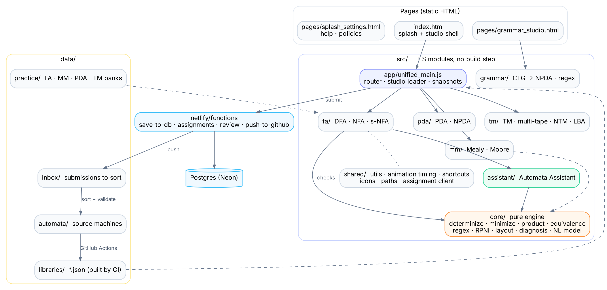

Each studio has the same shape: an HTML fragment for its controls, a *state* module that holds the current machine together with undo and redo stacks, a *renderer* that draws the machine into an SVG element, a *UI* module that wires up tools and buttons, a *simulation* module, a *file* module for saving, loading and exporting, and a *practice* module. The FA and Mealy/Moore studios build their HTML from template strings inside the shell; the PDA and TM studios fetch their HTML fragments when first opened.

## State as a single object

Each studio keeps the machine it is editing in a single exported object, `MACHINE`, and changes it through a small number of functions. Before every change, the UI calls `pushUndo`, which serialises the current machine onto the undo stack. Undo pops that snapshot back. This is not the most memory-efficient design, since every undo step stores a complete copy, but machines in a course are small and the simplicity is worth it: there is no way for undo to get out of step with the machine, because undo does not try to reverse individual operations.

## The renderer

Drawing automata well is harder than it looks, and the renderer is where the lessons of the first prototype ended up. Each state is an SVG group with a circle, a label and, for accepting states, a second inner circle. The initial state gets an incoming arrow from outside. Transitions between the same pair of states are merged into one arrow with a combined label (`a, b` rather than two arrows). When two states have transitions in both directions, each arrow is curved away from the other so that they do not overlap. Self-loops are drawn as a small loop above the state. Arrowheads are computed so that they end on the edge of the target circle rather than at its centre.

During a simulation, the renderer does not redraw anything; it adds CSS classes to the active state and the transition just taken, and the style sheet handles the highlighting. That separation turned out to be useful much later, when the Automata Assistant needed to mark incorrect states in red: it simply adds another class.

## Hosting and functions

The site is hosted on Netlify as static files. A handful of Netlify Functions (small server-side JavaScript functions) provide the features that need a server: storing submissions in a Postgres database, listing active assignments, saving instructor reviews, and pushing machines into the GitHub repository. Everything else runs in the browser. If the functions are unavailable, the studios still work; only submission and sharing are affected.

# 5. The finite automata studio

The FA studio was the first and is still the largest. It handles DFAs, NFAs and ε-NFAs, and it is where most students spend their time.

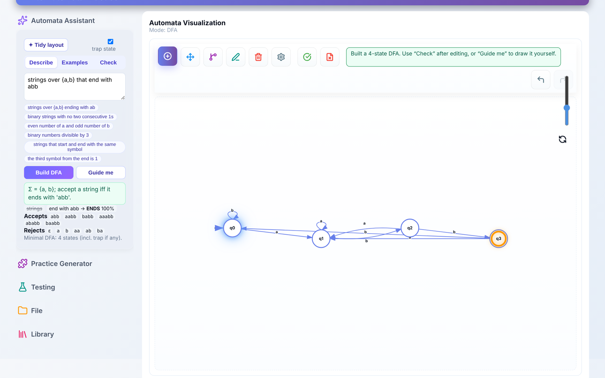{.screenshot}

## Tools

The toolbar has a small number of tools, each also available from the keyboard: add a state by clicking on the canvas, move states by dragging, add a transition by clicking the source and then the target, rename a state, edit a state's properties (initial, accepting), and delete. Transition labels may contain several symbols separated by commas, and the symbol `ε` (or `eps`) marks an ε-transition. An NFA may have several transitions from the same state on the same symbol; a DFA should not, and the validator says so.

## Simulation

Testing a string highlights the path through the machine one symbol at a time, with a speed control. For an NFA, the simulator tracks the *set* of active states, which is both correct and instructive: students can see why an NFA accepts if *any* path accepts. Bulk testing runs many strings at once and reports each result, which is useful for checking an answer against a list from the textbook.

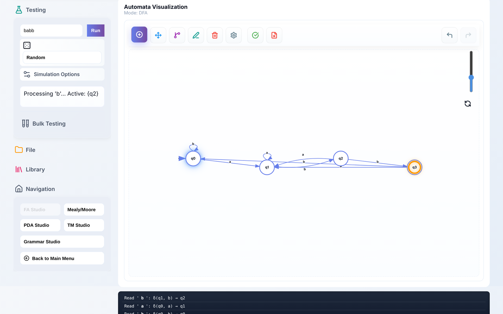{.screenshot}

## Conversions, animated

The part of the FA studio I am proudest of from January is the animated conversions. Choosing "NFA → DFA" from the mode menu runs the subset construction on the machine on the canvas, and instead of replacing it instantly, it builds the DFA one state and one transition at a time, logging each step: which subset is being processed, which symbol, what the move and closure produce, and whether the result is a new subset or one already seen. ε-NFA → NFA and DFA minimisation are animated the same way.

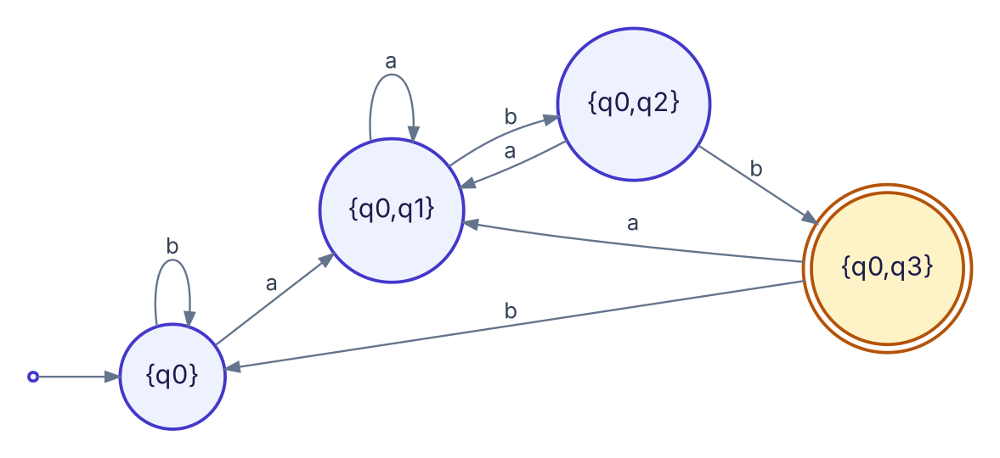{.narrow}

The animations exist because the procedures are the hardest part of the course to learn from a static textbook. Watching the table fill in, and being able to pause and compare it with my own working, was the single most useful study aid I built. It also turned out, much later, to hide two bugs: the January NFA → DFA routine always added an empty `{}` state even when nothing could reach it, and the comparison routine used to check practice answers was confused when the two machines had different alphabets. Chapter 14 tells that story.

## Saving, exporting, sharing

A machine can be saved as JSON (with a title and description, so that it can be added to the shared library), loaded from JSON, and exported as a PNG image for assignments and notes. Loading a file *animates* the machine being drawn, state by state, which looks good in a demonstration but, as November showed, was far too slow for large machines and could collide with a conversion started before the drawing finished.

## Practice

The practice panel offers questions at four difficulty levels for each of DFA, NFA and ε-NFA: one hundred and twenty construction questions in total. "Show solution" draws the reference answer; "Check answer" compares the student's machine with it. In January the comparison ran a list of sample strings through both machines and reported the first difference. That was better than nothing, and it caught most mistakes, but it was not a proof of correctness, and it could not detect when the *reference* answer was wrong.

# 6. The Mealy and Moore studio

Mealy and Moore machines reuse almost everything from the FA studio: the same canvas, tools, undo, saving and library. What changes is the meaning of the machine. A Moore machine stores an output symbol on each state, so adding a state opens a small dialog asking for its output. A Mealy machine stores output on each transition, so transitions are labelled `input/output`.

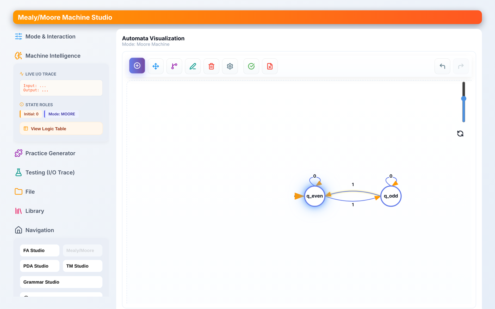{.screenshot}

Simulation produces an output string rather than accept or reject, and the studio shows the input and output side by side as the machine runs. The two conversions, Moore → Mealy and Mealy → Moore, are animated like the FA conversions. Moore → Mealy is straightforward: each transition takes the output of the state it enters. Mealy → Moore is not: a Mealy state that is entered with different outputs must be split into one Moore state per output, and the start state needs a copy for the moment before any input is read. That second subtlety is where, months later, I found the conversion could produce a machine with no start state at all.

The practice bank for this studio was the smallest in January (fourteen questions across Moore and Mealy), and it is still the one I would most like to grow, because transducers are where students most often confuse "what the machine remembers" with "what the machine prints".

# 7. The pushdown automata studio

The PDA studio adds a stack. Each transition is labelled with three things: the input symbol to read (or ε), the symbol to pop from the top of the stack (or ε), and the string to push in its place (or ε). The stack is drawn live in the side panel during a simulation, and the header shows the current top of the stack.

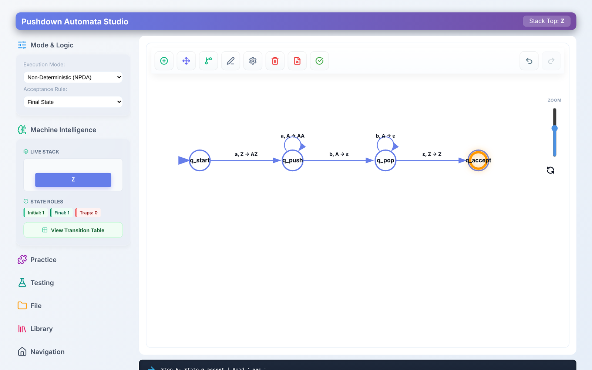{.screenshot}

## Non-determinism and acceptance

Pushdown automata are naturally non-deterministic: the standard PDA for even-length palindromes must *guess* where the middle of the string is. The simulator therefore explores every possible computation at once, breadth-first, and accepts if any branch accepts. A PDA can accept by final state, by empty stack, or by both, and the studio supports all three.

Breadth-first search over PDA configurations has a well-known trap: a machine with an ε-transition that pushes a symbol can grow its stack forever without reading any input. The January simulator protected itself with a step limit, which meant that some perfectly correct non-deterministic machines were rejected simply because the search ran out of steps before finding the accepting branch. The November version keeps a set of configurations it has already visited and prunes configurations whose stack is taller than the remaining input could ever empty, which removes the problem without a step limit that is too tight.

## The practice bank

The PDA practice bank was the most ambitious in January: thirty-three problems from $a^n b^n$ through balanced brackets, palindromes with and without a centre marker, counting relationships such as "twice as many zeros as ones", and unions such as "$a^i b^j$ with $j = i$ or $j = 2i$". It was also, as Chapter 14 explains, the bank with by far the most wrong answers.

# 8. The Turing machine studio

The TM studio is the most general. A transition reads a tape symbol, writes a symbol and moves the head left or right. The tape is drawn as a row of cells with the head highlighted, and it grows in either direction as the machine moves.

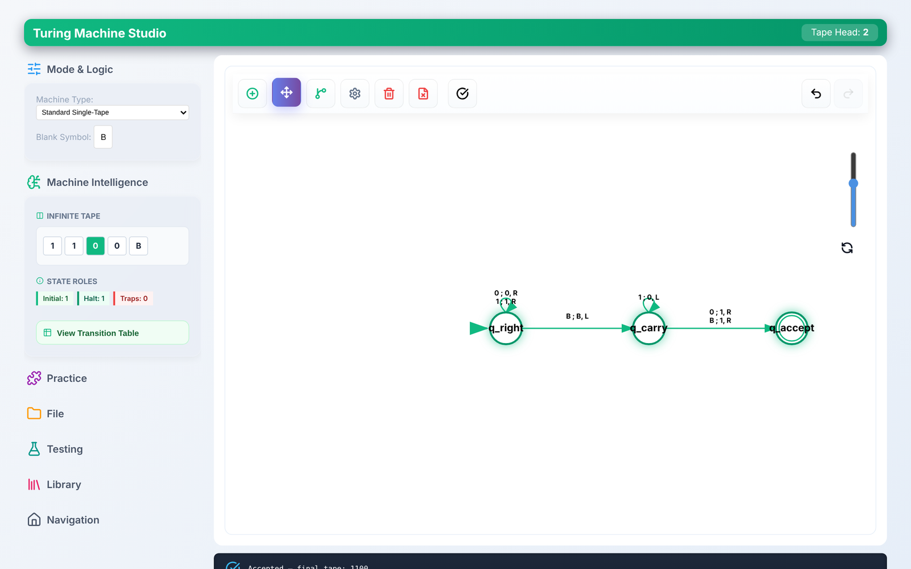{.screenshot}

Beyond the standard single-tape machine, the studio supports multi-tape machines (each transition reads and writes a tuple of symbols and moves each head independently), non-deterministic machines (simulated breadth-first, like the PDA), and linear-bounded automata (the head may not leave the cells that held the input). These variants matter in the course because several important results, for example that multi-tape machines are no more powerful than single-tape ones, are easier to believe after watching both run on the same input.

The TM practice bank has twenty challenges across four levels, from "invert every bit" to "accept exactly the strings of the form $w\#w$". Turing machine answers are harder to check than finite automaton answers, because equivalence of Turing machines is undecidable. The checker therefore compares behaviour on every input up to a fixed length, and, since November, compares the final tape as well as the accept/reject decision, so that a machine that halts in the right state with the wrong output is no longer marked correct.

# 9. The library and the commit storm

## A library that sorts itself

From the start I wanted Toc-Suite to have a shared library of machines: examples a student could load, study and modify. The library also had to grow without me editing a JSON file by hand every time a classmate had a good example.

The design that emerged in the first week is a small pipeline. Machines arrive as JSON files in an inbox folder (originally `Data/`, now `data/inbox/`), either committed directly or pushed by a Netlify Function when a student saves to the shared library. A GitHub Action, `build-library.yml`, runs on every push that touches the inbox or the automata folders. It validates each file (every transition must connect states that exist), detects its type, moves it to the right sub-folder (`fa`, `mm`, `pda` or `tm`), removes duplicates, and rebuilds one combined library file per studio. The studios fetch those library files when they open.

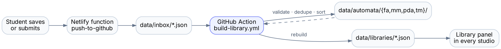

## Four days, more than a hundred commits

The repository history from 4 to 7 January 2026 shows what building that pipeline actually looked like. On 5 January alone there are fifty-nine commits. Many are the same file renamed back and forth between `automata/` and `automata/fa/` while I worked out where the Action expected it. Workflows appear and disappear: an `update_readme_summary.yml` that rewrote statistics into the README, created, edited four times, and deleted two days later because it fought with my own edits; a `create-json-from-image.yml` that tried to turn photographs of hand-drawn machines into JSON and was deleted the same day. The README is renamed to `READ.md` and back twice while I tested whether the Action's README updates were the cause of a loop.

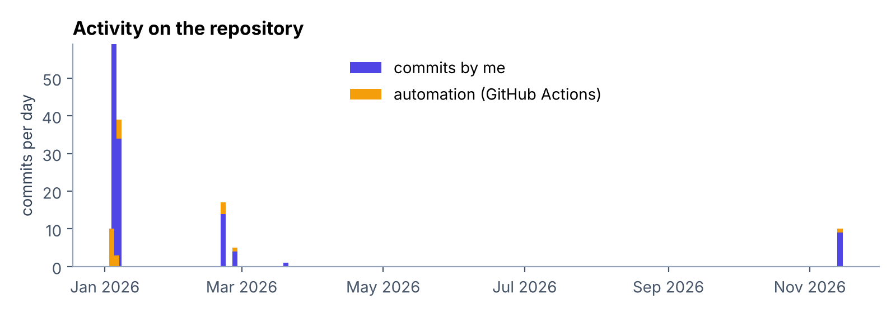

It would be easy to present that week as a clean design process. It was not. It was trial and error against a CI system I was learning as I went, with a deadline in the form of a semester that was about to restart. What I learned, and what I would tell anyone building something similar, is that automation which edits the repository it runs in needs to be designed very carefully: it must be idempotent, it must not trigger itself, and it must never overwrite a human's change. The final `build-library.yml` meets all three conditions, and it has run without trouble since, including when the November reorganisation moved every folder it touches.

## Uploads, functions and the database

The last two days of that first week, 6 and 7 January, added the server side: the Netlify Functions that store submissions in Postgres and push machines into the repository, and the package file that declares their dependencies. Most of these arrived as "Add files via upload" commits, because I was developing the functions locally and uploading them through the GitHub web interface, a habit that made the history harder to read and that I have since replaced with ordinary commits.

By the end of 7 January the application had five working studios (FA, Mealy/Moore, PDA, TM and the shared shell), a self-maintaining library and a working submission path. In lines of code, the application was about eleven thousand lines of JavaScript, not counting practice data.

# Part III — For the class {.part}

February and March 2026: assignments, quizzes, an instructor's portal and a Grammar Studio.

# 10. Assignments, quizzes and the portal

## From a tool to a classroom

Once classmates were using Toc-Suite regularly, the natural next request was a way to hand in work. Until then, "submitting" an automaton meant exporting a PNG and sending it in a chat group, which loses the machine itself: an image cannot be simulated, compared or corrected. On 21 February 2026 I committed the first version of a submission system, and on 26 February a dedicated review page for the instructor.

## How a submission flows

The flow has three parts.

First, an instructor creates an **assignment** through the portal page. An assignment has a title, a machine type (FA, Mealy/Moore, PDA or TM), a mode (*practice*, which can be submitted repeatedly, or *quiz*, which is stricter) and an active window. The `create-assignment` function stores it.

Second, when a student saves a machine in a studio, the client asks the `list-active-assignments` function whether an assignment of that machine type is open. If one is, the student is asked whether this save is a submission. Saying yes requires a college email login of the form `0902CS231028@rjit.ac.in`; the roll number is derived from the email, and the identity is locked for the browser session so that it cannot be changed between submissions. The `save-to-db` function stores the machine, the student's identity and the assignment in Postgres.

Third, the instructor opens the portal's review page, which lists submissions per assignment through `get-submissions`, lets the instructor open any machine directly in the matching studio, and records a review with `save-review`.

## Small defences

A submission system invites gaming, and a few simple defences went in from the start. The email must match the college domain and the roll-number pattern. The identity locks for the session. Each submission carries a coarse device signature (browser, language, time zone and screen size, encoded rather than stored as raw fields) so that an instructor can notice one device submitting for several students. None of this is security in a strong sense, and the policies page now says so plainly, but it is enough to keep a practice system honest.

## What I would do differently

The portal was built quickly and it shows. The review page and the portal page each contain a lot of inline script, and the boundary between "save to the shared library" and "submit to an assignment" was, for a while, confusing to students: an ordinary save was also copied to the review queue without the student necessarily realising. In November I made that explicit. The settings page now has a switch, on by default, that controls whether ordinary saves are shared with the class review queue, while assignment submissions are always sent because that is their purpose. The new privacy policy describes exactly what is sent and when.

# 11. The Grammar Studio

## Why a separate studio

Context-free grammars are the other half of the context-free story. A pushdown automaton recognises a language; a grammar generates it. The course expects students to move between the two, to build parse trees and derivations, and to use the pumping lemma for context-free languages to show that some languages, such as $a^n b^n c^n$, are not context-free. None of that fits naturally on an automaton canvas, so the Grammar Studio has its own page with tabs.

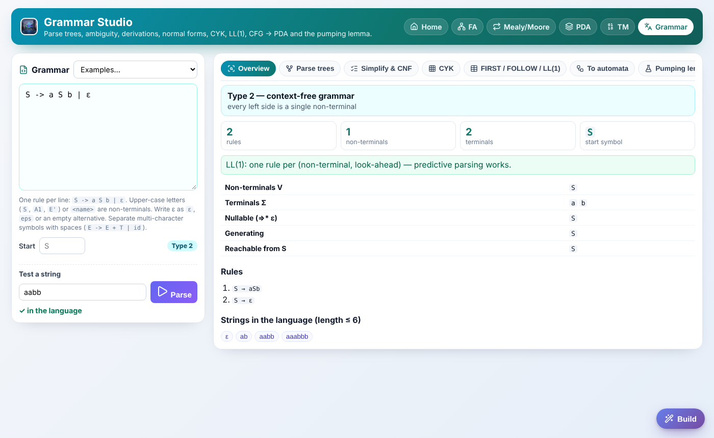{.screenshot}

## What it does

The **CFG input** tab accepts a grammar in a readable form such as `S -> a S b | eps` and validates it: undefined non-terminals, unreachable productions and malformed rules are reported.

The **conversion** tab builds a non-deterministic PDA from the grammar using the standard construction: push the start symbol, then for every production add a transition that replaces the non-terminal on top of the stack with the right-hand side, and for every terminal add a transition that matches it against the input. The construction is animated as a numbered list of steps, and the resulting PDA can be downloaded as JSON or opened directly in the PDA studio, where it can be simulated on real strings.

The **parse tree** and **derivation** tabs generate a leftmost derivation for an input string and draw the corresponding tree, which is the most direct way to see what "ambiguous grammar" means.

The **regular and recursively enumerable language** tabs connect the grammar world to the other studios: a right-linear grammar or a regular expression can be converted and opened in the FA studio or the Mealy/Moore studio, and a description of a recursively enumerable language can be turned into an editable starting machine in the TM studio.

The **pumping lemma** tab is a proof planner rather than a prover. It walks through the structure of a pumping-lemma argument for a context-free language (choose $p$, choose a string, consider every split $uvwxy$, pump) and helps the student fill in each step for their own language.

## Cross-studio routing

The Grammar Studio is the reason the shell gained *smart routing* in February. A machine produced by one studio can now be handed to another: the grammar's PDA opens in the PDA studio, a regular expression opens in the FA studio, and a file of any machine type loaded in the wrong studio is sent to the right one instead of failing. The router stores the machine to hand over in session storage, switches studio, and the destination studio picks it up on load.

# 12. Help, settings and phones

## A help page that teaches

The help page started as a list of buttons and their meanings. On 21 February I rewrote it as an interactive guide: an accordion of sections that remembers which ones were open, studio-by-studio *playbooks* that walk through a typical task, common pitfalls (an initial state with no outgoing transitions; a PDA that never empties its stack; a Turing machine with no transition on the blank symbol), and a checklist a student can tick through before submitting.

## Settings

The settings page gives each student a display name, a college email identity for submissions, a theme, a text size and a motion preference, with presets for "focus" and "calm" and the ability to export and import settings as a file. In November it gained an animation-speed setting that applies to every animation in the application, the sharing switch described above, a button to erase all local data, and links to the new privacy, terms and accessibility page.

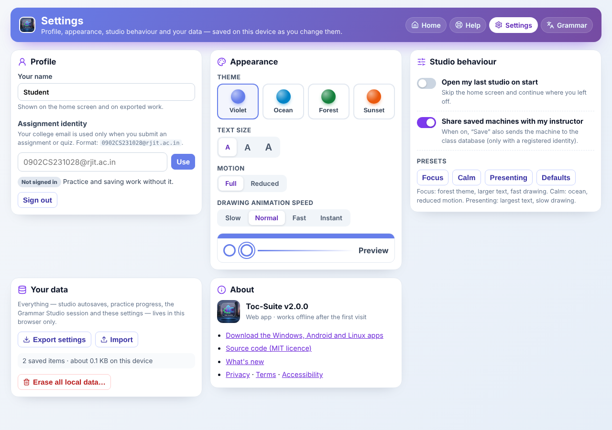{.screenshot}

## Phones

Most of my classmates use Toc-Suite on a phone, and phones were a constant source of small problems. The control panel becomes a slide-in drawer below a certain width, and on 20 March 2026 I fixed an accessibility problem where the drawer toggle in the Grammar Studio could not be reached. But the deeper phone problems were not fixed until November: on a narrow screen the 1400-by-900 drawing area was scaled down until states were seven pixels wide, the zoom control stretched into a tall white bar over the canvas, and the Grammar Studio left a large empty band where the hidden drawer still occupied space. Chapter 17 describes those fixes.

# 13. How the class used it

## Three patterns of use

Watching classmates use Toc-Suite over the spring taught me more about its design than any amount of testing on my own. Three patterns of use stood out, and each one pushed the design in a particular direction.

The first pattern was **checking homework**. A student would solve a problem on paper, draw the answer in the FA or PDA studio, and run the strings from the question. This is the use I had built the tool for, and it worked well for finite automata, where the strings in a textbook question usually include the tricky cases. It worked less well for pushdown automata, because students would run three or four strings of the "right shape" and stop. That is exactly the behaviour that let my own wrong PDA answers survive, and it is the reason the November PDA checker tests every string up to length six over the problem's alphabet instead of a short fixed list.

The second pattern was **learning a procedure**. Students preparing for an examination would load an NFA from the library and run the subset construction with the animation slowed down, pausing at each step to compare with their own table. Several asked for a way to practise the procedure itself rather than just watch it, which is what the conversion practice added in November finally provides: the machine to convert is drawn for you, you perform the conversion, and the checker tells you not only whether the language is right but whether the result is actually a DFA, or actually minimal.

The third pattern was **studying together**. Groups of two or three would sit around one phone, one person drawing while the others suggested changes. In that setting the canvas is small and attention is shared, and what helps most is a single, clear message about what is wrong. That observation shaped guided mode more than anything else. The assistant shows the most useful problem first, in a sentence, with a button that runs the string that proves it, rather than a list of every difference.

## What students asked for

The requests that came back most often were, roughly in order: "tell me *which* string fails, not just that it fails"; "let me practise conversions"; "it is too small on my phone"; "the loading animation is slow"; and "let me draw it myself but stop me when I go wrong". Every one of those is addressed by the November work, and the order of the list is close to the order in which they were tackled.

There were also requests I decided against. Several students asked for the practice checker to show the reference answer automatically after a wrong attempt. I kept "Show solution" as a separate, deliberate action, because seeing the answer immediately after a mistake removes the most valuable part of practice, which is finding the mistake yourself. Guided mode is the compromise: it never shows the answer, but it never leaves you stuck either.

## Phones first

The single most important fact about the class's usage is that most of it happened on phones. That was not what I had designed for in January; the canvas was sized for a laptop, and the side panel was simply squeezed. The phone fixes in November (a minimum canvas size with scrolling, a compact zoom control, a drawer that does not leave empty space) were overdue, and in hindsight I should have tested on a phone from the first day. Every new feature is now checked at phone, tablet, laptop and desktop sizes before it is committed.

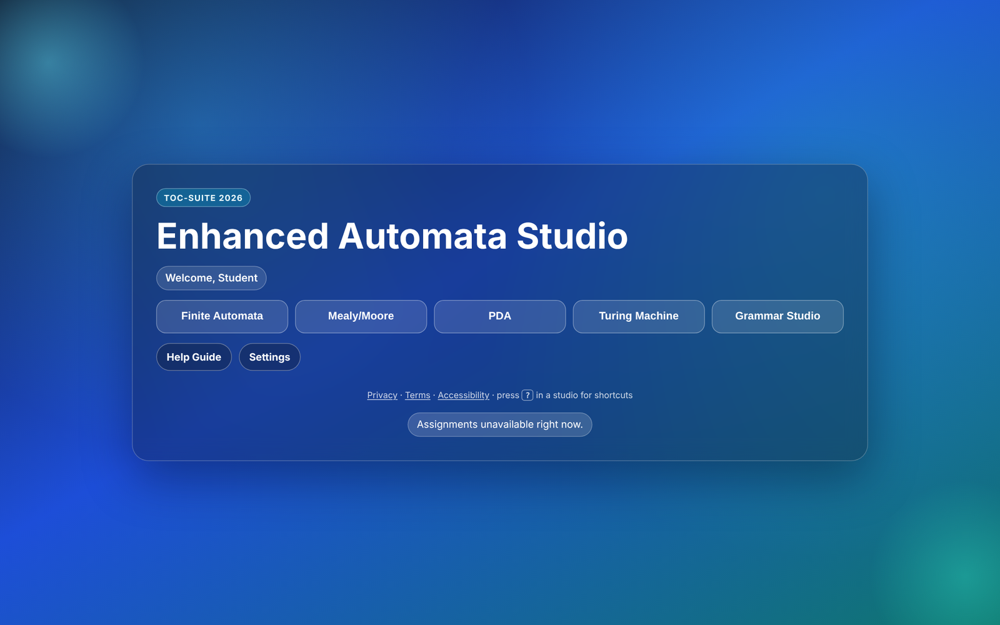{.screenshot}

# Part IV — A second look {.part}

November 2026: an audit, a verification engine, an assistant that understands English, and a codebase put in order.

# 14. The audit

## Why I went back

By November the project had been stable for eight months. Students used it; nobody reported serious problems. But I wanted to add something genuinely new, an assistant that could build an automaton from a description of its language, and before adding a feature that would *generate* answers I wanted to be sure the existing answers were right. If the assistant and the practice bank disagreed, I needed to know which one to trust.

So I set a rule for myself: no stored answer, conversion or checker would be trusted because it looked right. Every one would be compared against something independent.

## The method

For finite automata the independent reference was straightforward to build: a small engine (described in the next chapter) that can determinise and minimise any automaton, compare two automata exactly, and produce the shortest string on which they differ. With that engine I wrote **differential tests**: generate hundreds of random automata and random regular expressions, run them through the January code (the simulator, the NFA → DFA conversion, the minimiser, the regular-expression converter in the Grammar Studio) and through the new engine, and fail if they ever disagree.

For the practice banks, the reference was a *brute-force predicate*. For each question I wrote, by hand, a short JavaScript function that decides membership directly. For "strings that do not start with 1 or do not end with 0" the predicate is literally `w => !(w[0] === '1' && w.endsWith('0'))`. The test then runs the stored answer and the predicate on every string over the alphabet up to length eight (511 strings for a binary alphabet) and fails on the first disagreement.

For pushdown automata the predicates were the same idea, checked on every string up to length seven with the non-deterministic simulator. For Turing machines, which can transform their tape, each specification returns either "reject", "accept" or the exact expected final tape. For Mealy and Moore machines, each specification returns the full output string.

## What it found

The results were not what I expected.

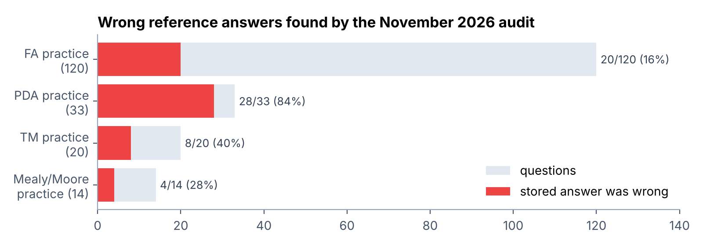

**Finite automata.** Twenty of the one hundred and twenty construction answers accepted the wrong language. Some were off by a single string: the answer for "start with 0 or end with 1" rejected the string `1`, which ends with 1; the answer for `(0|1)*01*` rejected `0`. Others were more seriously wrong: the answer for "the third symbol from the end is a" rejected `aaa`. One question asked for an NFA recognising strings whose length is prime, which is not a regular language at all, and its stored answer was an automaton with no transitions. I rewrote that question with a bound ("a prime length no larger than seven") so that it is both regular and meaningful.

**Pushdown automata.** Twenty-eight of thirty-three answers were wrong, which is the number that most surprised me. Almost all failed for the same reason: an accepting state that could be reached before the stack had been checked. The answer for $a^n b^n$, for example, entered an accepting state after the first `b`, so `aab` was accepted with an `A` still on the stack. In January I had tested these machines on a few strings of the expected shape, and they worked on those strings; the strings they wrongly accepted were exactly the ones I had not thought to try.

**Turing machines.** Eight of twenty answers were broken: string copy, string reversal, palindrome, $w c w$, balanced parentheses, marking both ends, "even number of zeros" (which accepted `0` because the start state was also the halting state) and an arbitrary-copy machine. Separately, the two machines in the TM *library* stored their head movement under the field name `direction` while the simulator reads `move`, so they never moved at all.

**Mealy and Moore machines.** Four machines were wrong: the "10" detector (in two places), the "11" detector, which forgot that `111` still ends in `11`, and a Mealy machine for strings ending in `110` with the same mistake. The serial binary adder could not be run at all, because its input symbols are the pairs `00`, `01`, `10`, `11` and the simulator read input one character at a time.

**The January code.** The NFA → DFA conversion always added an unreachable empty state. The equivalence check used for practice answers reported "incorrect" when the student's machine and the reference used different alphabets, even if they accepted the same strings over the common symbols. The Grammar Studio's regular-expression converter did not accept `+` as union, although that is the notation most textbooks use. The Mealy → Moore conversion could produce a machine with no start state, and it matched states to their copies by checking whether one name started with the other, so `q1` and `q11` were confused. The practice data had a misspelled key (`transition` instead of `transitions`), an older spelling of ε that the engine did not recognise, and three answers that referred to a trap state they never declared.

## What I took from it

It would be easy to read those numbers as a failure, and in one sense they are: for ten months a student could draw a correct PDA for $a^n b^n$, press "Check", and be told it was wrong because the reference was wrong. But the more useful reading is about method. Every one of those answers had been checked, by me, on examples. Examples are exactly what fails here, because the strings that expose a wrong automaton are the ones you do not think of. Exhaustive checking over short strings found every one of these bugs in seconds, and the exact equivalence check for finite automata makes the question unambiguous.

The fixes are now permanent. Every stored answer is rebuilt from a construction the engine verifies, every bank is checked by the test suite on every push, and a mistake in a future question will fail the build before it reaches a student.

# 15. A verification engine

## The core

The audit needed an engine that was independent of the January code, and it became the foundation for everything that followed. It lives in `src/core/` and has no knowledge of the user interface: it takes plain data and returns plain data, so the same code runs in the browser and in the Node.js test runner.

The core contains:

- **Determinisation** (subset construction with ε-closures) into a compact internal DFA format: an alphabet, a start state, a list of accepting flags and a transition table.
- **Minimisation** by partition refinement, after removing unreachable states.
- **Product constructions** for intersection, union, difference and symmetric difference.
- **Exact comparison**: build the symmetric-difference product, search it breadth-first, and return either "equivalent" or the shortest counterexample together with which machine accepts it.
- **Regular expressions** parsed into a syntax tree and compiled by Thompson's construction.
- **ε-removal**, **dead-state detection** and **structural checks** (missing start state, dangling transitions, non-determinism, unreachable states).

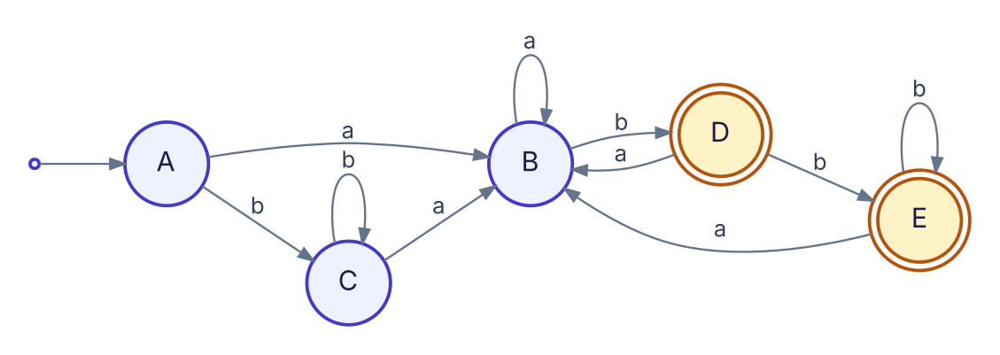{.narrow}

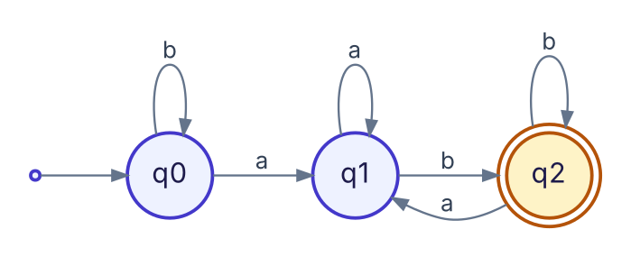{.narrow}

## Feedback that teaches

Exact comparison changed the practice checker more than any other single change. A wrong answer is no longer "incorrect"; it is "your machine accepts `aab`, but it should be rejected", with the shortest such string. A student who sees the shortest counterexample can trace it on their own drawing and find the mistake, which is far more instructive than a bare verdict.

## Conversion practice

With an engine that can check *any* finite automaton, it became possible to offer something the January version could not: practice in the conversion procedures themselves. The FA studio now has one hundred and fifty-nine conversion exercises across ε-NFA → NFA, NFA → DFA, DFA → minimal DFA and NFA → minimal DFA. Each exercise draws the machine to convert on the canvas; the student edits it into the answer and presses "Check".

Checking a conversion needs more than equivalence: the answer to an ε-removal question must have no ε-transitions; the answer to a subset-construction question must be deterministic; the answer to a minimisation question must have exactly the minimal number of states (with or without a trap state). The checker reports the first unmet requirement in words: "Same language, but not finished: your DFA has six states, but the minimal DFA has four."

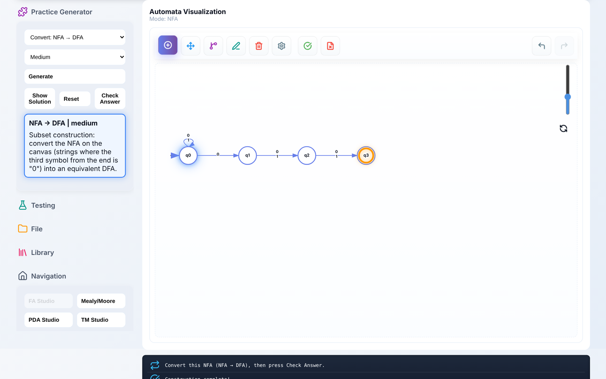{.screenshot}

Building those exercises raised its own small problems. Some NFA answers in the bank were already deterministic, which would make "convert this NFA to a DFA" trivial, so the generator adds a duplicate state and a second, parallel transition to make the source genuinely non-deterministic without changing its language. Some DFA answers were already minimal, so the generator duplicates states to create something to minimise. One ε-NFA question, the intersection of $(ab)^*$ and $(ba)^*$, has the answer $\{\varepsilon\}$ with no transitions at all, so there is nothing to remove and it is skipped.

## Testing the old code against the new

The engine also made it possible to keep the January code honest. The test suite generates random automata and checks that the January simulator, the January conversions and the Grammar Studio's converter agree with the engine. They now do. The same suite checks every practice bank, every library file, both directions of the Mealy/Moore conversion on random machines, and the exact Mealy/Moore equivalence check against brute force. There are forty-five test groups in all; they run in a few seconds on every push.

# 16. The Automata Assistant

## The idea

The feature that started the November work is the **Automata Assistant**, a panel in the FA studio with three abilities: build a DFA from a description in English, learn a DFA from examples of accepted and rejected strings, and watch a student draw while pointing out mistakes. The requirement I set was strict. It had to run entirely in the browser, with no server and no API key, and when it built an automaton, the automaton had to be *exactly* right, not approximately right.

## Describe → DFA

The obvious way to turn English into an automaton is to ask a large language model, and the obvious problem is that a language model produces something that looks like an automaton and is sometimes subtly wrong, which is precisely what the audit had just taught me to distrust. The assistant takes a different approach that splits the problem into a part that needs judgement and a part that needs precision.

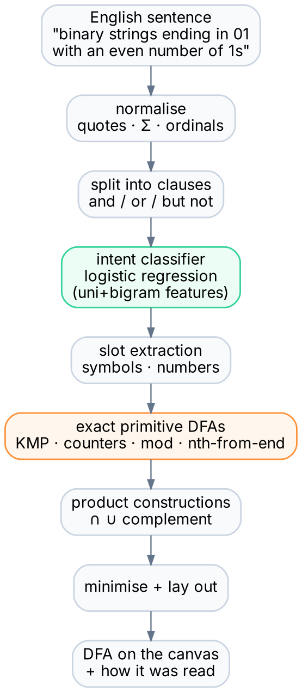{.tall}

The sentence is first normalised (quotation marks, "Σ = {a, b}", ordinal words such as "second-to-last") and split into clauses at "and", "or" and "but not", taking care not to split phrases like "starts and ends with". Each clause is then classified into one of about twenty kinds of condition: *starts with*, *ends with*, *contains*, *count modulo k*, *length at least n*, *n-th symbol from the end*, *divisible by*, *no k consecutive*, *a before b*, and so on. That classification is the only learned step. It is done by a small multinomial logistic-regression model over word unigrams and bigrams, trained on several thousand generated phrasings and stored as a 155 KB file in the repository. The training script uses a fixed random seed, so retraining reproduces the file byte for byte, and the test workflow fails if the committed model is out of date.

Once a clause is classified, the symbols and numbers are extracted by rules, and the condition is built as an **exact** automaton: a KMP-style pattern automaton for *contains* and *ends with*, a counter for modular conditions, a bit-mask automaton for "n-th from the end", a remainder automaton for divisibility. Clauses are combined with product constructions, and the result is minimised and laid out. A regular expression typed into the description, or a finite list of words, is recognised directly. The panel always shows how it read the sentence, clause by clause, and lists sample accepted and rejected strings, so that a misread is visible immediately.

How good is it? The classifier on its own scores 99.9% on its training phrasings and about 68% on phrasing templates deliberately held out from training, which is a harsh test: a held-out template is a sentence *shape* the model has never seen. The whole pipeline is measured differently, by brute force: every test description is parsed, and the resulting DFA is compared against a hand-written predicate on every string up to a fixed length. All sixty-three descriptions in the main test set pass. A separate set of twenty-five phrasings written after the model was trained scored 88% on first contact; the three failures pointed at general gaps (set-builder notation, "no more than", and "the last symbol is") which I fixed in the rules rather than by retraining on those exact sentences, and that set now passes completely. On the one hundred and twenty practice questions, the reader understands one hundred and ten and agrees with every corrected reference answer.

## Examples → DFA

The second ability learns a DFA from labelled examples, written as `+ ab`, `- ba` and so on. It uses RPNI, a classical state-merging algorithm: build a tree that accepts exactly the positive examples, then repeatedly try to merge states in a fixed order, keeping a merge only if the merged machine still rejects every negative example. The result is small and consistent with every example, and with enough examples it converges on the intended language.

## Guided mode

The third ability is the one my classmates asked for most, and it is the one I find most satisfying. In **guided mode** the assistant knows the target language but does not draw it. The student draws; after every change the assistant compares the drawing with the target and reports, in plain language, the most useful thing to fix next.

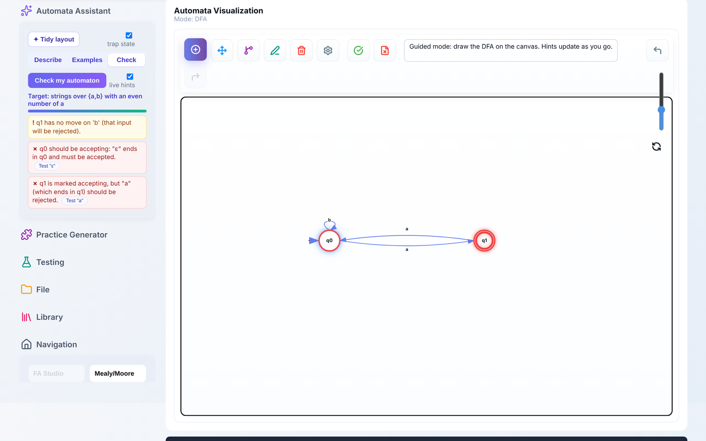{.screenshot}

The diagnosis is more than a counterexample. The assistant maps each drawn state to the target state it most plausibly represents, by following the shortest strings that reach it. That makes several kinds of explanation possible: "q1 is marked accepting, but `a`, which ends in q1, should be rejected"; "q2 is doing two jobs: after `ab` it should accept on `b` but after `b` it should not"; "q0 has no move on `b`". Each hint has a *Test* button that runs the string that proves it, and the offending state is ringed in red on the canvas. A progress bar shows how much of the target behaviour is already right. When nothing is wrong, the panel says so.

## The other half: practice

The assistant connects naturally to the practice panel. When a practice question is open, guided mode uses the question's reference answer as its target, so a student can practise with hints and then check without them. Because every reference answer is now verified, the assistant and the checker can no longer disagree.

# 17. Putting the house in order

## Ninety files in one folder

By November the repository root contained more than ninety files: every studio's modules, every practice bank, four library files, two dozen HTML pages and fragments, the style sheet, icons, a stray Python script and a text file I had added on the first day as a joke. Finding anything required knowing its name.

The reorganisation moved every file into a folder by role: `src/` for application code, with a sub-folder per studio plus `app/`, `shared/`, `core/` and `assistant/`; `data/` for practice banks, built libraries, library sources and the inbox; `pages/` for the secondary pages; `assets/` for styles, icons and vendored code; `docs/`, `tests/` and `tools/`. Five files that nothing referenced were removed.

Moving files in a no-build application is risky, because every relative import, every `fetch` of a JSON file and every link between pages encodes a path. I did the move with a script that rewrote each import by resolving it against the file's *old* location and re-expressing it from the *new* location, then checked that every import in the project resolved to an existing file. Data files are now fetched through a small helper that resolves paths against the site root, so they work whether the site is served from the domain root, from a GitHub Pages sub-path or from a local server. Old URLs still work: Netlify redirects send `/grammar_studio.html` and the other moved pages to their new homes, and a `404.html` page does the same on hosts without redirect rules.

## Every screen size

I tested every studio at phone, tablet, laptop and desktop sizes and fixed what I found. On phones the drawing area now keeps a minimum size and scrolls, so states remain legible instead of shrinking to a few pixels; the zoom control becomes a compact pill in the corner instead of a white bar across the canvas; the Grammar Studio's hidden drawer no longer leaves an empty band; and empty status boxes no longer appear as blank buttons in the toolbar.

::: twocol
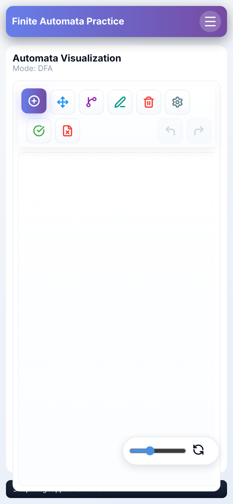

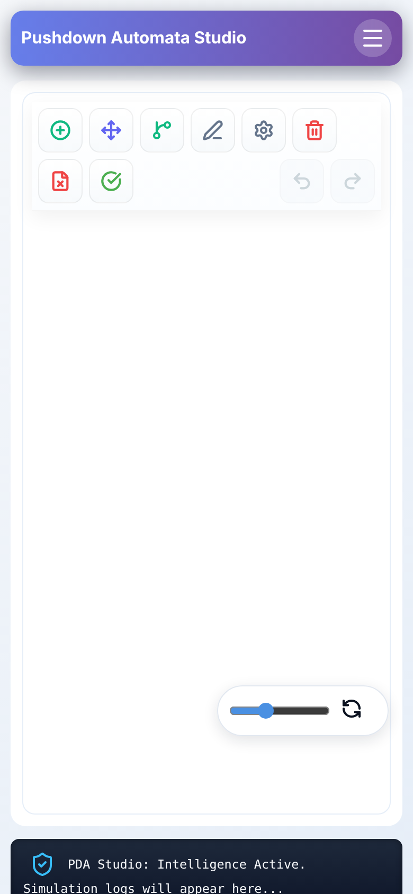
:::

## Keyboard, animation and files

Every studio now shares one set of keyboard shortcuts, and pressing `?` shows them.

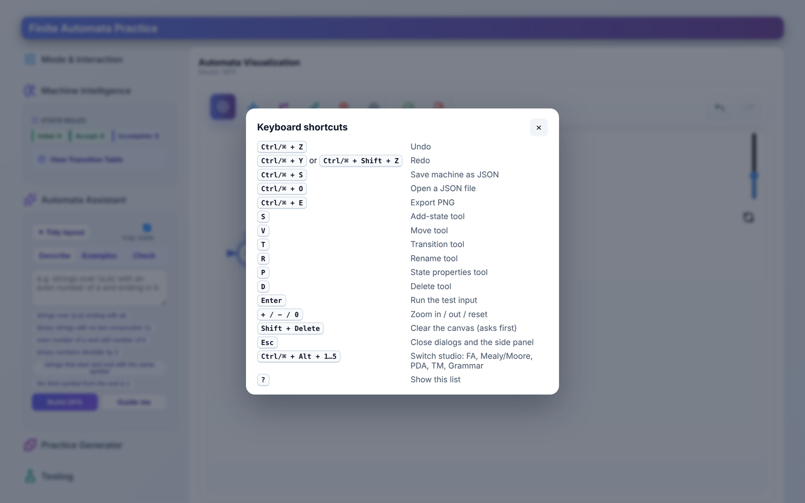{.screenshot}
 One shortcut was actively dangerous: Escape used to clear the canvas. It now closes the top-most dialog or the side panel, and clearing needs Shift + Delete and a confirmation. Animations were rewritten around a single timing source: drawing a loaded machine takes at most about two and a half seconds however large it is (it used to take one and a half seconds *per state and per transition*), conversion steps follow an animation-speed setting, and everything respects the operating system's reduced-motion preference. A second drawing or a conversion now waits for the first drawing to finish, which removed a race where converting a freshly loaded machine produced a corrupted result.

I also tested every upload and download path in every studio: saving and loading JSON, exporting PNG images, exporting transition tables as CSV, the Grammar Studio's PDA download, and settings export and import. Several did not work. Saving in the Mealy/Moore studio did nothing, because it waited for a button that did not exist. Saving and exporting in the PDA and TM studios needed two clicks. The shared dialogs in the main page kept the event handlers of every studio visited, so after switching from FA to Mealy/Moore and back, one click could save twice, or save the wrong machine. Each studio now resets those dialogs when it opens. File names are made safe for every operating system.

The Turing machine studio's Play button used to compute the result and print it in the log; it now animates the tape cell by cell, and the live tape and stack panels open automatically when a run starts.

## Faster to load

The icon library was the largest single file the application downloaded: 487 KB of icon definitions, loaded from a third-party server on every page, of which the application uses ninety-six. A build script now extracts only those icons into a 20 KB local file, which also removes the dependency on the third-party server. The PDA and TM practice banks and the assistant's model are loaded only when they are first needed. The first page now downloads about 640 KB uncompressed instead of about 1.4 MB.

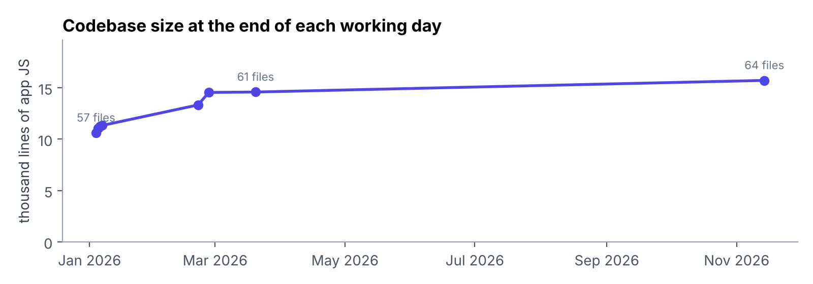

## Settings and policies

The last part of the clean-up was about trust. A new page sets out, in plain language, what the application stores on the device, what it sends to a server and when, how long submissions are kept, what students may and may not do with the tool in graded work, and what accessibility features exist. The settings page links to it and gained the controls it describes. The last traces of an early AI image generator, which no button reached any more, were removed along with the server functions behind it.

# 18. Inside the reader: one sentence, step by step

The description of the English reader in the previous chapters is abstract, so this chapter follows a single sentence all the way through it. The sentence is:

> binary strings that end with 01 and have an even number of 1s

## Normalisation

The reader first lower-cases the text and rewrites a small set of phrasings into canonical forms. "Second-to-last" becomes "second from the end"; "non-empty" becomes "of length at least 1"; quoted symbols are unified to single quotes; an explicit alphabet such as "Σ = {0, 1}" or "over {a, b}" is recorded and removed from the text. Here, the word "binary" tells the reader that the alphabet is {0, 1}, and nothing else needs rewriting.

## Splitting into clauses

The sentence is then split at "and", "or" and "but not", with care. Phrases that contain these words without joining two conditions ("starts and ends with", "between 2 and 5") are protected before splitting. "Or" binds more loosely than "and", so a sentence such as "starts with a and ends with b or has length 3" becomes two alternatives, the first of which has two conditions. A clause that has no verb of its own inherits one from the clause before it, so "contains aa or bb" is read as "contains aa or contains bb".

Our sentence becomes two clauses that must both hold:

| Clause | Text after splitting |
|---|---|
| 1 | strings that end with 01 |
| 2 | have an even number of 1s |

## Classifying each clause

Each clause is turned into features: individual words, pairs of adjacent words, and placeholder tokens for numbers (`NUM`), symbols of the alphabet (`SYM`) and ordinal words (`ORD`), so that "ends with 01" and "ends with abb" look alike to the model. The logistic-regression model scores every kind of condition and picks the highest.

| Clause | Top prediction | Confidence |
|---|---|---|
| strings that end with 01 | ENDS (ends with) | high |
| have an even number of 1s | COUNT_MOD (count of a symbol modulo k) | high |

A handful of deterministic rules can override the model where position words matter more than verbs. "The last symbol is 0" is an *ends with* condition, even though it contains neither "end" nor "with"; "the second symbol from the end is 1" is an *n-th from the end* condition even if the model is unsure. The rules exist because those phrasings are both common and unambiguous, and an error there would be particularly confusing.

## Extracting the slots

With the kind of condition known, simple rules pull out its parameters. For *ends with*, the slot is the string `01`. For *count modulo*, the slots are the symbol `1`, the modulus 2 ("even") and the remainder 0. If a required slot is missing ("ends with" and nothing after it), the reader reports a problem in words instead of guessing.

## Building exact automata

Each condition is now built as an exact DFA over {0, 1}:

- *Ends with 01* is a pattern automaton in the style of the Knuth–Morris–Pratt algorithm: its states record the longest suffix of the input so far that is also a prefix of `01`. It has three states.
- *Even number of 1s* is a two-state counter: the state flips on every 1 and stays on every 0.

## Combining and minimising

The two automata are combined with a product construction: a state of the product is a pair of states, one from each automaton, and it accepts when both components accept. The product has six states, and minimisation confirms that all six are needed. The result is drawn on the canvas, laid out by the automatic layout, and the panel explains what was understood:

> Σ = {0, 1}; accept a string iff it ends with '01' AND has an even number of '1'.

followed by a few accepted strings (`101`, `0101`, `11101`) and rejected strings (`01`, `1`, `0110`). That short list is surprisingly important. It lets a student check, at a glance, that the reader understood what they meant, which is the right protection against the one step that is learned rather than exact.

{.screenshot}

## What happens when it does not understand

If a clause is classified with low confidence, or a slot is missing, the reader does not produce a machine. It shows which clause it could not read, the two or three most likely interpretations, and suggestions for rephrasing. A wrong machine presented confidently would be far worse than an honest "I did not understand this part", and the design is built around that preference.

# 19. What the tests look like

The test suite is described in general terms in Chapters 14 and 15. Because it is the part of the project I would most want another developer to copy, this chapter shows what the tests actually look like.

## A brute-force reference

Every practice question that once had a wrong answer has an entry in `tests/practice-truth.mjs`: the alphabet, a predicate written directly in JavaScript, and a regular expression or description from which a correct machine can be built.

```js
'DFA/medium/7': { sigma: '01', pred: w => w[0] === '0' || w.endsWith('1'),
                  regex: '0(0|1)*|(0|1)*1' },
'NFA/medium/1': { sigma: 'ab', pred: w => w.length >= 2 && w[w.length - 2] === 'a',
                  regex: '(a|b)*a(a|b)' },
```

The test enumerates every string over the alphabet up to length eight and checks that the stored answer and the predicate agree on each one. The regular expression is itself checked against the predicate before it is used to rebuild an answer, so a mistake in the expression cannot quietly replace one wrong answer with another.

## A differential test

The differential tests generate random machines with a fixed seed and compare two implementations.

```js
for (let k = 0; k < 300; k++) {
  const nfa = randomNfa(rng, 2 + (k % 5), ['a', 'b']);
  const legacy = convertNfaToDfa(nfa);          // the January code
  const exact = FA.toMinimalDfa(nfa, ['a', 'b']); // the engine
  assert.ok(FA.compare(FA.toMinimalDfa(legacy, ['a', 'b']), exact).equivalent);
}
```

If the two ever disagree, the assertion message includes the shortest counterexample, which makes the bug easy to reproduce by hand.

## Specifications for transducers and Turing machines

For Mealy and Moore machines, each specification maps an input to the complete output string. For the Moore machine that outputs `Y` when the binary number read so far is divisible by three, the specification is a single line:

```js
w => 'Y' + prefixes(w).map(p => (parseInt(p, 2) % 3 ? 'N' : 'Y')).join('')
```

For Turing machines, a specification returns `null` when the input must be rejected, `true` when it must be accepted, or the exact expected tape when the machine transforms its input. The string-reversal machine's specification is `w => [...w].reverse().join('')`, and the test fails if the machine halts with any other tape.

## Tests for the user interface

The browser-level checks are not part of the automated suite, because they need a real browser, but they were run for every change in November. A script opens each studio at four screen sizes and reports any element that overflows the screen; another adds states with the keyboard, undoes and redoes, saves, exports a PNG, reloads a file, opens the shortcut sheet, zooms, and records every download and every error. Those scripts found the save, export and dialog bugs described in Chapter 17.

## Running everything

```bash
npm test               # the full suite, a few seconds
npm run train-model    # retrain the English reader's model (deterministic)
```

A GitHub workflow runs the suite on every push and also retrains the model and fails if the committed model differs from the retrained one, which guarantees that the model in the repository is always the one the training code produces.

# Part V — Reflection {.part}

What the project taught me, what it amounts to, and where it goes next.

# 20. Struggles and lessons

## Building faster than I could check

The clearest lesson of the whole project is visible in the audit numbers. In January I could build a working studio in a day; I could not, in that same day, verify the thirty practice answers that came with it. The answers I wrote were tested the way I had always tested my homework, on a few strings that matched my mental picture of the language. That method fails in a predictable way, because the strings that expose a wrong automaton are exactly the strings outside that mental picture.

The lesson is not "test more". It is to test differently: against an independent definition, over *all* inputs up to a bound, automatically, every time. A twenty-line brute-force predicate written by hand is a better reference than any automaton drawn by hand, because it is too simple to be wrong in the same way.

## Working against the semester

Toc-Suite was built in the gaps between classes, assignments and examinations. The January burst happened because there was a short window before the semester resumed; February's classroom features were added in a few long days when the course needed them; and there is a gap of almost eight months between March and November when I had no time for the project at all. That rhythm shaped the code. Features arrived in large, quick batches, and the slower work (tests, documentation, reorganisation) was always the work that was postponed.

If I were starting again I would put the slow work first. A test suite written in January would have caught the PDA answers before a single student saw them. A folder structure decided on the first day would have cost an hour then instead of a careful scripted migration ten months later.

## Learning the tools while using them

Many of the struggles in the history were not about Theory of Computation at all. They were about learning GitHub Actions while depending on them, learning Netlify Functions while students were submitting work through them, and learning how browsers treat ES modules, relative paths, service workers and local storage. The renamed-back-and-forth files of 5 January are a record of learning in public. I do not regret that: there is no better way to learn a tool than to need it to work. But I now separate experiments from the main branch, and the repository history since November reads as a sequence of deliberate changes rather than a sequence of attempts.

## Precision and judgement

The Automata Assistant taught me a lesson about where to use learning and where not to. A model is good at deciding *what kind* of condition a sentence describes, which is a fuzzy, linguistic judgement. It is a poor choice for producing the automaton itself, which must be exactly right. Splitting the problem along that line, with a small model for the judgement and exact constructions for the result, gave an assistant that is both flexible and trustworthy, and that can be checked by the same brute-force tests as everything else. I expect to reuse that pattern well beyond this project.

## Students as users

Finally, the project taught me what it means to have users. Classmates found bugs I would never have found, asked for features I would never have thought of (guided mode came directly from a friend's request to "let me draw it myself but tell me when I go wrong"), and used the tool in ways I had not imagined, mostly on phones and often in a hurry before a test. Every design decision since February has been tested against the question "would this confuse someone using it for the first time, on a phone, the night before an exam?"

# 21. Principles I now follow

The lessons of the previous chapter are easier to apply as a short list of working rules. These are the rules I now follow on Toc-Suite and on my other projects.

**1. Every answer needs an independent witness.** A reference answer, a conversion or a generated machine is not trusted until something written independently agrees with it: a brute-force predicate, a second implementation, or an exact equivalence check. Two implementations by the same person in the same style are not independent.

**2. Prefer exhaustive checks over clever examples.** For anything with a small input space, check every input up to a bound. It is simpler to write than a careful list of edge cases, it finds the edge cases you did not think of, and it runs in seconds.

**3. Learn only what must be learned.** Use a model for judgement (which kind of condition does this sentence describe?) and exact algorithms for everything that must be right (the automaton itself). Keep the learned part small, reproducible and visible to the user.

**4. Show the evidence, not just the verdict.** "Incorrect" teaches nothing. "Your machine accepts `aab`, but it should not" teaches the student where to look. Every checker in the application now reports a concrete string, a concrete state or a concrete count.

**5. Decide the structure before the second file.** Folder structure, file format and naming conventions are cheap to decide on day one and expensive to change on day three hundred.

**6. Design for the smallest screen first.** If it works on a phone held in one hand, it will work on a laptop. The reverse is not true.

**7. Automation must be idempotent and must not fight people.** A workflow that edits the repository must produce the same result when run twice, must not trigger itself, and must never overwrite a human's change.

**8. Never let an animation hold the user's work hostage.** Animations must be fast by default, cancellable or serialised, respectful of reduced-motion settings, and never the only way to see a result.

**9. Be explicit about data.** Every piece of information that leaves the student's device should be named, justified and switchable where possible, and the policy page should say so in plain language.

**10. Write it down.** This book exists because I could no longer remember why some things were built the way they were. Writing the reasons down while they are fresh is cheaper than reconstructing them from a commit history.

# 22. The project in numbers

| Measure | January 2026 | November 2026 |
|---|---|---|
| Studios | FA, Mealy/Moore, PDA, TM | + Grammar Studio, Automata Assistant |
| Application JavaScript (excluding practice data and tests) | about 10,600 lines | about 16,200 lines in 64 modules |
| Verification engine (`src/core`) | none | about 1,560 lines |
| Test suite | none | 45 test groups, about 880 lines |
| FA practice | 120 construction questions, 20 wrong | 120 verified + 159 conversion exercises |
| Mealy/Moore practice | 14, 4 wrong | 21 verified, plus Moore ↔ Mealy conversion practice |
| PDA practice | 33, 28 wrong | 33 verified |
| TM practice | 20, 8 wrong | 20 verified (final tape checked) |
| How answers are checked | sample strings | exact equivalence (FA), exhaustive short strings (MM, PDA, TM) |
| First-load download (uncompressed) | about 1.4 MB | about 0.64 MB |
| Files in the repository root | more than 90 | 15 |

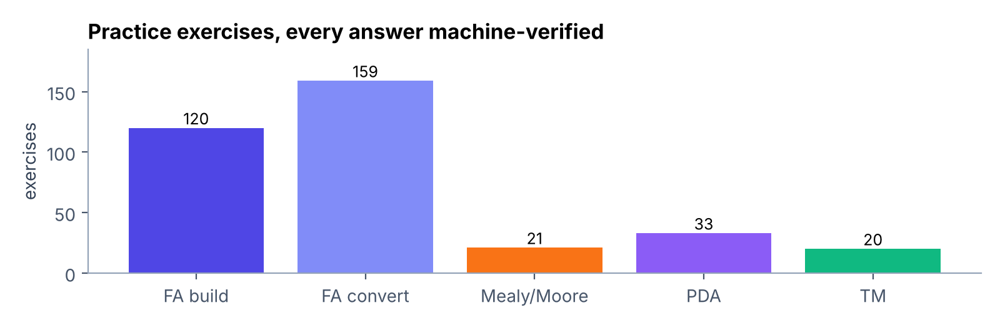

| Period | Commits (by me) | Main work |
|---|---|---|
| 4–7 January 2026 | about 110 | Initial build, five studios, library pipeline, functions |
| 21–26 February 2026 | about 20 | Grammar Studio, routing, assignments, portal, help, settings |
| 20 March 2026 | 1 | Grammar Studio mobile accessibility |
| 14 November 2026 | 9 | Assistant, audit, engine, reorganisation, responsive layout, performance, policies, documentation |

# 23. Where next

The roadmap file in the repository lists the next steps in detail. The most important are these.

**More of the syllabus.** The Grammar Studio should gain CYK parsing, conversion to Chomsky normal form, and LL(1) parsing tables, all of which are mechanical procedures that benefit from the same step-by-step animation as the subset construction. The TM studio should gain a library of reductions for the undecidability unit.

**The assistant beyond finite automata.** Guided mode currently works for finite automata, where equivalence is decidable. For pushdown automata and Turing machines, the same idea can work with bounded checking: the assistant can compare a drawing with a reference on every short string and explain the first difference. Describing a context-free language in English and receiving a PDA is harder, but the same split between a classifier for the *kind* of language and exact constructions for the machine should carry over to the common textbook families.

**Larger and better practice banks.** The Mealy/Moore bank is still small. Every bank would benefit from questions contributed by students, which the library pipeline already makes possible; what is missing is a review step that runs the same verification tests on contributed answers before they are published.

**Offline use.** The application is a progressive web app in name, but it currently caches only the shell. Caching the studios and practice banks would make it usable without a connection, which matters in examination halls and on unreliable college Wi-Fi.

**Languages.** Many students would find the help pages and the assistant's explanations easier in Hindi. The assistant's reader is also English-only; a second trained classifier for Hindi descriptions is a natural extension of the same design.

**A second audit.** Finally, I intend to repeat the November exercise periodically. The most valuable thing the project gained this year was not a feature but a habit: no answer is trusted until something independent has checked it.

# Appendix A — Timeline {.unnumbered}

| Date | Event |
|---|---|
| October 2025 | Reference screenshot of a mobile automata app saved; earlier prototypes |
| 4–5 January 2026 | Initial build of the unified studio; library pipeline; dozens of iterations on the GitHub Actions |
| 6–7 January 2026 | Netlify Functions for submissions and library pushes; templates; TM and Mealy/Moore library examples |
| 21 February 2026 | Grammar Studio; smart cross-studio routing; assignments and verified submissions; help guide; settings |
| 26 February 2026 | Grammar–machine bridge polish; dedicated review page for the instructor portal; PDA export |
| 20 March 2026 | Grammar Studio mobile sidebar accessibility fix |
| 14 November 2026 | Automata Assistant; verification engine and audit; practice banks rebuilt; conversion practice; repository reorganisation; responsive layout; keyboard shortcuts; animation and file-handling fixes; performance; settings and policies; documentation |

# Appendix B — Repository map {.unnumbered}

| Path | Contents |
|---|---|
| `index.html` | Splash screen and studio shell |
| `src/app/` | Shell: routing, studio loading, autosave snapshots |
| `src/fa/`, `src/mm/`, `src/pda/`, `src/tm/` | One folder per studio: state, renderer, UI, simulation, files, practice, library |
| `src/grammar/` | Grammar Studio logic and the regular-expression converter |
| `src/core/` | Verification engine, regular expressions, RPNI, layout, diagnosis, English reader and its model |
| `src/assistant/` | The Automata Assistant panel |
| `src/shared/` | Utilities, animation timing, keyboard shortcuts, paths, assignment client |
| `data/practice/` | Practice banks for every studio |
| `data/libraries/` | Library files built by CI |
| `data/automata/`, `data/inbox/` | Library sources and incoming submissions |
| `pages/` | Grammar Studio, help, settings, policies, instructor portal |
| `assets/` | Style sheet, icons, vendored icon subset |
| `netlify/functions/` | Server-side functions |
| `tests/` | Unit, differential and data-audit tests |
| `tools/` | Model training, practice-bank builders, icon builder, documentation builders |
| `docs/` | This book, the study guide, the technical guide, figures and screenshots |

# Appendix C — Glossary {.unnumbered}

**Accepting state.** A state in which a finite automaton or PDA accepts if the input has been consumed.

**Counterexample.** A string accepted by one of two automata and rejected by the other; the shortest one is the most useful feedback.

**Differential test.** A test that runs two independent implementations on the same random inputs and fails if they disagree.

**ε-closure.** The set of states reachable from a state using only ε-transitions.

**Equivalence.** Two automata are equivalent if they accept exactly the same strings.

**Guided mode.** The Automata Assistant mode in which the student draws and the assistant explains mistakes without revealing the answer.

**Minimal DFA.** The DFA with the fewest states for a given regular language; it is unique up to renaming of states.

**Product construction.** Running two automata in parallel on the same input, used for intersection, union and comparison.

**RPNI.** Regular Positive and Negative Inference, a state-merging algorithm for learning a DFA from labelled examples.

**Studio.** One of the application's workspaces: FA, Mealy/Moore, PDA, TM or Grammar.

**Subset construction.** The conversion of an NFA into a DFA whose states are sets of NFA states.

**Trap state.** A non-accepting state with no way out, used to make a DFA total.

# Appendix D — The audit, answer by answer {.unnumbered}

These tables list every finite-automaton and pushdown-automaton reference answer that the November 2026 audit found to be wrong, with the shortest string on which the old answer disagreed with the definition of the language. They were generated from the repository as it stood before the fixes, using the same predicates as the test suite. Every answer has since been rebuilt and is checked on every push.

## Finite automata

| Question | Statement | Shortest failing string | The old answer |
|---|---|---|---|
| DFA medium | DFA accepting strings that DO NOT start with "1" OR DO NOT end with "0" (Σ={0, 1}) | `1` | rejected it |
| DFA medium | DFA for strings where the third symbol from the end is "a" (Σ={a, b}) | `aaa` | rejected it |
| DFA medium | DFA accepting strings that start with "0" OR end with "1" (Σ={0, 1}) | `1` | rejected it |
| NFA basic | NFA for language 0*1*0*1 (Σ={0, 1}) | `1` | rejected it |
| NFA basic | NFA for language a+ b* (Σ={a, b}) | `aba` | accepted it |
| NFA medium | NFA for strings where second-to-last symbol is "a" (Σ={a, b}) | `aa` | rejected it |
| NFA medium | NFA for the language (ab)* or (ba)* (Σ={a, b}) | `abba` | accepted it |
| NFA medium | NFA accepting language "1" or "01" (Σ={0, 1}) | `ε` | accepted it |
| NFA medium | NFA for strings that starts and ends with "a" (Σ={a, b}) | `a` | rejected it |
| NFA hard | NFA for the regular expression (00)* (11)* (00\|11) (Σ={0, 1}) | `00` | rejected it |
| NFA hard | NFA accepting strings where the second symbol from the start is "0" AND the third symbol from t | `100` | rejected it |
| NFA hard | NFA for language w mid \|w\| text is prime (Σ={a}) | `aa` | rejected it |
| ENFA easy | ε-NFA for strings of "a"s where the length is either 2 or 4 (Σ={a}) | `a` | accepted it |
| ENFA basic | ε-NFA for (0\|1)*01* (ends with 0 followed by 1s) (Σ={0, 1}) | `0` | rejected it |
| ENFA basic | ε-NFA for language (aa)* or (bb)* (Σ={a, b}) | `a` | accepted it |
| ENFA medium | ε-NFA for L = 0+ (1 or ε) (Σ={0, 1}) | `010` | accepted it |
| ENFA medium | ε-NFA for language (a or ε) . (b or ε) . (c or ε) (Σ={a, b, c}) | `cc` | accepted it |
| ENFA hard | ε-NFA for $L = (a\|b)* . (a . a or b . b) (ends with aa or bb) (Σ={a, b}) | `a` | accepted it |
| ENFA hard | ε-NFA for language (0* 1)* (10)* (Σ={0, 1}) | `1` | rejected it |
| ENFA hard | ε-NFA for language (01)^n (10)^m, where n, m >= 1 (Σ={0, 1}) | `011` | accepted it |
| ENFA hard | ε-NFA for $L = a \cdot \Sigma \cdot a \cdot \Sigma$ (Σ={a, b}) | `aaa` | accepted it |

## Pushdown automata

| Problem | Shortest failing string | The old answer |
|---|---|---|
| Equality: a^n b^n | `aab` | accepted it |
| Balanced Parentheses | `()()` | rejected it |
| Even Palindrome (ww^R) | `0` | accepted it |
| Comparative: a^2n b^n | `ab` | accepted it |
| Equality: n(a) = n(b) | `a` | accepted it |
| Comparative: n(a) + n(b) = n(c) | `ε` | rejected it |
| Non-Deterministic Union: a^n b^2n OR a^2n b^n | `ab` | accepted it |
| Inequality: n(a) ≠ n(b) | `ε` | accepted it |
| Double Equality: a^n b^n c^m d^m | `abccd` | accepted it |
| Offset: a^n b^(n+2) | `bb` | rejected it |
| Multiplier: a^n b^3n | `ab` | accepted it |
| Equation: n(a) = 2n(b) + 1 | `aaab` | rejected it |
| Prefix Constraint: n(a) ≥ n(b) | `aaaaaa` | rejected it |
| Search: Exactly one 'aaa' | `aaaba` | rejected it |
| Union: n(a)=n(b) OR n(a)=n(c) | `a` | accepted it |
| Sum: n(b) = n(a) + n(c) | `a` | accepted it |
| Modulo: Even Zeros, Equal 0/1 | `1` | accepted it |
| Marker: a^n c b^2n | `ac` | accepted it |
| NPDA: w x w^R | `010` | rejected it |
| Inequality: a^n b^m (n ≠ m) | `ε` | accepted it |
| Partial: a^n b^n c^m | `a` | accepted it |
| Nested: { } and [ ] | `[` | accepted it |
| Summation: i + j = k | `ε` | rejected it |
| Bound: a^n b^n (n ≤ 3) | `aab` | accepted it |
| Structure: Equal a/b, Even Length | `a` | accepted it |
| Debt: n(0) = 2 * n(1) | `0` | accepted it |
| Deterministic Palindrome (w#w^R) | `b#b` | rejected it |
| NPDA: Palindrome w w^R | `a` | accepted it |

The pattern in the second table is striking: in almost every case the old answer *accepted* a string it should have rejected, usually a short one such as `a` or `ab`. Those are the strings a person testing "typical" inputs never tries, and they are the first strings an exhaustive check tries.
