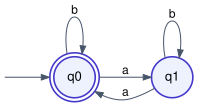

# Introduction {.unnumbered}

The Theory of Computation asks three questions. *Automata theory* asks which problems can be solved by machines with limited memory. *Computability theory* asks which problems can be solved by any machine at all. *Complexity theory* asks which problems can be solved efficiently. All three questions are made precise with a small amount of discrete mathematics, and almost every result is established by one of four proof techniques. This paper collects that mathematics and those techniques in one place, with the notation used throughout the series.

# Sets

A **set** is an unordered collection of distinct objects, its **elements**. We write $x \in A$ when $x$ is an element of $A$, and $x \notin A$ otherwise. A set may be given by listing its elements, $\{0, 1, 2\}$, or by a property, $\{ n \in \mathbb{N} \mid n \text{ is even} \}$. The set with no elements is the **empty set** $\emptyset$.

$A$ is a **subset** of $B$, written $A \subseteq B$, when every element of $A$ is an element of $B$; it is a **proper subset**, $A \subsetneq B$, when moreover $A \neq B$. Two sets are equal exactly when each is a subset of the other, and this is how set equalities are usually proved: show $A \subseteq B$ and $B \subseteq A$ separately.

The standard operations are

| Operation | Definition |
|---|---|
| Union | $A \cup B = \{ x \mid x \in A \text{ or } x \in B \}$ |
| Intersection | $A \cap B = \{ x \mid x \in A \text{ and } x \in B \}$ |
| Difference | $A \setminus B = \{ x \mid x \in A \text{ and } x \notin B \}$ |
| Complement (relative to a universe $U$) | $\overline{A} = U \setminus A$ |
| Cartesian product | $A \times B = \{ (a, b) \mid a \in A, b \in B \}$ |
| Power set | $\mathcal{P}(A) = \{ S \mid S \subseteq A \}$ |

**De Morgan's laws** relate the operations: $\overline{A \cup B} = \overline{A} \cap \overline{B}$ and $\overline{A \cap B} = \overline{A} \cup \overline{B}$. These laws reappear in automata theory, where they show that closure under union and complement implies closure under intersection.

If $A$ has $n$ elements, $\mathcal{P}(A)$ has $2^n$. This single fact is behind the exponential cost of converting a nondeterministic finite automaton to a deterministic one: the deterministic machine's states are sets of the original states.

## Countable and uncountable sets

A set is **countable** if it is finite or its elements can be listed as $a_0, a_1, a_2, \dots$ — that is, if there is a bijection with $\mathbb{N}$ or with a finite set. The integers are countable ($0, 1, -1, 2, -2, \dots$), and so is $\mathbb{N} \times \mathbb{N}$ (list the pairs by the sum of their coordinates). The set $\Sigma^*$ of all finite strings over a finite alphabet is countable: list the strings by length, and alphabetically within each length.

**Theorem 1 (Cantor).** $\mathcal{P}(\mathbb{N})$ is not countable.

*Proof.* Suppose $S_0, S_1, S_2, \dots$ lists every subset of $\mathbb{N}$. Let $D = \{ n \mid n \notin S_n \}$. $D$ is a subset of $\mathbb{N}$, so $D = S_k$ for some $k$. Is $k \in D$? By definition of $D$, $k \in D$ exactly when $k \notin S_k = D$, a contradiction. $\square$

The same diagonal argument shows that the set of all languages over $\Sigma$ — the subsets of the countable set $\Sigma^*$ — is uncountable, while the set of all Turing machines is countable because every machine has a finite description. Hence **most languages are not recognised by any machine**. Paper 8 turns this counting argument into explicit examples.

# Relations and functions

A **binary relation** $R$ on a set $A$ is a subset of $A \times A$; we write $a \mathrel{R} b$ for $(a, b) \in R$. A relation is

- **reflexive** if $a \mathrel{R} a$ for every $a$;
- **symmetric** if $a \mathrel{R} b$ implies $b \mathrel{R} a$;
- **transitive** if $a \mathrel{R} b$ and $b \mathrel{R} c$ imply $a \mathrel{R} c$.

A relation with all three properties is an **equivalence relation**. It partitions $A$ into disjoint **equivalence classes** $[a] = \{ b \mid a \mathrel{R} b \}$; the number of classes is its **index**. Equivalence relations are central to automata theory: minimising a DFA means merging equivalent states, and the Myhill–Nerode theorem (Paper 3) characterises regular languages as exactly those whose natural equivalence relation on strings has finite index.

The **reflexive–transitive closure** $R^*$ of a relation $R$ is the smallest reflexive and transitive relation containing $R$: $a \mathrel{R^*} b$ when $b$ can be reached from $a$ in zero or more $R$-steps. Derivations in a grammar ($\Rightarrow^*$), computations of a machine ($\vdash^*$) and ε-closures are all reflexive–transitive closures of a one-step relation.

A **function** $f : A \to B$ assigns to every $a \in A$ exactly one $f(a) \in B$. It is **injective** (one-to-one) if $f(a) = f(a')$ implies $a = a'$, **surjective** (onto) if every $b \in B$ is some $f(a)$, and **bijective** if both. A **partial function** may be undefined on some inputs; the function computed by a Turing machine is partial, because the machine may run forever.

# Graphs and trees

A **directed graph** is a set of vertices with a set of ordered pairs of vertices, its edges. The state diagram of an automaton is a directed graph whose edges carry labels. A **path** is a sequence of vertices joined by edges; a vertex $v$ is **reachable** from $u$ if a path leads from $u$ to $v$. Reachability is computed by breadth-first or depth-first search in time linear in the size of the graph — the basis of every emptiness test in this series.

A **tree** is a connected graph without cycles, with one vertex designated the **root**. Parse trees of grammars (Paper 5) are ordered trees: the children of each node are ordered from left to right, and reading the leaves in order gives the derived string.

# Strings and languages

An **alphabet** $\Sigma$ is a finite, non-empty set of **symbols**. A **string** (or word) over $\Sigma$ is a finite sequence of symbols; $\varepsilon$ denotes the **empty string**. The **length** $|w|$ is the number of symbols in $w$, and $|w|_a$ is the number of occurrences of the symbol $a$.

The **concatenation** $xy$ of strings $x$ and $y$ is $x$ followed by $y$. Concatenation is associative, and $\varepsilon$ is its identity: $\varepsilon w = w \varepsilon = w$. We write $w^n$ for $n$ copies of $w$, with $w^0 = \varepsilon$, and $w^R$ for the **reverse** of $w$. A string $x$ is a **prefix** of $w$ if $w = xy$ for some $y$, a **suffix** if $w = yx$, and a **substring** if $w = uxv$.

$\Sigma^k$ is the set of strings of length $k$, $\Sigma^* = \bigcup_{k \ge 0} \Sigma^k$ the set of all strings, and $\Sigma^+ = \Sigma^* \setminus \{\varepsilon\}$.

A **language** over $\Sigma$ is any subset $L \subseteq \Sigma^*$. Since languages are sets, union, intersection and complement ($\overline{L} = \Sigma^* \setminus L$) apply. In addition:

| Operation | Definition |
|---|---|
| Concatenation | $L_1 L_2 = \{ xy \mid x \in L_1, y \in L_2 \}$ |
| Power | $L^0 = \{\varepsilon\}$, $L^{k+1} = L L^k$ |
| Kleene star | $L^* = \bigcup_{k \ge 0} L^k$ |
| Reversal | $L^R = \{ w^R \mid w \in L \}$ |
| Quotient | $L_1 / L_2 = \{ x \mid xy \in L_1 \text{ for some } y \in L_2 \}$ |

Two edge cases deserve care. $\emptyset$, the empty language, is different from $\{\varepsilon\}$, the language containing only the empty string: $\emptyset L = \emptyset$ while $\{\varepsilon\} L = L$, and $\emptyset^* = \{\varepsilon\}$.

## Decision problems as languages

Every yes/no question about finite objects can be written as a language. "Is this number prime?" becomes $\text{PRIMES} = \{ w \in \{0,1\}^* \mid w \text{ is the binary representation of a prime} \}$; "does DFA $D$ accept string $w$?" becomes $A_{\mathrm{DFA}} = \{ \langle D, w \rangle \mid D \text{ accepts } w \}$, where $\langle \cdot \rangle$ denotes a fixed encoding of objects as strings. Solving the problem means deciding membership in the language. This identification lets one theory cover arithmetic, graphs, programs and machines alike.

# Proof techniques

## Direct proof and proof by construction

A direct proof derives the conclusion from the hypotheses step by step. Many results in automata theory are **constructive**: to prove that a language is regular we build a finite automaton for it; to prove that regular languages are closed under union we give an algorithm that, from automata for $L_1$ and $L_2$, builds one for $L_1 \cup L_2$, and then prove that the algorithm is correct.

## Proof by contradiction

Assume the statement is false and derive a contradiction. Cantor's theorem above is an example, and so is every application of a pumping lemma: assume the language is regular (or context-free), apply the lemma, and pump a cleverly chosen string out of the language.

**Theorem 2.** $\sqrt{2}$ is irrational.

*Proof.* Suppose $\sqrt{2} = p/q$ in lowest terms. Then $p^2 = 2q^2$, so $p^2$ is even and therefore $p$ is even, $p = 2r$. Then $4r^2 = 2q^2$, so $q^2 = 2r^2$ and $q$ is even too, contradicting lowest terms. $\square$

## Induction

To prove $P(n)$ for every $n \ge n_0$: prove the **base case** $P(n_0)$, and prove that $P(k)$ implies $P(k + 1)$ for every $k \ge n_0$. In **strong induction** the step may assume $P(n_0), \dots, P(k)$.

In this subject induction is used most often on the length of a string or the number of steps of a derivation or computation. A typical example is the correctness of a DFA.

**Theorem 3.** Let $D$ be the two-state DFA of Figure 1. For every $w \in \{a, b\}^*$, $\hat\delta(q_0, w) = q_0$ if $|w|_a$ is even and $q_1$ if it is odd.

{width=48%}

*Proof by induction on $|w|$.* For $w = \varepsilon$, $\hat\delta(q_0, \varepsilon) = q_0$ and $|\varepsilon|_a = 0$ is even. Assume the claim for $w$ and consider $wx$ with $x \in \{a, b\}$. If $x = b$, the parity of $a$'s does not change and $\delta$ stays in the same state. If $x = a$, the parity flips and $\delta$ swaps $q_0$ and $q_1$. In both cases the claim holds for $wx$. $\square$

Since $q_0$ is the only accepting state, $L(D) = \{ w \mid |w|_a \text{ is even} \}$. Proofs of this shape — state an **invariant** for every state, then check it on every transition — establish the correctness of every automaton in this series.

**Structural induction** generalises induction to recursively defined objects such as regular expressions, parse trees and formulas: prove the property for the base objects, then show that each construction rule preserves it.

## The pigeonhole principle

If $n + 1$ objects are placed in $n$ boxes, some box holds at least two. Applied to a finite automaton with $n$ states reading a string of length $n$ or more, the principle says some state is visited twice — the observation behind the pumping lemma for regular languages. Applied to the $k + 1$ prefixes $\varepsilon, a, a^2, \dots, a^k$ and a $k$-state DFA, it shows that two of the prefixes lead to the same state, so the DFA cannot remember how many $a$'s it has read: this is the intuition for why $\{a^n b^n\}$ is not regular.

## Diagonalisation

Diagonalisation builds an object that differs from the $i$-th object of a list in the $i$-th place, so it cannot be in the list. Cantor used it for $\mathcal{P}(\mathbb{N})$; Turing used it to show that the halting problem is undecidable. Paper 8 gives the argument in full.

# Asymptotic notation

For functions $f, g : \mathbb{N} \to \mathbb{R}^{\ge 0}$:

- $f = O(g)$ if there are $c > 0$ and $n_0$ with $f(n) \le c \cdot g(n)$ for all $n \ge n_0$ — an upper bound up to a constant factor;
- $f = \Omega(g)$ if $g = O(f)$, and $f = \Theta(g)$ if both hold;
- $f = o(g)$ if $f(n)/g(n) \to 0$.

Polynomial bounds $O(n^k)$ and exponential bounds $2^{O(n^k)}$ separate the efficient from the inefficient in complexity theory (Paper 9).

# Summary

| Concept | Where it is used |
|---|---|
| Power set, $2^n$ | subset construction (NFA → DFA) |
| Equivalence relations, index | DFA minimisation, Myhill–Nerode |
| Reflexive–transitive closure | ε-closure, derivations $\Rightarrow^*$, computations $\vdash^*$ |
| Countability, diagonalisation | existence of undecidable languages, the halting problem |
| Induction on length / steps | correctness of automata and grammars, equivalence proofs |
| Pigeonhole principle | pumping lemmas, lower bounds on the number of states |

# Exercises

1. Prove that $(L_1 \cup L_2)^* = (L_1^* L_2^*)^*$ for all languages $L_1, L_2$.
2. Show that $\{\varepsilon\}^* = \emptyset^* = \{\varepsilon\}$, and that $L^* L^* = L^*$.
3. Prove by induction that every string over $\{a, b\}$ of length $n$ has exactly $n + 1$ prefixes.
4. Show that the set of all finite subsets of $\mathbb{N}$ is countable, while the set of all subsets is not.
5. Let $x \equiv y$ when $|x|$ and $|y|$ leave the same remainder modulo 3. Show that $\equiv$ is an equivalence relation on $\Sigma^*$ and find its index.
6. Use the pigeonhole principle to show that any DFA accepting $\{ a^n b^n \mid n \le 10 \}$ has at least 11 states.

*Hints.* (1) Show both inclusions; every string in the right-hand side is a concatenation of strings from $L_1 \cup L_2$. (4) Map a finite set $\{n_1, \dots, n_k\}$ to the number $\sum 2^{n_i}$. (6) Consider the states reached after $a^0, a^1, \dots, a^{10}$; if two coincide, say after $a^i$ and $a^j$, the DFA treats $a^i b^i$ and $a^j b^i$ alike.
