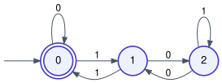
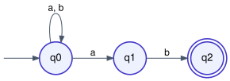
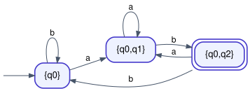
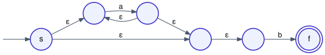

# Introduction {.unnumbered}

A finite automaton is the simplest model of a computer: it reads its input once, left to right, and remembers only which of finitely many states it is in. Despite the limitation, finite automata are everywhere — in lexical analysers, text search, network protocols, hardware controllers and input validation. This paper defines the three standard variants, proves that they recognise exactly the same languages, and develops the constructions that combine automata.

# Deterministic finite automata

**Definition 1.** A *deterministic finite automaton* (DFA) is a 5-tuple $M = (Q, \Sigma, \delta, q_0, F)$ where

- $Q$ is a finite set of **states**;
- $\Sigma$ is a finite **input alphabet**;
- $\delta : Q \times \Sigma \to Q$ is the **transition function**;
- $q_0 \in Q$ is the **start state**;
- $F \subseteq Q$ is the set of **accepting** (final) states.

Because $\delta$ is a total function, from every state there is exactly one move on every symbol. A diagram that omits some moves describes a *partial* DFA; it is completed by adding a non-accepting **trap state** (dead state) that receives every missing move and loops on every symbol.

**Definition 2.** The *extended transition function* $\hat\delta : Q \times \Sigma^* \to Q$ is defined by induction on the length of the input:
$$\hat\delta(q, \varepsilon) = q, \qquad \hat\delta(q, wa) = \delta(\hat\delta(q, w), a).$$
$M$ **accepts** $w$ if $\hat\delta(q_0, w) \in F$, and the **language** of $M$ is $L(M) = \{ w \in \Sigma^* \mid \hat\delta(q_0, w) \in F \}$. A language is **regular** if some DFA recognises it.

Equivalently, a *computation* of $M$ on $w = a_1 \cdots a_n$ is the sequence of states $r_0 = q_0$, $r_{i} = \delta(r_{i-1}, a_i)$; $M$ accepts when $r_n \in F$.

## Designing a DFA: states as summaries

The key design question is: *what must be remembered about the part of the input read so far?* Each state stands for one answer. The answers must be finitely many and must be updatable one symbol at a time.

**Example 1 (divisibility).** Binary numbers divisible by 3, read most significant bit first. If the prefix read so far denotes $v$, appending a bit $b$ gives $2v + b$. Hence it suffices to remember $v \bmod 3$, and the transition is $\delta(r, b) = (2r + b) \bmod 3$.

{width=58%}

The same idea gives a $k$-state DFA for divisibility by any $k$ in any base.

**Example 2 (pattern ending).** Strings over $\{a, b\}$ ending in $ab$: remember the longest suffix of the input that is a prefix of $ab$ — one of $\varepsilon$, $a$, $ab$. This "longest matching prefix" idea is the Knuth–Morris–Pratt automaton and works for any pattern.

**Example 3 (counting modulo).** Strings with $|w|_a \equiv 1 \pmod 3$ and an even number of $b$'s: remember the pair $(|w|_a \bmod 3, |w|_b \bmod 2)$, six states. This is a product construction, described in general below.

## Proving a DFA correct

State an invariant $I_q(w)$ for every state $q$: "$\hat\delta(q_0, w) = q$ if and only if $I_q(w)$". Prove it by induction on $|w|$, checking every transition, and then check that the accepting states are exactly those whose invariant implies membership. The invariants must be mutually exclusive and cover all strings.

# Nondeterministic finite automata

**Definition 3.** A *nondeterministic finite automaton* (NFA) is $N = (Q, \Sigma, \delta, q_0, F)$ where $\delta : Q \times \Sigma \to \mathcal{P}(Q)$. From a state, a symbol may lead to any number of states — including none.

The extended function follows *all* choices at once:
$$\hat\delta(q, \varepsilon) = \{q\}, \qquad \hat\delta(q, wa) = \bigcup_{p \in \hat\delta(q, w)} \delta(p, a).$$
$N$ accepts $w$ if $\hat\delta(q_0, w) \cap F \neq \emptyset$: *some* sequence of choices ends in an accepting state.

Nondeterminism is a design convenience, not extra power: it lets the automaton *guess*. To accept strings ending in $ab$, guess where the final $ab$ begins.

{width=58%}

Another standard example shows the economy of guessing: the language "the $k$-th symbol from the end is 1" has an NFA with $k + 1$ states, but every DFA for it needs $2^k$ states, because it must remember the last $k$ symbols.

# The subset construction

**Theorem 1 (Rabin–Scott).** For every NFA $N$ there is a DFA $D$ with $L(D) = L(N)$.

*Construction.* Let $D = (\mathcal{P}(Q), \Sigma, \delta_D, \{q_0\}, F_D)$ with
$$\delta_D(S, a) = \bigcup_{p \in S} \delta(p, a), \qquad F_D = \{ S \subseteq Q \mid S \cap F \neq \emptyset \}.$$

*Proof.* By induction on $|w|$, $\hat\delta_D(\{q_0\}, w) = \hat\delta_N(q_0, w)$: both are $\{q_0\}$ for $w = \varepsilon$, and both apply the same union for $wa$. So $D$ accepts $w$ iff $\hat\delta_N(q_0, w)$ contains an accepting state, iff $N$ accepts $w$. $\square$

In practice only the subsets **reachable** from $\{q_0\}$ are built, by a breadth-first search: start with $\{q_0\}$, and for every new subset $S$ and symbol $a$ compute $\delta_D(S, a)$, adding it if new. Applied to the NFA of Figure 2:

| DFA state | on $a$ | on $b$ | accepting? |
|---|---|---|---|
| $A = \{q_0\}$ | $\{q_0, q_1\} = B$ | $\{q_0\} = A$ | no |
| $B = \{q_0, q_1\}$ | $B$ | $\{q_0, q_2\} = C$ | no |
| $C = \{q_0, q_2\}$ | $B$ | $A$ | yes |

{width=60%}

The empty set, if reachable, is the trap state. In the worst case $2^{|Q|}$ subsets are reachable, and the example "$k$-th symbol from the end" shows the bound is tight.

# NFAs with ε-moves

**Definition 4.** An ε-NFA allows transitions on the empty string: $\delta : Q \times (\Sigma \cup \{\varepsilon\}) \to \mathcal{P}(Q)$. An ε-move changes state without reading input.

The **ε-closure** $E(S)$ of a set of states is the set of states reachable from $S$ by zero or more ε-moves — the reflexive–transitive closure of the ε-relation, computed by graph search. Then
$$\hat\delta(q, \varepsilon) = E(\{q\}), \qquad \hat\delta(q, wa) = E\Big(\bigcup_{p \in \hat\delta(q, w)} \delta(p, a)\Big).$$

ε-moves make it easy to glue automata together, which is how regular expressions are compiled (Thompson's construction, Paper 3).

{width=70%}

**Theorem 2.** For every ε-NFA there is an NFA without ε-moves, and a DFA, with the same language.

*Construction (ε-elimination).* Keep the states. For every state $q$ and symbol $a$, let $\delta'(q, a) = E\big(\bigcup_{p \in E(\{q\})} \delta(p, a)\big)$, and make $q$ accepting if $E(\{q\}) \cap F \neq \emptyset$. For the DFA, run the subset construction starting from $E(\{q_0\})$ and take ε-closures after every move. $\square$

**Corollary.** DFAs, NFAs and ε-NFAs recognise exactly the regular languages.

# Combining automata

## Product construction

Given DFAs $M_1 = (Q_1, \Sigma, \delta_1, s_1, F_1)$ and $M_2 = (Q_2, \Sigma, \delta_2, s_2, F_2)$, the product automaton runs both in parallel:
$$Q = Q_1 \times Q_2, \quad \delta((p, q), a) = (\delta_1(p, a), \delta_2(q, a)), \quad s = (s_1, s_2).$$
Choosing the accepting set gives different operations:

| Accepting pairs $(p, q)$ | Language |
|---|---|
| $p \in F_1$ and $q \in F_2$ | $L_1 \cap L_2$ |
| $p \in F_1$ or $q \in F_2$ | $L_1 \cup L_2$ |
| $p \in F_1$ and $q \notin F_2$ | $L_1 \setminus L_2$ |
| exactly one of them | $L_1 \triangle L_2$ (symmetric difference) |

Both DFAs must be **complete** over the same alphabet, otherwise a missing move in one machine would wrongly reject.

## Closure properties

**Theorem 3.** The regular languages are closed under union, intersection, complement, difference, concatenation, Kleene star, reversal and homomorphism.

*Proof sketch.*

- *Complement:* swap accepting and non-accepting states of a **complete** DFA. (On an NFA this does not work: an NFA may accept and reject the same string along different paths.)
- *Union, intersection, difference:* product construction, or for union a new start state with ε-moves to both start states.
- *Concatenation $L_1L_2$:* ε-moves from the accepting states of $N_1$ to the start of $N_2$; only $N_2$'s accepting states accept.
- *Star $L^*$:* a new accepting start state with an ε-move to the old start, and ε-moves from the old accepting states back to the old start.
- *Reversal:* reverse every transition, make the old start state the only accepting state, and add a new start state with ε-moves to the old accepting states.
- *Homomorphism $h$:* replace each transition on $a$ by a path spelling $h(a)$. $\square$

Closure properties are a powerful tool in both directions. To show a language regular, build it from known regular pieces. To show a language **not** regular, intersect it with a regular language and obtain a known non-regular one: e.g. if $L = \{ w \mid |w|_a = |w|_b \}$ were regular, so would be $L \cap a^*b^* = \{a^nb^n\}$, which is not (Paper 3).

# Decision problems for finite automata

| Problem | Algorithm | Time |
|---|---|---|
| Membership: is $w \in L(D)$? | run $D$ on $w$ | $O(\lvert w \rvert)$ |
| Membership for an NFA | track the set of current states | $O(\lvert w \rvert \cdot \lvert \delta \rvert)$ |
| Emptiness: is $L(D) = \emptyset$? | is an accepting state reachable from the start? | linear |
| Finiteness: is $L(D)$ finite? | is there a cycle on a path from the start to an accepting state? | linear |
| Equivalence: $L(D_1) = L(D_2)$? | is $L(D_1) \triangle L(D_2)$ empty? (product), or compare minimal DFAs | polynomial |
| Universality: $L(D) = \Sigma^*$? | is the complement empty? | linear for DFAs, PSPACE-complete for NFAs |

# Common mistakes

1. **Forgetting the trap state** before complementing or building a product.
2. **Complementing an NFA** by swapping final states — the result is usually wrong. Determinise first.
3. **Treating ε-moves as reading a symbol.** An ε-move consumes nothing; after every symbol, take the ε-closure.
4. **Too few states.** If two prefixes must lead to different futures (one can be extended to an accepted string by some $z$ and the other cannot), they must end in different states. Paper 3 turns this into the Myhill–Nerode theorem.
5. **Missing the empty string.** Check whether $\varepsilon \in L$: the start state is accepting exactly when it is.

# Exercises

1. Design DFAs over $\{0, 1\}$ for: (a) strings containing $0110$ as a substring; (b) strings whose third-to-last symbol is 1; (c) binary numbers divisible by 5; (d) strings in which every 0 is immediately followed by 1.
2. Convert the NFA with states $\{p, q, r\}$, start $p$, accepting $r$, and moves $p \xrightarrow{a} \{p, q\}$, $p \xrightarrow{b} \{p\}$, $q \xrightarrow{b} \{r\}$, $r \xrightarrow{a,b} \{r\}$ to a DFA. What language does it accept?
3. Prove that the "$k$-th symbol from the end is 1" language needs $2^k$ DFA states. (*Hint:* any two different strings of length $k$ must reach different states.)
4. Give an ε-NFA for $(ab \cup a)^*$ and remove its ε-moves.
5. Show that if $L$ is regular, so is $\mathrm{half}(L) = \{ x \mid xy \in L \text{ for some } y \text{ with } |y| = |x| \}$.

*Answers.* (2) Strings containing $ab$ as a substring; the DFA has states $\{p\}$, $\{p,q\}$, $\{p,r\}$, $\{p,q,r\}$, the last two accepting. (5) Run a DFA forward on $x$ while guessing, in parallel, a state reachable backwards from $F$ in exactly $|x|$ steps: keep pairs (forward state, set of states that can reach $F$ in the number of steps taken so far), and accept when the forward state belongs to the set.
