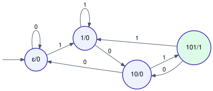
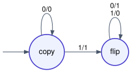

# Introduction {.unnumbered}

A finite automaton answers one question — accept or reject — after reading its whole input. Many systems instead react to every input symbol: a vending machine, a traffic light controller, a serial adder, a protocol decoder. **Transducers** are finite automata that produce an output symbol at every step. The two classical models, due to Edward Moore (1956) and George Mealy (1955), differ only in *where* the output is attached, and they are equally expressive up to a one-step delay.

# Definitions

**Definition 1.** A **Moore machine** is a 6-tuple $M = (Q, \Sigma, \Delta, \delta, \lambda, q_0)$ where $Q, \Sigma, \delta, q_0$ are as in a DFA, $\Delta$ is a finite **output alphabet**, and $\lambda : Q \to \Delta$ gives the output of each **state**.

On input $a_1 \cdots a_n$ with state sequence $r_0 = q_0, r_i = \delta(r_{i-1}, a_i)$, the output is
$$\lambda(r_0)\,\lambda(r_1)\cdots\lambda(r_n),$$
a string of length $n + 1$: a Moore machine produces an output even before reading anything.

**Definition 2.** A **Mealy machine** is $M = (Q, \Sigma, \Delta, \delta, \lambda, q_0)$ where $\lambda : Q \times \Sigma \to \Delta$ gives the output of each **transition**. The output on $a_1 \cdots a_n$ is
$$\lambda(r_0, a_1)\,\lambda(r_1, a_2)\cdots\lambda(r_{n-1}, a_n),$$
of length exactly $n$. Diagrams label each transition $a/b$: "on input $a$, output $b$".

A DFA is the special case of a Moore machine with $\Delta = \{0, 1\}$ and $\lambda(q) = 1$ iff $q \in F$: the last output symbol says whether the input is accepted.

# Design patterns

## Prefix conditions

For any regular language $L$, a transducer can output 1 exactly when the input read so far is in $L$: take the minimal DFA for $L$ and set $\lambda(q) = [q \in F]$ (Moore), or $\lambda(q, a) = [\delta(q, a) \in F]$ (Mealy).

**Example 1 (sequence detector, overlapping).** Output 1 whenever the last three inputs are $101$. The states record the longest suffix of the input that is a prefix of $101$:

{width=70%}

On input $10101$ the Moore output is $0\,0\,0\,1\,0\,1$: the second detection reuses the final 1 of the first. A **non-overlapping** detector restarts after each detection: from the "matched" state, it behaves like the start state. On $10101$ it outputs $0\,0\,0\,1\,0\,0$.

The Mealy version needs one state fewer: the transition that completes the pattern carries the output 1, so no separate "matched" state is required.

## Remainders and counters

**Example 2.** Moore machine that outputs the remainder modulo 3 of the binary number read so far (most significant bit first): states $0, 1, 2$, $\delta(r, b) = (2r + b) \bmod 3$, $\lambda(r) = r$. On $1101$ ($= 13$) the output is $0\,1\,0\,0\,1$ — the remainders of $0, 1, 3, 6, 13$.

## Serial arithmetic

Arithmetic on numbers presented **least significant bit first** needs only a bounded carry and is therefore finite-state.

**Example 3 (two's complement).** The two's complement of $x$ keeps every bit up to and including the first 1 (from the right) and flips the rest. A Mealy machine reading LSB first:

{width=56%}

On $0110$ written MSB first ($= 6$), the machine reads $0, 1, 1, 0$ and outputs $0, 1, 0, 1$, i.e. $1010$ MSB first $= 10 = 16 - 6$.

**Example 4 (serial adder).** Inputs are bit pairs $(x_i, y_i)$, LSB first; output $s_i = x_i \oplus y_i \oplus c$; states $c \in \{0, 1\}$ hold the carry with $c' = \mathrm{maj}(x_i, y_i, c)$. Two states suffice for numbers of any length. (The final carry is lost unless an extra $(0,0)$ pair is appended.)

**Example 5 (increment).** Add 1 LSB first: start in "carry" state; on 1 output 0 and stay; on the first 0 output 1 and move to "copy", which copies the remaining bits.

Reading MSB first, increment is *not* possible with a Mealy machine: the first output bit depends on whether all later bits are 1, which has not been read yet. This is the basic limit of one-pass transducers — the output may depend only on the past.

# Equivalence of Moore and Mealy machines

Because a Moore machine emits one extra initial symbol, equivalence is defined modulo that symbol: Moore machine $M$ and Mealy machine $M'$ are equivalent if for every input $w$, the output of $M$ is $\lambda(q_0)$ followed by the output of $M'$.

**Theorem 1.** For every Moore machine there is an equivalent Mealy machine with the same number of states.

*Construction.* Keep the states and transitions and put the output of the target state on the transition: $\lambda'(q, a) = \lambda(\delta(q, a))$. $\square$

**Theorem 2.** For every Mealy machine with $n$ states and output alphabet $\Delta$ there is an equivalent Moore machine with at most $n \cdot |\Delta| + 1$ states.

*Construction.* A Moore state must "remember" the output of the transition that entered it, so split each state $q$ into copies $(q, b)$, one for every output $b$ on a transition entering $q$. Set $\lambda(q, b) = b$ and $\delta'((q, b), a) = (\delta(q, a), \lambda(q, a))$. The start state is $(q_0, b_0)$ for an arbitrary $b_0$ (the extra first output). $\square$

**Example.** In the two's-complement Mealy machine, "copy" is entered only by $0/0$ (and initially), while "flip" is entered by $1/1$, $0/1$ and $1/0$. The Moore machine therefore has three states, (copy, 0), (flip, 1) and (flip, 0), with outputs 0, 1 and 0.

# Minimisation

Two states of a transducer are **equivalent** if from them every input produces the same output. The table-filling and partition-refinement algorithms of Paper 3 apply with a different starting partition:

- **Moore:** start by grouping states with equal output $\lambda(q)$;
- **Mealy:** start by grouping states with equal output *vectors* $(\lambda(q, a))_{a \in \Sigma}$;

then refine repeatedly by successor classes until stable. The result is the unique minimal machine for the input–output behaviour. Equivalence of two machines is decided by minimising both, or by a breadth-first search of the product machine for a reachable pair of states that output differently.

# What transducers can and cannot do

A function $f : \Sigma^* \to \Delta^*$ is computed by a Mealy machine iff it is

1. **length-preserving**: $|f(w)| = |w|$;
2. **prefix-preserving** (causal): $f(w)$ is a prefix of $f(wz)$;
3. of **finite memory**: for each prefix $x$ let $f_x(z)$ be the last $|z|$ symbols of $f(xz)$ — what the machine will output on the rest of the input after having read $x$. There are only finitely many different functions $f_x$.

The third condition is the transducer analogue of Myhill–Nerode. It rules out, for example: reversing the input; outputting 1 when the numbers of 0s and 1s read so far are equal; and MSB-first increment. Turing machines (Paper 7) compute all of these.

# Applications

- **Digital design.** Moore machines model synchronous circuits whose outputs depend only on registers; Mealy machines model circuits whose outputs also depend on current inputs, typically needing fewer states but producing glitches when inputs change.
- **Protocols and controllers.** Traffic lights, vending machines, elevator controllers.
- **Text processing.** Tokenisers, case converters and simple encoders are Mealy machines; finite-state transducers with ε-outputs drive morphological analysers in natural-language processing.

# Exercises

1. Design a Mealy machine over $\{0,1\}$ that outputs 1 when the current input equals the previous one (output 0 on the first symbol). Convert it to a Moore machine.
2. Design a Moore machine that outputs, after each symbol, the number of $a$'s read so far modulo 4.
3. Design overlapping and non-overlapping Mealy detectors for $1011$; give their outputs on $1011011$.
4. Show that no Mealy machine outputs $f(w) = 1^{|w|}$ if $|w|_0 = |w|_1$ and $0^{|w|}$ otherwise.
5. Minimise the Moore machine obtained in Exercise 1 and verify it is equivalent to the Mealy machine.

*Answers.* (3) $1011011$ contains $1011$ at positions 1–4 and 4–7, sharing the 1 at position 4. Overlapping: $0001001$. Non-overlapping: $0001000$ — after the first match the detector restarts, so the shared 1 cannot begin the second match. (4) The function is not prefix-preserving: $f(01) = 11$ but $f(0) = 0$.
