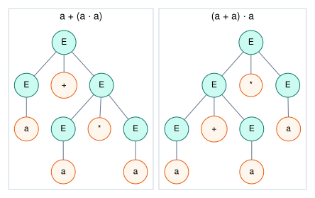

# Introduction {.unnumbered}

Regular languages cannot count without bound, yet the languages people care about most — programming languages, arithmetic expressions, nested markup — are built from matched pairs: parentheses, `begin … end`, opening and closing tags. Context-free grammars describe such nesting with recursive rewriting rules. They are the formal basis of every parser generator, and their machine counterpart, the pushdown automaton, is the subject of Paper 6.

# Grammars and derivations

**Definition 1.** A **context-free grammar** (CFG) is a 4-tuple $G = (V, \Sigma, R, S)$ where $V$ is a finite set of **variables** (non-terminals), $\Sigma$ a finite set of **terminals** disjoint from $V$, $R$ a finite set of **rules** $A \to \alpha$ with $A \in V$ and $\alpha \in (V \cup \Sigma)^*$, and $S \in V$ the **start variable**.

If $A \to \alpha$ is a rule, then $\beta A \gamma \Rightarrow \beta \alpha \gamma$ (one **derivation step**). $\Rightarrow^*$ is the reflexive–transitive closure. The **language** of $G$ is $L(G) = \{ w \in \Sigma^* \mid S \Rightarrow^* w \}$, and a language is **context-free** (CFL) if some CFG generates it. A string over $V \cup \Sigma$ derivable from $S$ is a **sentential form**.

**Examples.**

| Language | Grammar |
|---|---|
| $\{a^nb^n \mid n \ge 0\}$ | $S \to aSb \mid \varepsilon$ |
| palindromes over $\{a, b\}$ | $S \to aSa \mid bSb \mid a \mid b \mid \varepsilon$ |
| balanced parentheses | $S \to (S)S \mid \varepsilon$ |
| $\{ w \mid \lvert w\rvert_a = \lvert w\rvert_b \}$ | $S \to aSbS \mid bSaS \mid \varepsilon$ |
| $\{a^ib^jc^k \mid i = j \text{ or } j = k\}$ | $S \to XC \mid AY$, $X \to aXb \mid \varepsilon$, $C \to cC \mid \varepsilon$, $A \to aA \mid \varepsilon$, $Y \to bYc \mid \varepsilon$ |
| $\{a^ib^jc^k \mid k = i + j\}$ | $S \to aSc \mid T$, $T \to bTc \mid \varepsilon$ |

**Designing grammars.** Generate matched parts from the outside in ($S \to aSb$); use one variable per "phase" of the string; split unions into separate variables ($S \to X \mid Y$); for "at least as many", add optional extras ($S \to aSb \mid aS \mid \varepsilon$ gives $i \ge j$).

**Proving a grammar correct** takes two inductions: every derived string is in $L$ (induction on the length of the derivation) and every string of $L$ can be derived (induction on the length of the string). For $S \to aSbS \mid bSaS \mid \varepsilon$ and equal counts, the second direction uses the first position at which the running difference $|x|_a - |x|_b$ returns to 0.

# Parse trees and ambiguity

A **parse tree** for $w$ has root $S$, internal nodes labelled by variables whose children spell out a rule, and leaves labelled by terminals or $\varepsilon$ whose left-to-right reading is $w$. A **leftmost derivation** always rewrites the leftmost variable; parse trees, leftmost derivations and rightmost derivations are in one-to-one correspondence.

$G$ is **ambiguous** if some string has two different parse trees (equivalently, two leftmost derivations). The classic example is
$$E \to E + E \mid E * E \mid (E) \mid a,$$
in which $a + a * a$ has a tree that groups $a + (a * a)$ and another that groups $(a + a) * a$:

{width=86%}

Ambiguity matters because the tree determines meaning. It is removed by encoding precedence and associativity in the grammar:
$$E \to E + T \mid T, \qquad T \to T * F \mid F, \qquad F \to (E) \mid a.$$
Here $*$ binds tighter than $+$, and both are left-associative.

A language is **inherently ambiguous** if *every* grammar for it is ambiguous. $\{a^ib^jc^k \mid i = j \text{ or } j = k\}$ is inherently ambiguous: strings $a^nb^nc^n$ are generated both "as $i = j$" and "as $j = k$" in any grammar (proved by Ogden's lemma). Deciding whether a CFG is ambiguous is **undecidable** (Paper 8).

# Simplification

A variable is **useless** if it is not **generating** (derives no terminal string) or not **reachable** from $S$. Both sets are computed by fixed-point iteration: a variable is generating if some rule rewrites it to terminals and generating variables; reachable if it occurs in a rule of a reachable variable. Remove non-generating variables first, then unreachable ones (the other order can leave useless symbols).

**ε-rules.** Compute the **nullable** variables ($A \Rightarrow^* \varepsilon$). Replace each rule $A \to X_1 \cdots X_k$ by all versions obtained by deleting any subset of nullable $X_i$ (but never all of them), and drop the ε-rules. If $S$ was nullable, add a new start $S_0 \to S \mid \varepsilon$.

**Unit rules** $A \to B$. Compute the unit pairs $(A, B)$ with $A \Rightarrow^* B$ using unit rules only; for each pair and each non-unit rule $B \to \alpha$ add $A \to \alpha$; drop all unit rules.

# Normal forms

**Definition 2.** $G$ is in **Chomsky normal form** (CNF) if every rule is $A \to BC$ (with $B, C$ not the start variable) or $A \to a$, plus possibly $S \to \varepsilon$.

**Theorem 1.** Every CFL is generated by a grammar in CNF.

*Construction* (in this order):

1. **START**: add $S_0 \to S$.
2. **DEL**: remove ε-rules.
3. **UNIT**: remove unit rules.
4. **TERM**: in every rule with right side of length $\ge 2$, replace each terminal $a$ by a new variable $T_a$ with $T_a \to a$.
5. **BIN**: replace $A \to B_1 B_2 \cdots B_k$ ($k \ge 3$) by $A \to B_1 X_1$, $X_1 \to B_2 X_2$, …, $X_{k-2} \to B_{k-1}B_k$.

**Example.** $S \to aSb \mid \varepsilon$ becomes: $S_0 \to AX \mid AB \mid \varepsilon$, $S \to AX \mid AB$, $X \to SB$, $A \to a$, $B \to b$.

In CNF every derivation of a string of length $n \ge 1$ has exactly $2n - 1$ steps, and parse trees are binary — which is why CYK and the pumping lemma work cleanly on it.

**Greibach normal form** (GNF): every rule is $A \to a\alpha$ with $\alpha \in V^*$. Every ε-free CFL has a GNF grammar; the conversion removes left recursion ($A \to A\alpha \mid \beta$ becomes $A \to \beta A'$, $A' \to \alpha A' \mid \varepsilon$, then ε-removal) and substitutes leading variables in a fixed order. In GNF each derivation step produces exactly one terminal, so a string of length $n$ has an $n$-step derivation — the basis of the one-state PDA that reads one symbol per move.

# Membership: the CYK algorithm

For a CNF grammar and $w = a_1 \cdots a_n$, let $T[i, \ell]$ be the set of variables deriving the substring of length $\ell$ starting at position $i$:

- $T[i, 1] = \{ A \mid A \to a_i \}$;
- $T[i, \ell] = \{ A \mid A \to BC,\ B \in T[i, k],\ C \in T[i + k, \ell - k] \text{ for some } 1 \le k < \ell \}$.

$w \in L(G)$ iff $S \in T[1, n]$. The algorithm takes $O(n^3 |G|)$ time — dynamic programming over all substrings. Earley's algorithm works on any CFG in $O(n^3)$, and in $O(n^2)$ on unambiguous grammars.

# Deterministic parsing: FIRST, FOLLOW and LL(1)

For a sentential form $\alpha$, $\mathrm{FIRST}(\alpha)$ is the set of terminals that begin strings derived from $\alpha$ (plus $\varepsilon$ if $\alpha \Rightarrow^* \varepsilon$). For a variable $A$, $\mathrm{FOLLOW}(A)$ is the set of terminals that can appear immediately after $A$ in a sentential form, with $\$ \in \mathrm{FOLLOW}(S)$ marking the end of input.

The **LL(1) table** puts rule $A \to \alpha$ in cell $[A, a]$ for every $a \in \mathrm{FIRST}(\alpha)$, and, if $\alpha \Rightarrow^* \varepsilon$, in $[A, b]$ for every $b \in \mathrm{FOLLOW}(A)$. The grammar is **LL(1)** if no cell holds two rules; a predictive parser then decides every step by one symbol of look-ahead.

For the grammar
$$E \to TE', \quad E' \to {+}TE' \mid \varepsilon, \quad T \to FT', \quad T' \to {*}FT' \mid \varepsilon, \quad F \to (E) \mid a$$
we get $\mathrm{FIRST}(E) = \mathrm{FIRST}(T) = \mathrm{FIRST}(F) = \{(, a\}$, $\mathrm{FOLLOW}(E) = \mathrm{FOLLOW}(E') = \{), \$\}$, $\mathrm{FOLLOW}(T) = \mathrm{FOLLOW}(T') = \{+, ), \$\}$, $\mathrm{FOLLOW}(F) = \{*, +, ), \$\}$, and the table has no conflicts. Left-recursive and ambiguous grammars are never LL(1).

# Closure properties

**Theorem 2.** CFLs are closed under union, concatenation, Kleene star, reversal, homomorphism, inverse homomorphism and **intersection with a regular language**. They are **not** closed under intersection or complement.

*Proof sketch.* With start variables $S_1, S_2$: union $S \to S_1 \mid S_2$; concatenation $S \to S_1S_2$; star $S \to SS_1 \mid \varepsilon$; reversal reverses every right side. Intersection with a regular language runs a PDA and a DFA in parallel (product of control states). For non-closure: $\{a^nb^nc^m\}$ and $\{a^mb^nc^n\}$ are CFLs whose intersection $\{a^nb^nc^n\}$ is not; and since $L_1 \cap L_2 = \overline{\overline{L_1} \cup \overline{L_2}}$, closure under complement would imply closure under intersection. $\square$

# The pumping lemma for context-free languages

**Theorem 3.** If $L$ is context-free, there is $p \ge 1$ such that every $w \in L$ with $|w| \ge p$ can be written $w = uvxyz$ with

1. $|vxy| \le p$,
2. $|vy| \ge 1$,
3. $uv^ixy^iz \in L$ for all $i \ge 0$.

*Proof.* Take a CNF grammar with $k$ variables and let $p = 2^{k}$. A parse tree of a string of length $\ge p$ has height $> k$, so on its longest root-to-leaf path some variable $A$ appears twice among the lowest $k + 1$ variables. The upper $A$ derives $vxy$ and the lower derives $x$; replacing the lower subtree by the upper one (or vice versa) pumps $v$ and $y$ together. The height bound gives $|vxy| \le p$, and CNF (no unit or ε-rules) gives $|vy| \ge 1$. $\square$

**Example 1.** $\{a^nb^nc^n\}$ is not context-free. Take $w = a^pb^pc^p$. Since $|vxy| \le p$, $vxy$ touches at most two of the three blocks. Pumping with $i = 2$ increases at most two of the three counts (and if $v$ or $y$ straddles a block boundary, the order breaks), so $uv^2xy^2z \notin L$.

**Example 2.** $\{ww \mid w \in \{a,b\}^*\}$ is not context-free. Take $w = a^pb^pa^pb^p$ and consider where the window $vxy$ (length $\le p$) falls; in each case, pumping down ($i = 0$) yields a string whose two halves differ.

**Example 3.** $\{a^{n^2}\}$, $\{a^q \mid q \text{ prime}\}$ and $\{a^{2^n}\}$ are not context-free. Over a one-letter alphabet every CFL is regular (Parikh's theorem), so the regular-language arguments of Paper 3 apply.

**Ogden's lemma** strengthens the pumping lemma by letting you *mark* positions of $w$ and forcing $v$ or $y$ to contain a marked position; it proves inherent ambiguity and handles languages the plain lemma cannot.

# Decision problems

| Problem | Status |
|---|---|
| Membership $w \in L(G)$ | decidable, CYK $O(n^3)$ |
| Emptiness $L(G) = \emptyset$ | decidable: is $S$ generating? |
| Finiteness | decidable: cycle in the variable graph of a CNF grammar without useless symbols |
| $L(G) = \Sigma^*$, $L(G_1) = L(G_2)$, $L(G_1) \cap L(G_2) = \emptyset$, ambiguity, "is $L(G)$ regular?" | **undecidable** |

# The Chomsky hierarchy

| Type | Grammar rules | Machine | Example |
|---|---|---|---|
| 3 (regular) | $A \to aB \mid a \mid \varepsilon$ | finite automaton | $(ab)^*$ |
| 2 (context-free) | $A \to \alpha$ | pushdown automaton | $a^nb^n$ |
| 1 (context-sensitive) | $\alpha A \beta \to \alpha\gamma\beta$, $\gamma \neq \varepsilon$ (non-contracting) | linear bounded automaton | $a^nb^nc^n$ |
| 0 (unrestricted) | $\alpha \to \beta$ | Turing machine | the halting problem's yes-instances |

Each class strictly contains the one above it. A non-contracting grammar for $\{a^nb^nc^n \mid n \ge 1\}$:
$$S \to aSBC \mid aBC,\quad CB \to BC,\quad aB \to ab,\quad bB \to bb,\quad bC \to bc,\quad cC \to cc.$$

# Exercises

1. Give CFGs for: $\{a^ib^j \mid i \le 2j\}$; $\{ w \in \{a,b\}^* \mid |w|_a = 2|w|_b \}$; the complement of $\{ww\}$.
2. Show that $S \to aS \mid aSbS \mid \varepsilon$ is ambiguous, describe its language, and give an unambiguous grammar for it.
3. Convert $S \to ASA \mid aB$, $A \to B \mid S$, $B \to b \mid \varepsilon$ to CNF.
4. Run CYK for $baaba$ on $S \to AB \mid BC$, $A \to BA \mid a$, $B \to CC \mid b$, $C \to AB \mid a$.
5. Compute FIRST and FOLLOW for $S \to AaAb \mid BbBa$, $A \to \varepsilon$, $B \to \varepsilon$ and decide whether it is LL(1).
6. Prove that $\{a^ib^jc^k \mid i < j < k\}$ is not context-free. (*Hint:* $w = a^pb^{p+1}c^{p+2}$; pump up if $vxy$ avoids the $c$'s, down otherwise.)

*Answers.* (2) It generates strings in which every prefix has at least as many $a$'s as $b$'s; $aab$ has two trees. An unambiguous grammar: $S \to aS \mid aTbS \mid \varepsilon$, $T \to aTbT \mid \varepsilon$. (4) Accepted: $S \in T[1,5]$ (the classic textbook example). (5) FIRST$(AaAb) = \{a\}$, FIRST$(BbBa) = \{b\}$: LL(1).
