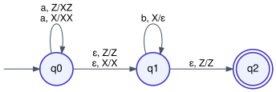

# Introduction {.unnumbered}

A finite automaton forgets everything except its current state. Give it a stack — unbounded memory that can only be accessed at the top — and it can match nested structure: push on every opening symbol, pop on every closing one. The resulting machine, the pushdown automaton, recognises exactly the context-free languages. This paper defines PDAs, develops design patterns, proves the equivalence with grammars, and explains why the deterministic version is strictly weaker.

# Definition

**Definition 1.** A **pushdown automaton** (PDA) is a 7-tuple $P = (Q, \Sigma, \Gamma, \delta, q_0, Z_0, F)$ where

- $Q$ is a finite set of states, $q_0 \in Q$ the start state, $F \subseteq Q$ the accepting states;
- $\Sigma$ is the input alphabet and $\Gamma$ the **stack alphabet**, with $Z_0 \in \Gamma$ the initial stack symbol;
- $\delta : Q \times (\Sigma \cup \{\varepsilon\}) \times \Gamma \to$ finite subsets of $Q \times \Gamma^*$.

$(p, \gamma) \in \delta(q, a, X)$ means: in state $q$, reading $a$ (or nothing, if $a = \varepsilon$) with $X$ on top of the stack, the PDA may move to $p$ and replace $X$ by the string $\gamma$, whose first symbol becomes the new top. In diagrams this move is labelled $a, X / \gamma$. Pushing $Y$ on top of $X$ is $a, X / YX$; popping is $a, X / \varepsilon$; leaving the stack unchanged is $a, X / X$.

A **configuration** (instantaneous description) is a triple $(q, w, \gamma)$: current state, unread input, stack contents (top first). One move is
$$(q, aw, X\beta) \vdash (p, w, \gamma\beta) \quad\text{if } (p, \gamma) \in \delta(q, a, X),$$
and $\vdash^*$ is its reflexive–transitive closure. The PDA is nondeterministic: a configuration may have several successors.

**Acceptance.**

- *By final state:* $L(P) = \{ w \mid (q_0, w, Z_0) \vdash^* (q, \varepsilon, \gamma),\ q \in F \}$ for any stack $\gamma$.
- *By empty stack:* $N(P) = \{ w \mid (q_0, w, Z_0) \vdash^* (q, \varepsilon, \varepsilon) \}$ for any state $q$.

**Theorem 1.** The two modes are equivalent: for every PDA accepting by final state there is one accepting the same language by empty stack, and vice versa.

*Construction.* (Final state → empty stack.) Add a new bottom marker $X_0$ below $Z_0$ so the original PDA can never empty the stack by accident; from every accepting state, add ε-moves to a "drain" state that pops every symbol. (Empty stack → final state.) Add the bottom marker $X_0$; whenever $X_0$ becomes the top — the simulated stack is empty — move by ε to a new accepting state. $\square$

# Design patterns

## Counting with the stack

$\{a^nb^n \mid n \ge 0\}$: push one $X$ per $a$, guess the switch to the $b$'s, pop one $X$ per $b$, and accept when only $Z_0$ remains.

{width=74%}

Trace on $aabb$: $(q_0, aabb, Z) \vdash (q_0, abb, XZ) \vdash (q_0, bb, XXZ) \vdash (q_1, bb, XXZ) \vdash (q_1, b, XZ) \vdash (q_1, \varepsilon, Z) \vdash (q_2, \varepsilon, Z)$ — accepted.

Variations follow from the same idea:

| Language | Change |
|---|---|
| $\{a^nb^{2n}\}$ | push two $X$ per $a$ (one move pushing $XX$) |
| $\{a^{2n}b^n\}$ | push one $X$ for every second $a$ (two states alternate), pop one per $b$ |
| $\{a^ib^j \mid i > j\}$ | accept at the end if an $X$ is still on top |
| $\{a^ib^j \mid i \neq j\}$ | union of $i > j$ and $i < j$: a nondeterministic first move chooses |
| $\{a^ib^jc^k \mid k = i + j\}$ | push on $a$ and on $b$, pop on $c$ |
| $\{a^ib^jc^k \mid i = k\}$ | push on $a$, ignore $b$, pop on $c$ |

## Signed counters: counting in any order

$\{ w \mid |w|_a = |w|_b \}$: keep the *difference* $|w|_a - |w|_b$ on the stack, as $X$'s when it is positive and $Y$'s when it is negative. On $a$: pop a $Y$ if one is on top, otherwise push $X$. On $b$: symmetric. Accept with $Z_0$ on top. Only one kind of symbol is ever on the stack above $Z_0$, so the top tells the sign. The same machine with acceptance "top is $X$" recognises "more $a$'s than $b$'s".

## Guessing the middle

Even-length palindromes $\{ww^R\}$: push symbols while guessing, at each step, whether the middle has been reached; after the guess, pop and compare. The guess is essential: a deterministic machine cannot know where the middle is. With a centre marker, $\{wcw^R\}$ needs no guess.

## Matching several kinds of brackets

Push a symbol recording the *kind* of each opener; on a closer, pop only if the top matches. Accept on $Z_0$.

# Equivalence with context-free grammars

**Theorem 2.** A language is context-free if and only if some PDA recognises it.

## From a grammar to a PDA

Given $G = (V, \Sigma, R, S)$, build a PDA with three states that simulates **leftmost derivations** on its stack:

1. $q_{\text{start}} \xrightarrow{\varepsilon, Z_0 / S Z_0} q_{\text{loop}}$;
2. for every rule $A \to \alpha$: $q_{\text{loop}} \xrightarrow{\varepsilon, A / \alpha} q_{\text{loop}}$ (expand);
3. for every terminal $a$: $q_{\text{loop}} \xrightarrow{a, a / \varepsilon} q_{\text{loop}}$ (match);
4. $q_{\text{loop}} \xrightarrow{\varepsilon, Z_0 / Z_0} q_{\text{accept}}$.

*Correctness.* By induction on the number of moves: the PDA reaches $(q_{\text{loop}}, y, \alpha Z_0)$ after reading $x$ iff $S \Rightarrow^*_{lm} x\alpha$ by a leftmost derivation with $y$ still to read. The stack holds the unexpanded rest of the sentential form. $\square$

**Example.** For $S \to aSb \mid \varepsilon$ the PDA expands $S$ to $aSb$ or $\varepsilon$ and matches $a$ and $b$. On $ab$: push $S$; expand to $aSb$; match $a$; expand $S$ to $\varepsilon$; match $b$; accept.

## From a PDA to a grammar

Assume the PDA accepts by empty stack, has a single accepting state reached with an empty stack, and every move either pushes exactly one symbol or pops exactly one (any PDA can be normalised this way). For every pair of states $p, q$ introduce a variable $A_{pq}$ that generates exactly the strings taking the PDA from $p$ with empty stack to $q$ with empty stack. The rules are

- $A_{pq} \to a\,A_{rs}\,b$ whenever $p \xrightarrow{a,\ \varepsilon/X} r$ pushes $X$ and $s \xrightarrow{b,\ X/\varepsilon} q$ pops the same $X$;
- $A_{pq} \to A_{pr}A_{rq}$ for every $r$;
- $A_{pp} \to \varepsilon$.

The start variable is $A_{q_0 q_{\text{acc}}}$. Correctness is proved by induction on the length of computations (stack empty only at the ends → the first rule; empty somewhere in between → the second). This is the "triple construction" in Hopcroft–Ullman's form $[pXq]$. $\square$

# Deterministic pushdown automata

**Definition 2.** A PDA is **deterministic** (DPDA) if for every $q, a, X$: $|\delta(q, a, X)| \le 1$, and if $\delta(q, \varepsilon, X) \neq \emptyset$ then $\delta(q, a, X) = \emptyset$ for every $a \in \Sigma$. At most one move is possible in every configuration. DPDAs accept by final state (by empty stack they could only accept prefix-free languages).

The **deterministic context-free languages** (DCFLs) — those accepted by DPDAs — form a proper subclass of the CFLs:

| Property | Regular | DCFL | CFL |
|---|---|---|---|
| Closed under complement | yes | **yes** | no |
| Closed under union | yes | no | yes |
| Closed under intersection with regular | yes | yes | yes |
| Unambiguous grammar exists | yes | **yes** (every DCFL) | not always |
| Membership in time | $O(n)$ | $O(n)$ | $O(n^3)$ (general) |

$\{ww^R\}$ is a CFL but not a DCFL: a deterministic machine cannot tell where the middle is. The formal proof (Hopcroft, Motwani and Ullman, §6.4) shows that a DPDA for it could be adapted to accept a language that is not context-free. $\{wcw^R\}$, $\{a^nb^n\}$ and balanced parentheses are DCFLs. DCFLs are exactly the languages of LR(1) grammars, which is why parser generators such as yacc and bison accept deterministic grammars.

# Closure, decision problems and limits

PDAs inherit everything proved for grammars in Paper 5: closure under union, concatenation, star and intersection with regular languages; decidable membership and emptiness; undecidable equivalence and universality.

A useful consequence of the intersection-with-regular property is the **product construction for PDAs**: run a PDA and a DFA in parallel, pairing their states; the stack belongs to the PDA alone. Intersecting two PDAs this way is impossible, because the product would need two stacks — and a machine with two stacks is as powerful as a Turing machine (Paper 7).

# Common mistakes

1. **Popping from an empty stack.** Every move must name the top symbol it pops; keep $Z_0$ at the bottom and handle it explicitly.
2. **Forgetting ε-moves for the switch.** Moving from "push" to "pop" usually needs an ε-move (or the first move on the new symbol must do the switching).
3. **Accepting too early.** With final-state acceptance, the input must be fully read; check that the final ε-move can only fire with the right top.
4. **Using two stacks' worth of information.** $a^nb^nc^n$ needs to compare the $b$'s with both the $a$'s and the $c$'s; once the $a$'s are popped for the $b$'s, nothing is left for the $c$'s.

# Exercises

1. Give PDAs for: $\{a^ib^jc^k \mid i = j \text{ or } j = k\}$; $\{ w \in \{a,b\}^* \mid |w|_a = 2|w|_b \}$; $\{ a^ib^j \mid i \le j \le 2i \}$.
2. Convert $S \to SS \mid (S) \mid \varepsilon$ to a PDA and trace it on $(()())$.
3. Convert your PDA for $\{a^nb^n\}$ (normalised as described) to a grammar with the $A_{pq}$ construction, and simplify the result.
4. Show that $\{ a^nb^n \} \cup \{ a^nb^{2n} \}$ is context-free but not deterministic context-free. (*Hint:* if a DPDA accepted it, after $a^nb^n$ it would have to continue and accept $a^nb^{2n}$; modify it to recognise $\{a^nb^nc^n\}$.)
5. Prove that the PDA in Figure 1 accepts exactly $\{a^nb^n\}$, by stating the stack contents as an invariant of each state.

*Answers.* (1, last) For each $a$ nondeterministically push one or two $X$'s, then pop one $X$ per $b$ and accept on $Z_0$. (4) Replace the "second" $b$-phase by $c$'s in a copy of the control states; a DPDA for the union would give a PDA for $\{a^nb^nc^n\}$.
