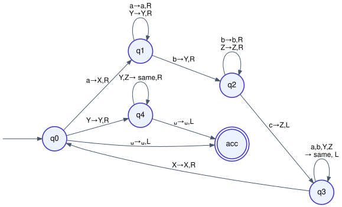

# Introduction {.unnumbered}

In 1936 Alan Turing asked what a human computer — a clerk with pencil, paper and unlimited patience — could compute by following fixed rules. His answer was a machine with a finite control and an unbounded tape that it can read, write and move along in both directions. Every reasonable model of computation proposed since, from the lambda calculus to modern processors, computes exactly the same functions. This paper defines the Turing machine, shows how to program it, and proves that its many variants are equally powerful.

# The standard Turing machine

**Definition 1.** A (deterministic) **Turing machine** is a 7-tuple $M = (Q, \Sigma, \Gamma, \delta, q_0, q_{\text{acc}}, q_{\text{rej}})$ where

- $Q$ is a finite set of states, with start state $q_0$ and distinct halting states $q_{\text{acc}}$, $q_{\text{rej}}$;
- $\Sigma$ is the input alphabet, not containing the **blank** $\sqcup$;
- $\Gamma \supseteq \Sigma \cup \{\sqcup\}$ is the tape alphabet;
- $\delta : (Q \setminus \{q_{\text{acc}}, q_{\text{rej}}\}) \times \Gamma \to Q \times \Gamma \times \{L, R\}$.

The tape is infinite to the right (or in both directions — it makes no difference). Initially it holds the input followed by blanks, and the head is on the first input symbol. $\delta(q, a) = (p, b, D)$ means: in state $q$ reading $a$, write $b$, move the head one cell in direction $D$, enter $p$. Moving left from the leftmost cell leaves the head in place.

A **configuration** $u\,q\,v$ records the tape contents $uv$ (blanks beyond are implicit), the state $q$, and the head on the first symbol of $v$. The machine **accepts** if it reaches $q_{\text{acc}}$, **rejects** if it reaches $q_{\text{rej}}$, and otherwise **loops** forever. Many textbooks and tools (including Toc-Suite) instead let the machine halt when no move is defined and treat that as rejection; the two conventions are equivalent.

**Definition 2.** $L(M)$, the set of strings $M$ accepts, is the language **recognised** by $M$. A language is **Turing-recognisable** (recursively enumerable) if some TM recognises it. A TM is a **decider** if it halts on every input; a language is **decidable** (recursive) if some decider recognises it.

The difference matters: on a string outside $L$, a recogniser may run forever, so waiting for its answer is not a procedure for deciding membership. Paper 8 shows that the two classes really differ.

# Programming Turing machines

## Marking and sweeping: $\{a^nb^nc^n \mid n \ge 0\}$

This language is not context-free, yet a TM decides it by crossing off one symbol of each block per round:

1. If the current cell is blank, accept. If it is $a$, replace it by $X$; otherwise go to step 5.
2. Move right past $a$'s and $Y$'s to the first $b$; replace it by $Y$ (reject if none).
3. Move right past $b$'s and $Z$'s to the first $c$; replace it by $Z$ (reject if none).
4. Move left to the rightmost $X$, step right, and repeat from 1.
5. (No $a$ left.) Scan right over $Y$'s and $Z$'s; accept at the blank, reject on anything else.

{width=88%}

The order check is built in: step 2 skips only $a$'s and $Y$'s, so an $a$ after a $b$, or a $c$ before a $b$, makes some step fail. The machine makes $O(n)$ sweeps of length $O(n)$: $O(n^2)$ moves.

## Comparing halves: $\{w\#w \mid w \in \{0,1\}^*\}$

Repeatedly: cross off the leftmost unmarked symbol before $\#$, remembering it in the state; move right past $\#$ to the leftmost unmarked symbol and check that it matches; cross it off; return. When only $\#$ and marks remain on the left, check that nothing unmarked is left on the right. For $\{ww\}$ without a separator, first find the middle by marking symbols alternately from both ends.

## Arithmetic

- **Binary increment:** move to the rightmost bit; turn trailing 1s into 0s while moving left; turn the first 0 (or the blank) into 1.
- **Unary addition** $1^m 0 1^n \mapsto 1^{m+n}$: replace the 0 by 1, go to the end, erase the last 1.
- **Unary subtraction** $1^m 0 1^n \mapsto 1^{\max(m-n, 0)}$: repeatedly erase one 1 from each number.
- **Copying** $w \mapsto w\#w$: mark a symbol, carry it in the state to the end of the copy, return.

A TM **computes** a function $f$ if, started on $w$, it halts with $f(w)$ on the tape. The functions computable this way are the **partial recursive** (Turing-computable) functions.

## Techniques

- **Storing in the state:** remembering a symbol or a small counter multiplies the number of states.
- **Multiple tracks:** treat each cell as a tuple — e.g. a symbol and a mark — by enlarging $\Gamma$.
- **Subroutines:** a group of states that performs a task (go to the left end, copy a block) and returns to a designated state.
- **Markers:** a special symbol at the left end avoids falling off the tape.

# Variants and their equivalence

All of the following recognise exactly the Turing-recognisable languages; the simulations below show how.

**Stay option** ($D \in \{L, R, S\}$): a stay move is a right move followed by a left move.

**Two-way infinite tape:** fold the tape at the origin into two tracks, one for the right half and one for the left half (reversed); the control remembers which track it is on.

**Multitape TMs** ($k$ tapes, $k$ heads, $\delta : Q \times \Gamma^k \to Q \times \Gamma^k \times \{L, R, S\}^k$). *Simulation:* store the $k$ tapes on one tape separated by $\#$, marking each head position with a dotted symbol. To simulate one step, sweep once to read the $k$ marked symbols, then sweep again to update them (shifting the tape right if a head moves onto a $\#$). After $t$ steps each tape segment has length $O(t)$, so one step costs $O(t)$ and $t$ steps cost $O(t^2)$: **a quadratic slowdown**.

**Nondeterministic TMs** ($\delta : Q \times \Gamma \to \mathcal{P}(Q \times \Gamma \times \{L, R\})$): accept if *some* branch of the computation tree accepts. *Simulation:* a deterministic three-tape machine explores the tree **breadth-first** — tape 1 keeps the input, tape 2 simulates one branch, tape 3 holds the address (sequence of choices) of the branch being tried, incremented in shortlex order. Depth-first search would fail by following an infinite branch. If every branch halts within $t$ steps and the branching factor is $b$, the simulation takes $2^{O(t)}$ time — whether this exponential cost is necessary is the P vs NP question (Paper 9).

**Enumerators:** a TM with an output printer that prints strings, possibly forever. $L$ is Turing-recognisable iff some enumerator prints exactly $L$. (⇐: on input $w$, run the enumerator and accept if it prints $w$. ⇒: for $i = 1, 2, \dots$ run the recogniser for $i$ steps on each of the first $i$ strings of $\Sigma^*$ and print those that accept — **dovetailing**.) $L$ is decidable iff some enumerator prints it in shortlex order.

**Other equivalent models:** two-stack PDAs; counter machines with two counters; the $\lambda$-calculus; $\mu$-recursive functions; Post systems; unrestricted (type 0) grammars; random-access machines; any general-purpose programming language with unbounded memory.

**Theorem 1.** A language is generated by an unrestricted grammar iff it is Turing-recognisable.

# Linear bounded automata

A **linear bounded automaton** (LBA) is a nondeterministic TM whose head never leaves the cells holding the input (end markers on both sides). LBAs recognise exactly the **context-sensitive languages** (type 1). They are far more powerful than PDAs — $\{a^nb^nc^n\}$, $\{ww\}$ and $\{a^{n^2}\}$ are all context-sensitive — but strictly weaker than TMs. Membership for LBAs is decidable: with $|Q|$ states, tape alphabet $\Gamma$ and input length $n$ there are at most $|Q| \cdot n \cdot |\Gamma|^n$ configurations, so a computation that runs longer must repeat a configuration and loop. Emptiness for LBAs, however, is undecidable. Whether deterministic LBAs are as powerful as nondeterministic ones is a long-standing open problem.

# Universal machines and the Church–Turing thesis

A Turing machine can be **encoded** as a string $\langle M \rangle$ — list its states, alphabet and transitions in a fixed format. A **universal Turing machine** $U$ takes $\langle M, w \rangle$ and simulates $M$ on $w$, accepting iff $M$ accepts. $U$ is the theoretical ancestor of the stored-program computer: programs are data.

**The Church–Turing thesis.** *Every function that can be computed by an effective procedure — a finite, mechanical, step-by-step method — can be computed by a Turing machine.*

The thesis is not a theorem: "effective procedure" is an informal notion. It is supported by the equivalence of every model proposed so far. In practice it licenses a higher-level style of proof: to show that a language is decidable, it is enough to describe an algorithm in clear prose, knowing that it could be translated into a Turing machine.

# Turing machines and the other models

| Machine | Memory | Recognises |
|---|---|---|
| DFA / NFA | finite control only | regular languages |
| PDA | one stack | context-free languages |
| LBA | tape bounded by the input | context-sensitive languages |
| TM (decider) | unbounded tape, always halts | decidable languages |
| TM | unbounded tape | Turing-recognisable languages |

A PDA with **two** stacks is a Turing machine: the two stacks hold the tape to the left and to the right of the head, and a head move pops from one and pushes onto the other.

# Exercises

1. Design TMs (state diagrams) for: $\{a^nb^{2n}\}$; $\{ w \in \{a,b\}^* \mid |w|_a = |w|_b \}$; $\{ a^{2^n} \mid n \ge 0 \}$.
2. Give a TM that computes $f(1^n) = 1^{2n}$, and one that reverses a string over $\{a, b\}$.
3. How many moves does the $\{a^nb^nc^n\}$ machine make on $a^nb^nc^n$, as a function of $n$, up to a constant factor? Can a two-tape TM do it in $O(n)$?
4. Describe a 2-PDA (two-stack PDA) that simulates a given TM.
5. Show that the class of decidable languages is closed under union, intersection, complement, concatenation and star; and that the recognisable languages are closed under all of these except complement.

*Answers.* (1, last) Sipser's machine: sweep left to right crossing off every other $a$; if a single $a$ remains accept; if the number of $a$'s was odd and greater than 1 reject; otherwise return and repeat. (3) $\Theta(n^2)$; yes — copy the $a$'s to the second tape, then match the $b$'s and the $c$'s against it in two passes. (5) For concatenation and star of recognisable languages, guess the split nondeterministically, or dovetail over all splits.
