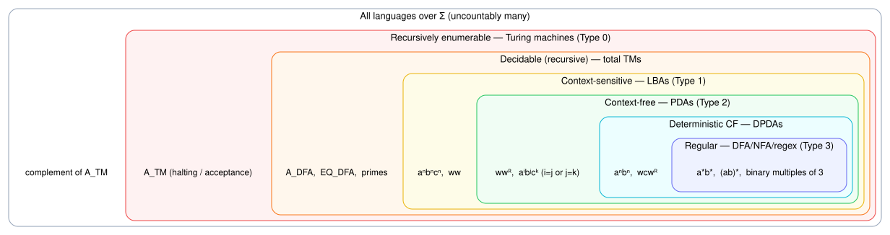

# Introduction {.unnumbered}

Some problems have no algorithm at all — not a slow one, not one we have not found yet, but none, ever. Turing proved it in the same paper in which he defined his machines. This paper first collects the questions about automata and grammars that *are* decidable, then proves that the acceptance problem for Turing machines is not, and develops reductions — the tool that spreads undecidability from one problem to hundreds of others.

Throughout, $\langle O \rangle$ is a string encoding of an object $O$ (a machine, a grammar, a pair). A decider first checks that its input is a valid encoding and rejects otherwise; we leave that check implicit.

# Decidable problems

**Theorem 1.** The following languages are decidable.

| Language | Decider |
|---|---|
| $A_{\mathrm{DFA}} = \{\langle B, w\rangle \mid \text{DFA } B \text{ accepts } w\}$ | simulate $B$ on $w$ |
| $A_{\mathrm{NFA}}$, $A_{\mathrm{REX}}$ | convert to a DFA, then as above |
| $E_{\mathrm{DFA}} = \{\langle B\rangle \mid L(B) = \emptyset\}$ | mark states reachable from the start; accept iff no accepting state is marked |
| $EQ_{\mathrm{DFA}} = \{\langle B_1, B_2\rangle \mid L(B_1) = L(B_2)\}$ | build $C$ with $L(C) = L(B_1) \triangle L(B_2)$; test $E_{\mathrm{DFA}}$ |
| $A_{\mathrm{CFG}} = \{\langle G, w\rangle \mid w \in L(G)\}$ | convert $G$ to CNF; try all derivations of $2\lvert w\rvert - 1$ steps (or run CYK) |
| $E_{\mathrm{CFG}}$ | mark generating variables; accept iff the start variable is unmarked |
| $A_{\mathrm{LBA}}$ | simulate for $\lvert Q\rvert \cdot n \cdot \lvert\Gamma\rvert^n$ steps; a longer run must loop |

**Corollary.** Every context-free language is decidable: for fixed $G$, the decider for $A_{\mathrm{CFG}}$ with $G$ built in decides $L(G)$.

Note what is missing: $EQ_{\mathrm{CFG}}$ is **not** decidable (the symmetric-difference trick fails because CFLs are not closed under intersection or complement), and neither is $ALL_{\mathrm{CFG}} = \{\langle G\rangle \mid L(G) = \Sigma^*\}$.

# The acceptance problem is undecidable

$$A_{\mathrm{TM}} = \{ \langle M, w \rangle \mid M \text{ is a TM that accepts } w \}.$$

$A_{\mathrm{TM}}$ is **recognisable**: the universal machine $U$ simulates $M$ on $w$ and accepts if $M$ does. But $U$ loops when $M$ loops, so it is not a decider.

**Theorem 2.** $A_{\mathrm{TM}}$ is undecidable.

*Proof (diagonalisation).* Suppose a decider $H$ exists: $H(\langle M, w\rangle)$ accepts if $M$ accepts $w$ and rejects otherwise. Build $D$:

> $D$ on input $\langle M \rangle$: run $H$ on $\langle M, \langle M \rangle\rangle$; if $H$ accepts, **reject**; if $H$ rejects, **accept**.

$D$ always halts. Now run $D$ on its own description:

- $D$ accepts $\langle D \rangle$ ⟺ $H$ rejects $\langle D, \langle D\rangle\rangle$ ⟺ $D$ does not accept $\langle D \rangle$.

A contradiction, so $H$ cannot exist. $\square$

The proof is Cantor's diagonal argument in disguise: list all machines $M_1, M_2, \dots$ as rows and their encodings as columns, with entry "accept/reject" for $M_i$ on $\langle M_j\rangle$. $D$ disagrees with every $M_i$ on the diagonal entry $\langle M_i\rangle$, so $D$ is not in the list — yet it would be, if $H$ existed.

## Recognisable, co-recognisable, decidable

**Theorem 3.** $L$ is decidable if and only if both $L$ and $\overline{L}$ are Turing-recognisable.

*Proof.* (⇒) A decider for $L$ recognises $L$; swapping its answers recognises $\overline{L}$. (⇐) Run the two recognisers in parallel, alternating steps. Every string is in exactly one of $L$, $\overline{L}$, so one of them eventually accepts; answer accordingly. $\square$

**Corollary.** $\overline{A_{\mathrm{TM}}}$ is not Turing-recognisable. (Otherwise $A_{\mathrm{TM}}$ would be decidable.) So there are concrete languages beyond the reach of any Turing machine, as the counting argument of Paper 1 predicted.

# Reductions

A function $f : \Sigma^* \to \Sigma^*$ is **computable** if some TM, on every input $w$, halts with $f(w)$ on its tape. Language $A$ is **mapping reducible** to $B$, written $A \le_m B$, if there is a computable $f$ with
$$w \in A \iff f(w) \in B \quad \text{for every } w.$$

**Theorem 4.** If $A \le_m B$ and $B$ is decidable (recognisable), then $A$ is decidable (recognisable). Equivalently: if $A \le_m B$ and $A$ is undecidable (unrecognisable), then so is $B$.

*Proof.* To decide $A$ on $w$: compute $f(w)$ and run the decider for $B$. $\square$

To prove a problem $B$ undecidable, **reduce a known undecidable problem to $B$** — in that direction. The reduction shows that solving $B$ would solve the known problem.

## The halting problem

$$\mathit{HALT}_{\mathrm{TM}} = \{ \langle M, w\rangle \mid M \text{ halts on } w \}.$$

**Theorem 5.** $\mathit{HALT}_{\mathrm{TM}}$ is undecidable.

*Proof.* $A_{\mathrm{TM}} \le_m \mathit{HALT}_{\mathrm{TM}}$. Given $\langle M, w\rangle$, construct $M'$: "on input $x$, run $M$ on $x$; if $M$ accepts, accept; if $M$ rejects, **loop forever**". Then $M'$ halts on $w$ iff $M$ accepts $w$. Map $\langle M, w\rangle \mapsto \langle M', w\rangle$. $\square$

## Emptiness

**Theorem 6.** $E_{\mathrm{TM}} = \{\langle M\rangle \mid L(M) = \emptyset\}$ is undecidable.

*Proof.* Reduce $A_{\mathrm{TM}}$ to $\overline{E_{\mathrm{TM}}}$. Given $\langle M, w\rangle$, build $M_w$: "on input $x$: if $x \neq w$, reject; otherwise run $M$ on $w$". Then $L(M_w) = \{w\}$ if $M$ accepts $w$, and $\emptyset$ otherwise. So $\langle M, w\rangle \in A_{\mathrm{TM}} \iff \langle M_w\rangle \notin E_{\mathrm{TM}}$. A decider for $E_{\mathrm{TM}}$ would decide $A_{\mathrm{TM}}$. $\square$

Similar constructions — machines that ignore their input until a simulation finishes — show that $REGULAR_{\mathrm{TM}}$ ("is $L(M)$ regular?"), $EQ_{\mathrm{TM}}$ and many others are undecidable. $EQ_{\mathrm{TM}}$ is in fact neither recognisable nor co-recognisable.

# Rice's theorem

A **property** of recognisable languages is a set $P$ of such languages; it is **non-trivial** if some TM's language has it and some does not.

**Theorem 7 (Rice).** For every non-trivial property $P$, the language $\{\langle M\rangle \mid L(M) \in P\}$ is undecidable.

*Proof.* Assume $\emptyset \notin P$ (otherwise use the complement of $P$). Fix a machine $T$ with $L(T) \in P$. Reduce $A_{\mathrm{TM}}$: given $\langle M, w\rangle$ build $M'$: "on input $x$, run $M$ on $w$; if it accepts, run $T$ on $x$ and answer as $T$ does". If $M$ accepts $w$, $L(M') = L(T) \in P$; otherwise $L(M') = \emptyset \notin P$. $\square$

Rice's theorem is about the **language**, not the machine: "does $M$ have more than 10 states?" is decidable. It explains why no program analyser can decide, for all programs, whether a program ever outputs anything, terminates on all inputs, or is equivalent to another program — every such tool must be incomplete or occasionally wrong.

# The Post correspondence problem

An instance of **PCP** is a finite collection of dominoes $\left[\frac{t_1}{b_1}\right], \dots, \left[\frac{t_k}{b_k}\right]$ with strings on top and bottom. A **match** is a non-empty sequence $i_1, \dots, i_m$ (repetitions allowed) with $t_{i_1}\cdots t_{i_m} = b_{i_1}\cdots b_{i_m}$.

**Example.** Dominoes $\left[\frac{b}{ca}\right], \left[\frac{a}{ab}\right], \left[\frac{ca}{a}\right], \left[\frac{abc}{c}\right]$ have the match $2, 1, 3, 2, 4$: top $a\,b\,ca\,a\,abc$ = bottom $ab\,ca\,a\,ab\,c$ = $abcaaabc$.

**Theorem 8 (Post, 1946).** PCP is undecidable.

*Idea.* Encode a computation history of a TM on $w$ as a match: dominoes copy each configuration onto the next, applying one transition at a time, and a match exists exactly when an accepting configuration can be reached. PCP is a convenient source of reductions for problems about strings and grammars.

**Corollary.** For CFGs, the following are undecidable: is $G$ ambiguous? is $L(G_1) \cap L(G_2) = \emptyset$? is $L(G) = \Sigma^*$? (The last uses computation histories directly: the set of strings that are *not* accepting histories of $M$ on $w$ is context-free.)

# Summary

| Problem | DFA | CFG / PDA | LBA | TM |
|---|---|---|---|---|
| Membership | decidable | decidable | decidable | **undecidable** (recognisable) |
| Emptiness | decidable | decidable | undecidable | undecidable (co-recognisable) |
| Universality ($= \Sigma^*$) | decidable | undecidable | undecidable | undecidable |
| Equivalence | decidable | undecidable | undecidable | undecidable (neither) |

{width=96%}

# Exercises

1. Show that $INFINITE_{\mathrm{DFA}} = \{\langle B\rangle \mid L(B) \text{ is infinite}\}$ is decidable.
2. Show that $\{\langle G\rangle \mid G \text{ is a CFG and } \varepsilon \in L(G)\}$ is decidable.
3. Prove by reduction that $\{\langle M\rangle \mid M \text{ accepts } \varepsilon\}$ is undecidable. Does Rice's theorem apply?
4. Is $\{\langle M\rangle \mid M \text{ ever moves its head left on input } \varepsilon\}$ decidable? (Careful: this is not a property of $L(M)$.)
5. Show that $A \le_m B$ implies $\overline{A} \le_m \overline{B}$, and use it to prove that $EQ_{\mathrm{TM}}$ is not recognisable.
6. Find a match for the PCP instance $\left[\frac{ab}{a}\right], \left[\frac{b}{bb}\right], \left[\frac{a}{ba}\right]$, or argue that none exists.

*Answers.* (1) Let $n$ be the number of states; accept iff some accepted string has length between $n$ and $2n - 1$ (pumping), or test for a reachable, co-reachable cycle. (3) Yes, the property "$\varepsilon \in L$" is non-trivial. (4) Decidable: simulate $|Q| + 1$ moves. While the head only moves right it reads fresh blanks, so if no left move happens by then a state has repeated in identical circumstances and the machine will move right forever. (6) A match exists: dominoes 1, 2 give top $ab \cdot b = abb$ and bottom $a \cdot bb = abb$. (Starting with domino 2 never works: the bottom stays ahead with $b$'s that only domino 2 can follow.)
