# How to use this guide {.unnumbered}

This guide covers the Theory of Computation syllabus in the order most courses teach it: languages and finite automata, non-determinism and the conversions between machines, regular expressions and their limits, transducers, context-free grammars and pushdown automata, and Turing machines. Each chapter gives the definitions you need, works through at least one example completely, and ends with a short list of common mistakes.

Every diagram of an automaton in this guide was produced by Toc-Suite's own engine, so every one of them is correct by construction: the same code that checks your practice answers drew it. Wherever you see a **Try it** box, the example can be reproduced in the app in a minute or two, and doing so is the fastest way to make the idea stick.

::: {.callout .try data-title="Try it"}
Open the FA studio, expand **Automata Assistant**, type *strings over {a,b} that end with abb* and press **Build DFA**. You will get the machine in Figure 1. Then press **Guide me** instead, and draw it yourself: the assistant will tell you what is wrong after every change, without showing the answer.
:::

## Notation {.unnumbered}

| Symbol | Meaning |
|---|---|
| $\Sigma$ | an alphabet: a finite, non-empty set of symbols, such as $\{0, 1\}$ or $\{a, b\}$ |
| $\varepsilon$ | the empty string, of length 0 |
| $\lvert w \rvert$ | the length of string $w$ |
| $\lvert w \rvert_a$ | the number of occurrences of symbol $a$ in $w$ |
| $\Sigma^*$ | all strings over $\Sigma$, including $\varepsilon$ |
| $\Sigma^+$ | all non-empty strings over $\Sigma$ |
| $L(M)$ | the language accepted by machine $M$ |
| $\delta$ | a transition function |
| $q_0$, $F$ | the start state and the set of accepting (final) states |

In diagrams, the start state has an arrow coming in from nowhere, accepting states are drawn with a double circle (and shaded), and an arrow labelled `a, b` stands for two transitions, one on `a` and one on `b`.

# 1. Strings and languages

## Definitions

An **alphabet** $\Sigma$ is a finite set of symbols. A **string** over $\Sigma$ is a finite sequence of symbols from $\Sigma$; the string with no symbols is $\varepsilon$. A **language** over $\Sigma$ is any set of strings over $\Sigma$, finite or infinite. Some examples over $\Sigma = \{a, b\}$:

- $L_1 = \{ w \mid w \text{ ends with } abb \}$, which is infinite and contains $abb$, $aabb$, $babb$, …
- $L_2 = \{ w \mid \lvert w \rvert_a \text{ is even} \}$, which contains $\varepsilon$, $b$, $aa$, $aba$, …
- $L_3 = \{ a^n b^n \mid n \ge 0 \}$, which contains $\varepsilon$, $ab$, $aabb$, …
- $L_4 = \{ ab, ba \}$, a finite language with two strings.

Operations on strings: **concatenation** $xy$ (write $x$ then $y$), **length**, **reversal** $w^R$, **prefix** and **suffix**. Operations on languages: **union** $L \cup M$, **intersection** $L \cap M$, **complement** $\overline{L} = \Sigma^* \setminus L$, **concatenation** $LM = \{xy \mid x \in L, y \in M\}$, and **Kleene star** $L^* = \{\varepsilon\} \cup L \cup LL \cup LLL \cup \dots$

## Deciding membership

A machine that "accepts a language" is a procedure for deciding membership: given $w$, answer yes if $w \in L$ and no otherwise. The whole course is about which languages can be decided by which kinds of machine. A finite automaton can decide $L_1$, $L_2$ and $L_4$ but not $L_3$; a pushdown automaton can decide all four; a Turing machine can decide all four and much more.

::: {.callout data-title="A habit worth forming"}
Before designing any machine, write down five strings that should be accepted and five that should be rejected, and make sure the lists include $\varepsilon$, a single symbol, and the shortest strings that only *just* belong or only *just* fail. Most wrong answers fail on exactly those strings. Toc-Suite's checkers try all short strings automatically for the same reason.
:::

# 2. Deterministic finite automata

## Definition

A **deterministic finite automaton** (DFA) is a 5-tuple $M = (Q, \Sigma, \delta, q_0, F)$ where $Q$ is a finite set of states, $\Sigma$ the alphabet, $\delta : Q \times \Sigma \to Q$ the transition function, $q_0 \in Q$ the start state and $F \subseteq Q$ the accepting states. The machine reads the input one symbol at a time, starting in $q_0$; on each symbol it moves along the unique transition. It accepts if it is in a state of $F$ when the input runs out.

The word *deterministic* means that for every state and every symbol there is **exactly one** next state. A drawing that leaves some transitions out is a *partial* DFA; the missing transitions are understood to go to a non-accepting **trap state** that loops on every symbol. Many textbooks omit the trap state in drawings. Toc-Suite accepts both forms when checking answers, and the Automata Assistant's *trap state* checkbox chooses which one it draws.

## Example: strings ending in *abb*

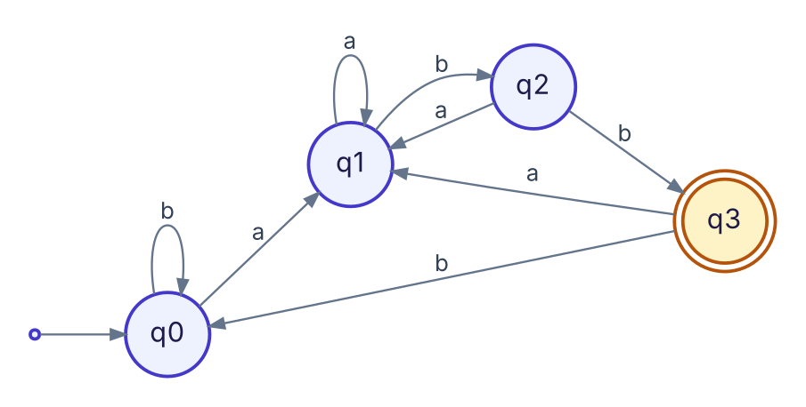{.narrow}

Each state records how much of the pattern $abb$ has just been seen at the end of the input:

| State | Meaning | on `a` | on `b` |
|---|---|---|---|
| q0 (start) | no useful suffix | q1 | q0 |
| q1 | input ends in `a` | q1 | q2 |
| q2 | input ends in `ab` | q1 | q3 |
| q3 (accept) | input ends in `abb` | q1 | q0 |

The interesting transitions are the ones that "fall back". From q3, reading `a` does not return to q0 but to q1, because the new last symbol `a` is the start of another possible `abb`. From q2, reading `a` goes to q1 for the same reason. Getting these fall-back transitions right is the whole difficulty of pattern-matching DFAs, and it is exactly what the Knuth–Morris–Pratt string-matching algorithm computes.

::: {.callout .try data-title="Try it"}
Draw the DFA in the FA studio, then use **Bulk test** with the strings `abb`, `aabb`, `abab`, `abbb`, `ε`. Only the first two should be accepted. Then change q3's transition on `a` to point at q0 and press **Check my automaton** in the assistant: it will tell you that `abbabb` is now wrongly rejected.
:::

## Example: counting modulo 2

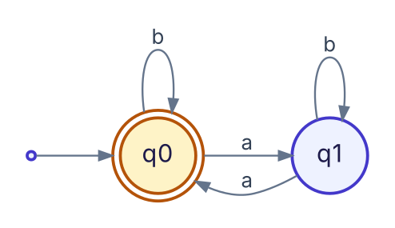{.narrow}

When the condition is about *how many* times something occurs, the states record the count modulo the relevant number. Here two states suffice: "even so far" (start, accepting) and "odd so far". Every `a` flips the state and every `b` leaves it unchanged.

Combining two such conditions, for example "an even number of a's *and* an odd number of b's", needs a state for every *pair* of counts: four states (even–even, even–odd, odd–even, odd–odd), of which exactly one accepts. That is the **product construction**, and it is the general way to build a DFA for the intersection of two regular languages.

## Example: divisibility

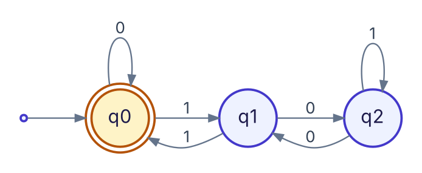{.narrow}

Reading a binary number one bit at a time multiplies the value so far by 2 and adds the new bit. So if the remainder so far is $r$, reading bit $b$ gives remainder $(2r + b) \bmod 3$. The states are the three remainders; the start state is remainder 0 (the empty input counts as zero) and the only accepting state is also remainder 0. The same idea works for any divisor and any base.

## A method for designing DFAs

1. Decide what the machine must **remember** after reading a prefix of the input to be able to finish the job. That memory is the set of states.
2. Make sure the memory is **finite**. If the language needs unbounded memory (for example, "as many b's as a's"), no DFA exists.
3. Write the transition for every state and symbol, including the fall-back transitions.
4. Mark the start state and the accepting states.
5. Test the shortest strings, including $\varepsilon$.

## Common mistakes

- Forgetting $\varepsilon$: if the empty string belongs to the language, the start state must be accepting.
- Missing fall-back transitions in pattern DFAs (the `a` from q3 in Figure 1).
- Two transitions from one state on the same symbol, which makes the machine an NFA.
- Confusing "contains" (once the pattern is seen, accept forever) with "ends with" (the pattern must be at the end).

# 3. Non-deterministic finite automata

## Definition

A **non-deterministic finite automaton** (NFA) is like a DFA except that the transition function returns a *set* of states: $\delta : Q \times \Sigma \to 2^Q$. From a state, a symbol may lead to several states, or to none. The NFA accepts $w$ if **at least one** way of following the transitions consumes $w$ and ends in an accepting state.

A useful way to think about it is that the NFA keeps track of *all the states it could be in*. Toc-Suite's simulator does exactly that: when you test a string on an NFA, every active state is highlighted at once.

## Example: strings ending in *abb*, again

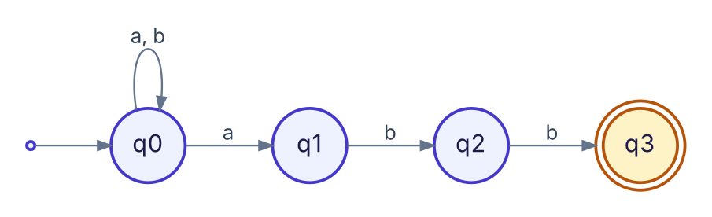{.narrow}

The NFA is much easier to design than the DFA in Figure 1: stay in q0 on any symbol, and at some point guess that the last three symbols are beginning. The fall-back transitions are unnecessary because a wrong guess simply dies.

## NFAs and DFAs are equally powerful

Every NFA can be converted into a DFA that accepts the same language. The idea is that the DFA's state is the *set* of NFA states the NFA could be in. This is the **subset construction**.

1. The DFA's start state is $\{q_0\}$.
2. For a DFA state $S$ (a set of NFA states) and a symbol $a$, the next DFA state is the union of $\delta(q, a)$ over all $q \in S$.
3. Repeat for every new set that appears, until no new sets appear.
4. A DFA state is accepting if it contains at least one accepting NFA state.

For the NFA in Figure 4 the construction produces four states:

| DFA state | on `a` | on `b` | accepting? |
|---|---|---|---|
| {q0} (start) | {q0, q1} | {q0} | no |
| {q0, q1} | {q0, q1} | {q0, q2} | no |
| {q0, q2} | {q0, q1} | {q0, q3} | no |
| {q0, q3} | {q0, q1} | {q0} | yes |

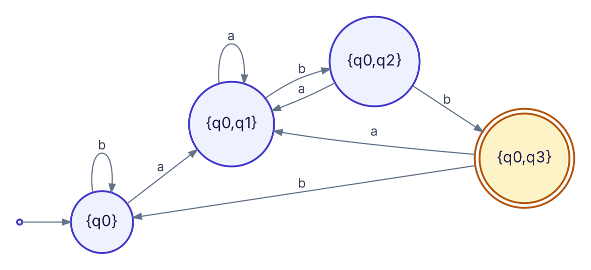{.narrow}

Renaming the sets to q0–q3 gives exactly the DFA of Figure 1. In general the subset construction can produce up to $2^n$ states from an $n$-state NFA, but only the sets reachable from the start set are ever built.

::: {.callout .try data-title="Try it"}
Load or draw the NFA of Figure 4, then choose **NFA → DFA** in the mode menu. The construction is animated one subset at a time, with each step written to the log. For practice, choose **Convert: NFA → DFA** in the practice panel: the NFA is drawn for you, you convert it, and **Check Answer** tells you whether your result is deterministic and accepts the same language.
:::

# 4. ε-transitions

## Definition

An **ε-NFA** may also move along transitions labelled $\varepsilon$ without reading any input. The **ε-closure** of a state $q$, written $\text{ECLOSE}(q)$, is the set of states reachable from $q$ using only ε-transitions, including $q$ itself.

ε-transitions make machines easy to build by composition. To accept $L_1 \cup L_2$, add a new start state with ε-transitions to the start states of machines for $L_1$ and $L_2$. To accept $L_1 L_2$, add ε-transitions from the accepting states of the first machine to the start of the second. This is how regular expressions are turned into automata (Chapter 6).

## Removing ε-transitions

An ε-NFA can be turned into an ordinary NFA with the same states:

- For each state $q$ and symbol $a$: $\delta'(q, a) = \text{ECLOSE}\big(\delta(\text{ECLOSE}(q), a)\big)$, that is, take any number of ε-moves, then one $a$-move, then any number of ε-moves.
- A state $q$ is accepting in the new NFA if $\text{ECLOSE}(q)$ contains an accepting state.

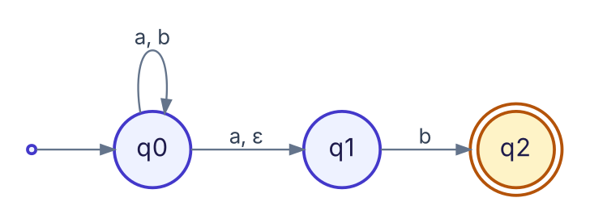{.narrow}

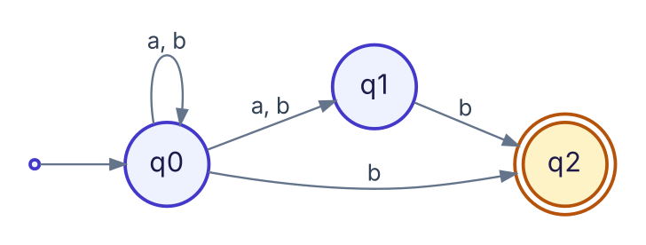{.narrow}

Working the example: $\text{ECLOSE}(q0) = \{q0, q1\}$. On `a`, from $\{q0, q1\}$ we can reach $q0$ and $q1$, whose closure is $\{q0, q1\}$; on `b` we can reach $q0$ and $q2$, whose closure is $\{q0, q1, q2\}$. So in the new NFA, $q0$ goes to $q0$ and $q1$ on `a`, and to $q0$, $q1$ and $q2$ on `b`. State $q0$ is not accepting, because its closure does not contain $q2$.

::: {.callout .warn data-title="Common mistake"}
Forgetting the closure *after* the symbol. If $q1$ has an ε-transition to an accepting state, then any move into $q1$ also counts as a move into that accepting state.
:::

# 5. Minimising a DFA

## Equivalent states

Two states $p$ and $q$ of a DFA are **equivalent** if, for every string $w$, reading $w$ from $p$ ends in an accepting state exactly when reading $w$ from $q$ does. Equivalent states can be merged without changing the language. The **minimal DFA** for a language merges all equivalent states (and removes unreachable ones). It is unique: any two minimal DFAs for the same language differ only in the names of their states.

## Partition refinement

1. Remove states that cannot be reached from the start.
2. Split the states into two groups: accepting and non-accepting. (No accepting state is equivalent to a non-accepting one, because $\varepsilon$ distinguishes them.)
3. Repeatedly split a group if two of its states go, on some symbol, into *different* groups.
4. Stop when no group splits. Each group is one state of the minimal DFA.

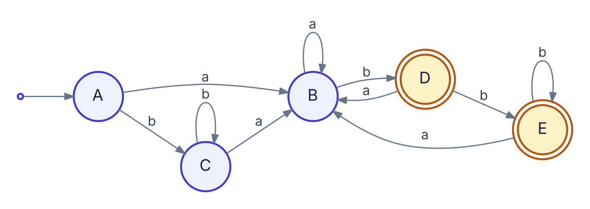{.narrow}

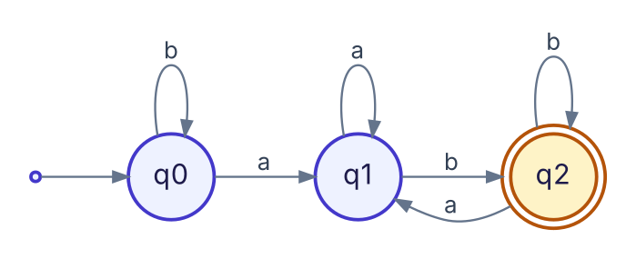{.narrow}

Working the example: start with $\{D, E\}$ (accepting) and $\{A, B, C\}$. In the second group, $B$ goes to $D$ on `b` but $A$ and $C$ stay in the non-accepting group, so $B$ splits off: $\{A, C\}, \{B\}, \{D, E\}$. Now check again: $A$ and $C$ both go to $B$ on `a` and to $C$ on `b`, so they stay together; $D$ and $E$ both go to $B$ on `a` and to $E$ on `b`, so they stay together. Nothing splits, so the minimal DFA has three states.

::: {.callout .try data-title="Try it"}
In the practice panel choose **Convert: DFA → Minimal DFA**. The DFA drawn for you has redundant states; merge them and press **Check Answer**. If you leave two equivalent states unmerged, the checker tells you how many states the minimal DFA has.
:::

## Testing equivalence of two DFAs

Two DFAs accept the same language if and only if their minimal DFAs are the same up to renaming. A more direct test, and the one Toc-Suite uses, is to run both machines in parallel (the product construction) and search for a reachable pair of states where exactly one is accepting. If such a pair exists, the path to it is a string that distinguishes the machines, and a breadth-first search finds the *shortest* such string. That string is what the checker shows you when your answer is wrong.

# 6. Regular expressions

## Syntax and meaning

A **regular expression** describes a language using three operations on smaller expressions:

| Expression | Language |
|---|---|
| $\varnothing$ | the empty language |
| $\varepsilon$ | $\{\varepsilon\}$ |
| $a$ (a symbol) | $\{a\}$ |
| $R + S$ (also written $R \mid S$) | union: $L(R) \cup L(S)$ |
| $RS$ | concatenation: $L(R)L(S)$ |
| $R^*$ | Kleene star: zero or more repetitions |
| $R^+$ | one or more repetitions, $RR^*$ |
| $R?$ | optional, $R + \varepsilon$ |

Star binds tightest, then concatenation, then union, so $ab^* + c$ means $(a(b^*)) + c$. Toc-Suite accepts both `+` and `|` for union in the FA studio, the Grammar Studio and the Automata Assistant's description box.

Some expressions worth knowing by heart, over $\{a, b\}$:

| Language | Expression |
|---|---|
| all strings | $(a+b)^*$ |
| ending in $abb$ | $(a+b)^*abb$ |
| containing $aa$ | $(a+b)^*aa(a+b)^*$ |
| even length | $((a+b)(a+b))^*$ |
| no two consecutive $b$'s | $(a + ba)^*(\varepsilon + b)$ |
| an even number of $a$'s | $(b^* a b^* a)^* b^*$ |

## From expression to automaton: Thompson's construction

Every regular expression can be turned into an ε-NFA by building small machines for symbols and combining them:

- **symbol $a$**: two states joined by an $a$-transition;
- **union**: a new start state with ε-transitions into both machines, and ε-transitions from both accepting states into a new accepting state;
- **concatenation**: an ε-transition from the first machine's accepting state to the second's start;
- **star**: a new start and accept state, with ε-transitions that allow skipping the machine entirely or repeating it.

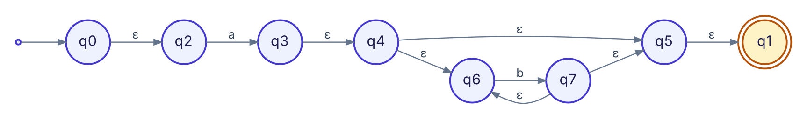

## From automaton to expression

The reverse direction, from a DFA to a regular expression, is done by **state elimination**: add a new start and a new accepting state, then remove the original states one at a time. When a state $q$ with a self-loop labelled $S$ is removed, every path $p \xrightarrow{R} q \xrightarrow{T} r$ is replaced by a single edge $p \xrightarrow{R S^* T} r$, combined by union with any edge already from $p$ to $r$. When only the new start and accept states remain, the label between them is the expression. The result depends on the order of elimination but always describes the same language.

**Arden's theorem** gives an algebraic route: if $X = AX + B$ and $\varepsilon \notin L(A)$, then $X = A^*B$. Writing one equation per state and solving them gives an expression for the language of the start state.

## Useful identities

$R + R = R$; $\ R\varepsilon = \varepsilon R = R$; $\ R\varnothing = \varnothing$; $\ (R^*)^* = R^*$; $\ (R + S)^* = (R^* S^*)^*$; $\ R^*R^* = R^*$; $\ (RS)^*R = R(SR)^*$.

::: {.callout .try data-title="Try it"}
Type `(a+b)*abb` into the Automata Assistant and press **Build DFA**: the reader recognises a regular expression and builds the minimal DFA. Type the same expression into the Grammar Studio's regular-expression tab and choose **Convert Regex and Open FA** to see the same machine reached by a different route.
:::

# 7. What finite automata cannot do

## Closure properties

The regular languages are closed under union, intersection, complement, difference, concatenation, star and reversal: applying any of these operations to regular languages gives a regular language. The proofs are constructions: product automata for intersection and union, swapping accepting and non-accepting states of a *complete* DFA for complement, ε-transitions for concatenation and star, and reversing every arrow (then determinising) for reversal.

Closure properties are also a tool for proving that a language is *not* regular. If $L$ were regular, then $L \cap a^*b^*$ would be regular too; so if that intersection is known to be non-regular, so is $L$.

## The pumping lemma for regular languages

**Lemma.** If $L$ is regular, there is a number $p$ (the pumping length) such that every string $s \in L$ with $\lvert s \rvert \ge p$ can be split as $s = xyz$ with

1. $\lvert y \rvert \ge 1$,
2. $\lvert xy \rvert \le p$, and
3. $x y^i z \in L$ for every $i \ge 0$.

The reason is the pigeonhole principle: a DFA with $p$ states that reads $p$ symbols must visit some state twice, and the part of the input between the two visits ($y$) can be repeated or removed without changing whether the machine accepts.

## Using it: $\{a^n b^n \mid n \ge 0\}$ is not regular

Suppose it were regular, with pumping length $p$. Take $s = a^p b^p$, which is in the language and has length at least $p$. Any split $s = xyz$ with $\lvert xy \rvert \le p$ has $y$ consisting only of $a$'s, and $\lvert y \rvert \ge 1$. Then $xy^2z$ has more $a$'s than $b$'s, so it is not in the language, contradicting condition 3. So the language is not regular.

::: {.callout .warn data-title="Common mistakes with the pumping lemma"}
You choose the string $s$, but you do **not** choose the split: the argument must work for **every** split allowed by conditions 1 and 2. And the lemma can only prove that a language is *not* regular. A language that satisfies the pumping conditions may still be non-regular.
:::

## The Myhill–Nerode view

Two strings $x$ and $y$ are **distinguishable** with respect to $L$ if some suffix $z$ makes exactly one of $xz$, $yz$ belong to $L$. A language is regular if and only if it has finitely many classes of mutually indistinguishable strings, and the number of classes is exactly the number of states of its minimal DFA. For $a^n b^n$, the strings $a, aa, aaa, \dots$ are pairwise distinguishable (append $b^i$), so there are infinitely many classes and no DFA exists. This view is also how Toc-Suite's guided mode explains that one of your states is "doing two jobs": it has found two strings that reach the same state of your machine but are distinguishable in the target language.

# 8. Mealy and Moore machines

## Machines that produce output

A finite automaton answers yes or no. A **transducer** reads an input string and produces an output string. Two standard models differ only in where the output is attached.

A **Moore machine** $(Q, \Sigma, \Gamma, \delta, \lambda, q_0)$ has an output function $\lambda : Q \to \Gamma$ on **states**. It emits $\lambda(q_0)$ before reading anything and then $\lambda$ of each state it enters, so an input of length $n$ produces an output of length $n + 1$.

A **Mealy machine** $(Q, \Sigma, \Gamma, \delta, \lambda, q_0)$ has an output function $\lambda : Q \times \Sigma \to \Gamma$ on **transitions**. It emits one symbol per input symbol, so an input of length $n$ produces an output of length $n$.

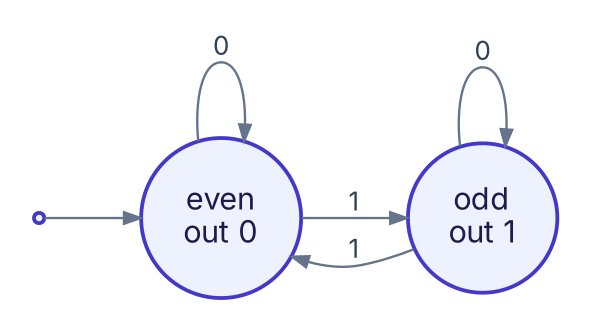{.narrow}

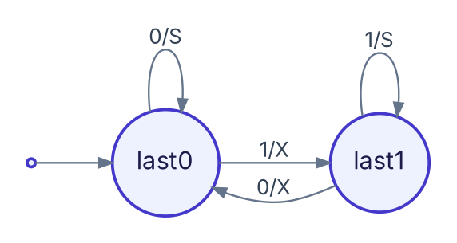{.narrow}

## Converting Moore to Mealy

Give each transition the output of the state it enters: a transition $p \xrightarrow{a} q$ in the Moore machine becomes $p \xrightarrow{a / \lambda(q)} q$. The Mealy machine produces the Moore machine's output without its first symbol $\lambda(q_0)$, and that is the standard sense in which the two are equivalent.

## Converting Mealy to Moore

A Mealy state may be entered with different outputs, and a Moore state can only have one, so such a state must be **split**: one copy for each output with which it can be entered. Each copy keeps all of the original state's outgoing transitions, redirected to the copy of the target that carries the transition's output. The start state needs a copy for the moment before any input is read; its output is arbitrary, because the comparison ignores the first Moore output.

For the change detector above, `last0` is entered with output `S` (from itself on 0) and with output `X` (from `last1` on 0), so it splits into `last0/S` and `last0/X`; `last1` likewise splits into `last1/X` and `last1/S`. The Moore machine has four states.

::: {.callout .try data-title="Try it"}
In the Mealy/Moore studio, draw the change detector as a Mealy machine and choose **Mealy → Moore** in the mode menu to watch the states split. In the practice panel, **Convert: Mealy → Moore** gives you a verified Mealy machine to convert by hand; the checker compares outputs on every input exactly.
:::

## Common mistakes

- Off-by-one comparisons between Moore and Mealy outputs: a Moore machine always prints one more symbol.
- Detecting overlapping patterns: a detector for `11` must still output "yes" after `111`, because the last two symbols are still `11`.
- Forgetting that a Mealy machine's output depends on the symbol being read *now*, not on the state alone.

# 9. Context-free grammars

## Definition

A **context-free grammar** (CFG) is a 4-tuple $G = (V, \Sigma, R, S)$: a set of variables (non-terminals) $V$, terminals $\Sigma$, production rules $R$ of the form $A \to \alpha$ where $A \in V$ and $\alpha$ is a string of variables and terminals, and a start variable $S$. A **derivation** repeatedly replaces a variable by the right-hand side of one of its rules. The language $L(G)$ is the set of terminal strings derivable from $S$.

Example: $S \to aSb \mid \varepsilon$ generates $\{a^n b^n \mid n \ge 0\}$. A derivation of $aabb$ is $S \Rightarrow aSb \Rightarrow aaSbb \Rightarrow aabb$.

## Parse trees and ambiguity

A **parse tree** shows a derivation as a tree: the root is $S$, each internal node is a variable whose children are the right-hand side of the rule applied, and the leaves read left to right give the string. A grammar is **ambiguous** if some string has two different parse trees. The classic example is $E \to E + E \mid E * E \mid a$, in which $a + a * a$ has two trees, one for each order of evaluation. Ambiguity is usually removed by introducing a variable for each precedence level: $E \to E + T \mid T$, $T \to T * F \mid F$, $F \to a$.

::: {.callout .try data-title="Try it"}
In the Grammar Studio, enter `S -> a S b | eps`, open **Parse Tree** and generate the tree for `aabb`. The **Derivation** tab shows the leftmost derivation step by step.
:::

## Normal forms

A grammar is in **Chomsky normal form** if every rule has the form $A \to BC$ or $A \to a$ (plus $S \to \varepsilon$ if needed). Every CFG can be converted to CNF by: adding a new start variable; removing ε-rules; removing unit rules $A \to B$; replacing terminals inside long rules by new variables; and splitting rules with more than two variables. CNF matters because every derivation of a string of length $n$ then takes exactly $2n - 1$ steps, which is what the CYK parsing algorithm relies on.

# 10. Pushdown automata

## Definition

A **pushdown automaton** (PDA) is a finite automaton with a stack. A transition is labelled $a, X \to \gamma$: read input symbol $a$ (or $\varepsilon$), pop stack symbol $X$ (or $\varepsilon$), and push the string $\gamma$ (or $\varepsilon$), whose first symbol becomes the new top. The stack starts with a bottom marker, conventionally $Z$. A PDA accepts **by final state** if it can consume the input and end in an accepting state, or **by empty stack** if it can consume the input and empty its stack. The two modes accept the same class of languages. PDAs are naturally non-deterministic, and the non-deterministic PDA is strictly more powerful than the deterministic one.

## Example: $a^n b^n$

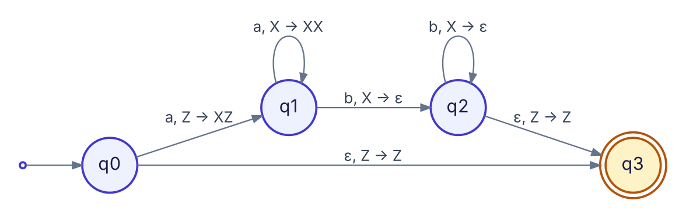{.narrow}

A run on `aabb`, written as (state, remaining input, stack with top on the left):

| Step | Configuration | Transition used |
|---|---|---|
| 0 | (q0, aabb, Z) | start |
| 1 | (q1, abb, XZ) | a, Z → XZ |
| 2 | (q1, bb, XXZ) | a, X → XX |
| 3 | (q2, b, XZ) | b, X → ε |
| 4 | (q2, ε, Z) | b, X → ε |
| 5 | (q3, ε, Z) | ε, Z → Z, accept |

The final ε-move into the accepting state is guarded by popping and re-pushing $Z$. That guard is the most important detail in the machine: without it, the PDA could enter an accepting state while X's remain on the stack and would wrongly accept `aab`. Most wrong PDAs make exactly this mistake.

::: {.callout .warn data-title="The most common PDA mistake"}
An accepting state that can be reached before the stack has been checked. Always ask: *what is on the stack when I enter the accepting state, and does that guarantee the counts matched?*
:::

## From a grammar to a PDA

Every CFG has an equivalent PDA with three states. Push $S$ and move to a looping state. In the loop, if the top of the stack is a variable $A$, replace it by the right-hand side of any rule for $A$ (an ε-move); if the top is a terminal, it must match the next input symbol, and both are consumed. When only $Z$ remains, move to the accepting state. The PDA guesses a leftmost derivation and checks it against the input.

::: {.callout .try data-title="Try it"}
In the Grammar Studio enter `S -> a S b | eps`, open **Conversion** and press **Animate CFG to NPDA**. Then press **Open in PDA Studio** and run `aabb` and `aab`.
:::

## The pumping lemma for context-free languages

If $L$ is context-free, there is a $p$ such that every $s \in L$ with $\lvert s \rvert \ge p$ can be split as $s = uvwxy$ with $\lvert vx \rvert \ge 1$, $\lvert vwx \rvert \le p$, and $u v^i w x^i y \in L$ for all $i \ge 0$. The proof uses a long path in a parse tree on which some variable repeats.

**Example:** $\{a^n b^n c^n\}$ is not context-free. Take $s = a^p b^p c^p$. Since $\lvert vwx \rvert \le p$, the part $vwx$ cannot contain both $a$'s and $c$'s. So pumping changes the count of at most two of the three letters, and $uv^2wx^2y$ is not in the language. The Grammar Studio's **Context-Free Pumping Lemma** tab walks through this kind of argument for your own language.

## Closure properties

Context-free languages are closed under union, concatenation, star and reversal, and under intersection *with a regular language*, but **not** under intersection or complement. For example, $\{a^n b^n c^m\}$ and $\{a^m b^n c^n\}$ are both context-free, but their intersection is $\{a^n b^n c^n\}$, which is not.

# 11. Turing machines

## Definition

A **Turing machine** has a finite control and an unbounded tape divided into cells, each holding a symbol; cells that have never been written hold the blank symbol (Toc-Suite uses `B`). A transition is labelled $a \to b, D$: if the head reads $a$, write $b$ and move in direction $D$ (left `L` or right `R`). The machine starts in $q_0$ with the input on the tape and the head on its first symbol. It **halts** when no transition applies; it accepts if it halts in an accepting state.

## Example: incrementing a binary number

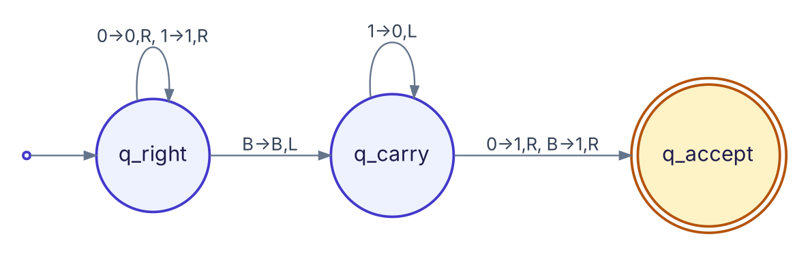{.narrow}

A run on `1011` (the head position is in brackets):

| Step | State | Tape | Action |
|---|---|---|---|
| 0 | q_right | [1]011 | read 1, write 1, move R |
| 1–3 | q_right | 101[1] … 1011[B] | scan right to the blank |
| 4 | q_carry | 101[1] | at the blank: write B, move L, start carrying |
| 5 | q_carry | 10[1]0 | read 1, write 0, move L |
| 6 | q_carry | 1[0]00 | read 1, write 0, move L |
| 7 | q_accept | 11[0]0 | read 0, write 1, move R, accept |

The tape now holds `1100`, which is 11 + 1 = 12 in binary.

::: {.callout .try data-title="Try it"}
Load the binary incrementer from the TM studio's library, type `1011` and press Play. The tape panel animates every step; the header shows the head position.
:::

## Variants

- **Multi-tape** machines have several tapes and heads. They are no more powerful than single-tape machines, but can be quadratically faster.
- **Non-deterministic** machines may have several transitions for the same state and symbol; they accept if any branch accepts. They are no more powerful either, because a deterministic machine can explore the branches breadth-first.
- **Linear-bounded automata** may only use the cells that hold the input. They recognise exactly the context-sensitive languages.

All three variants are available in the TM studio's machine-type menu.

## Decidability

A language is **decidable** (recursive) if some Turing machine accepts every string in it and rejects every string not in it, always halting. It is **recognisable** (recursively enumerable) if some machine accepts exactly its strings but may run forever on others. The **halting problem**, deciding whether a given machine halts on a given input, is recognisable but not decidable; the proof is a diagonal argument in which a hypothetical decider is run on its own description. Many other problems are shown undecidable by **reduction** from the halting problem. For finite automata, by contrast, almost everything is decidable: emptiness, membership and, crucially, equivalence, which is why Toc-Suite can check FA answers exactly but can only check Turing-machine answers on finitely many inputs.

# 12. Before the examination

## A checklist for every machine you draw

1. Is there exactly one start state?
2. Should $\varepsilon$ be accepted? Is the start state's accepting flag consistent with that?
3. For a DFA: does every state have exactly one transition on every symbol (or is a trap state understood)?
4. Test the five shortest accepted and the five shortest rejected strings.
5. For a PDA: what is on the stack when you enter each accepting state?
6. For a TM: is there a transition for the blank symbol where the input ends? Does the machine halt?
7. For a transducer: is the output length right (one extra for Moore)?

## How to practise with Toc-Suite

| Goal | Where |
|---|---|
| Build DFAs, NFAs and ε-NFAs from descriptions (120 questions) | FA studio → Practice → *Build from a description* |
| Practise ε-removal, subset construction and minimisation (159 exercises) | FA studio → Practice → *Convert: …* |
| Get hints while drawing | FA studio → Automata Assistant → **Guide me** |
| Mealy and Moore construction and conversion (21 machines) | Mealy/Moore studio → Practice |
| Pushdown automata (33 problems) | PDA studio → Practice |
| Turing machines (20 challenges, tape checked) | TM studio → Practice |
| Grammars, parse trees, CFG → PDA, pumping lemma | Grammar Studio |

Every reference answer in these banks is verified automatically against an independent definition of its language, so if the checker says your answer is wrong, it will also show you a string that proves it.
