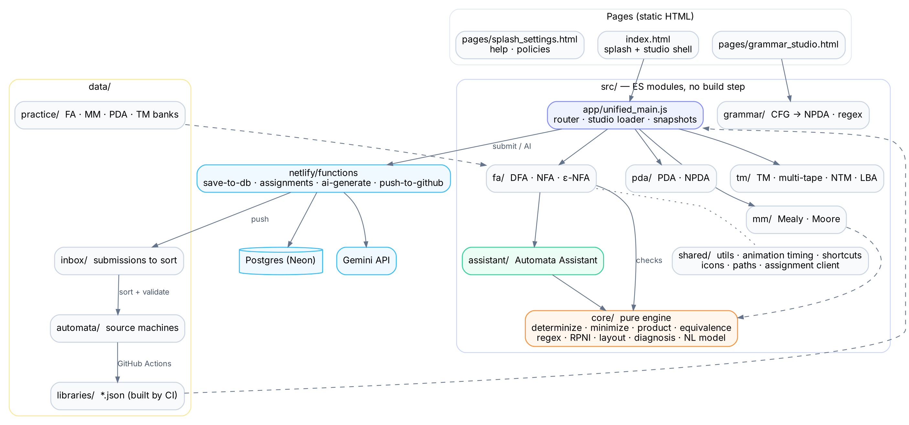
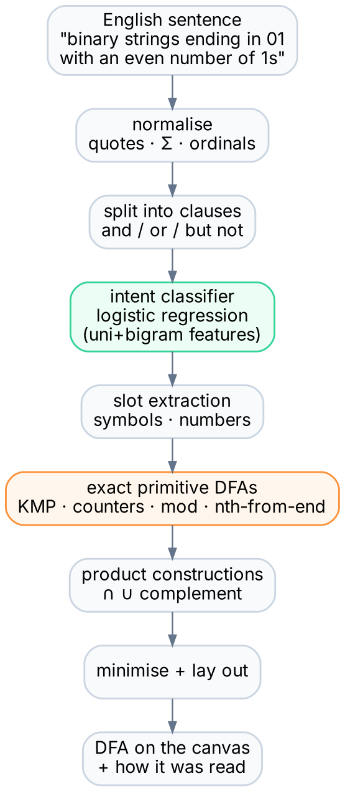

# 1. Overview

Toc-Suite is a static web application written in plain JavaScript ES modules. It has no build step: the files in the repository are the files the browser runs. A few Netlify Functions provide server-side features (submissions, instructor review, library pushes and the AI generator). This guide is for anyone who wants to run, modify or extend the code.

## Running locally

```bash
git clone https://github.com/shiroonigami23-ui/Toc-Suite.git
cd Toc-Suite
python3 -m http.server 5173      # any static server works
# open http://localhost:5173
npm test                         # Node 20+; no dependencies to install
```

ES modules must be served over HTTP; opening `index.html` from the file system will not load them. Server-side features need `netlify dev` and the environment variables in Chapter 9; everything else works with a plain static server.

## Design principles

- **No build step.** Every module is readable source. Paths are relative and resolved at run time.
- **Shared shell, separate studios.** One page hosts the FA, Mealy/Moore, PDA and TM studios; each studio has the same internal shape.
- **Pure core.** Anything that can be computed without the DOM (determinisation, equivalence, regular expressions, learning, layout, diagnosis, the English reader) lives in `src/core` and is tested in Node.
- **Verified data.** Every practice answer and library machine is checked by the test suite against an independent definition.
- **Graceful degradation.** If the functions or the network are unavailable, drawing, simulation, conversion, practice and the assistant still work.

# 2. Repository layout



| Path | Purpose |
|---|---|
| `index.html` | Splash screen, shared dialogs, and the studio shell's container |
| `404.html` | Redirects pre-November URLs on hosts without redirect rules |
| `manifest.json`, `service-worker.js` | Progressive web app shell (must stay at the root for scope) |
| `netlify.toml` | Build command, security headers, redirects for moved pages |
| `src/app/unified_main.js` | Routing, studio loading, autosave snapshots, splash, settings application |
| `src/app/machine_router.js` | Cross-studio routing of machines and pages |
| `src/shared/` | `utils.js` (logging, dialogs, shortcuts, animation timing, file names), `animation.js` (drawing a machine), `paths.js` (`appUrl`), `assignment-client.js`, `ai-auth.js` |
| `src/fa/` | FA studio: `state`, `renderer`, `ui`, `simulation`, `automata` (conversions), `conversion-animation`, `equivalence`, `file`, `practice`, `library-loader`, `fa_logic_table` |
| `src/mm/` | Mealy/Moore studio, same shape, plus `moore_mealy_automata` (conversions) and `moore_mealy_equivalence` |
| `src/pda/` | PDA studio, plus the HTML fragment `pda_studio.html` |
| `src/tm/` | TM studio (single-tape, multi-tape, NTM, LBA), plus `tm_studio.html` |
| `src/grammar/` | Grammar Studio and the regular-expression converter |
| `src/core/` | Engine: `fa.js`, `regex.js`, `learn.js`, `layout.js`, `diagnose.js`, `nl.js`, `nl-model.json` |
| `src/assistant/assist_panel.js` | The Automata Assistant user interface |
| `data/practice/` | Practice banks (JS modules) |
| `data/libraries/` | Built library files (written by CI; do not edit by hand) |
| `data/automata/` | Library source machines, one JSON file each, by type |
| `data/inbox/` | Incoming machines to be sorted by CI |
| `data/templates/` | Starter machines |
| `pages/` | Grammar Studio, help, settings, policies, instructor portal and review |
| `assets/` | `css/style.css`, icons, `vendor/lucide-icons.js` (generated subset) |
| `netlify/functions/` | Server-side functions |
| `tests/` | Test suite (`node --test`) |
| `tools/` | Model trainer, practice-bank builders, icon builder, documentation builders |
| `docs/` | Books, figures and screenshots |

## Paths

Modules import each other with relative paths. Data files and pages are referenced through `appUrl(path)` from `src/shared/paths.js`, which resolves a path from the repository root using the module's own URL. This keeps the application working when it is served from a domain root, from a sub-path such as GitHub Pages, or locally. Do not write `fetch('data/…')` directly in a module: a relative `fetch` resolves against the *page*, not the module.

# 3. The shell and the studios

## Loading a studio

`startUnifiedApp()` applies stored preferences, reads the route from the URL hash (`#fa`, `#mm`, `#pda`, `#tm`) or the last studio used, and calls `loadStudio(target)`. The FA and Mealy/Moore studios build their HTML from template strings in `StudioContext.getHtmlContent`; the PDA and TM studios fetch their fragments (`src/pda/pda_studio.html`, `src/tm/tm_studio.html`) and their modules, which `warmupSpecializedStudios()` prefetches during idle time on the splash screen. After the HTML is inserted, the studio's `initializeUI()` runs and the Lucide icon runtime converts any `<i data-lucide>` elements.

## Snapshots

Every few seconds, and when leaving a studio, the shell serialises the current machine to local storage (`tocCanvasSnapshotFaV1` and similar). When a studio opens with an empty canvas, the snapshot is restored. Machines handed from one studio to another (for example, a PDA built in the Grammar Studio) travel through session storage and are consumed once.

## The internal shape of a studio

| Module | Responsibility |
|---|---|
| `*_state.js` | Holds `MACHINE`, the undo and redo stacks, and helpers (`pushUndo`, `undo`, `redo`, `setMachine`) |
| `*_renderer.js` | Draws `MACHINE` into the SVG groups `#states` and `#edges`; never mutates the machine |
| `*_ui.js` | Wires tools, buttons, dialogs and keyboard handlers; calls `pushUndo` before every change |
| `*_simulation.js` | Runs inputs, highlights the active state and transition |
| `*_file.js` | Save (JSON), load (JSON, with routing to the right studio), export PNG, image import via AI |
| `*_practice.js` | Generate, show solution, check answer |
| `*_library_loader.js` | Fetches and lists the studio's library |

### Shared dialogs

Some dialogs (save to library, PNG export, clear canvas, state properties, rename, transitions) live in `index.html` and are shared by the FA and Mealy/Moore studios. Each of those studios calls `resetSharedDialogButtons()` at the start of `initializeUI()`, which replaces the buttons with clean clones so that a previous studio's handlers do not remain attached. If you add a shared dialog button, add its id to `SHARED_DIALOG_BUTTONS` in `utils.js`.

## Keyboard shortcuts

`initializeShortcuts()` in `utils.js` installs one global handler. Buttons are found by id first and by `.toolbar-icon[data-mode="…"]` second, so a new studio gets the shortcuts by using the same ids or data-mode values. The list shown by the `?` key is the `SHORTCUTS` array in the same file; keep it in step with the handler.

## Animation timing

All animations take their timing from `utils.js`:

- `constructionDelay(steps)` for drawing a loaded machine; the whole drawing takes at most about 2.5 seconds at normal speed.
- `stepDelay()` for one explained step of a conversion (slow 1500 ms, normal 700 ms, fast 250 ms, instant 0).
- `animationSpeed()` reads the `tocAnimSpeed` setting and returns `instant` when the body has `data-motion="reduced"` or the operating system requests reduced motion.

`animateMachineDrawing()` serialises drawings through `window.__tocDrawing`, a promise for the drawing in progress. Code that reads or converts the machine after a load should `await window.__tocDrawing` first.

# 4. Data formats

All machines share the same outer shape: a `type`, a list of `states` and a list of `transitions`. Positions are in the SVG's 1400 × 900 coordinate system.

## Finite automata

```json
{
  "type": "DFA",
  "states": [
    { "id": "q0", "x": 200, "y": 300, "initial": true, "accepting": false },
    { "id": "q1", "x": 500, "y": 300, "initial": false, "accepting": true }
  ],
  "transitions": [
    { "from": "q0", "to": "q1", "symbol": "a" },
    { "from": "q1", "to": "q1", "symbol": "a,b" }
  ],
  "alphabet": ["a", "b"]
}
```

`type` is `DFA`, `NFA` or `ENFA`. A transition label may hold several symbols separated by commas. The empty string may be written `ε`, `eps`, `epsilon`, `λ` or left empty; `isEpsilon` in `src/core/fa.js` defines the accepted spellings.

## Mealy and Moore machines

Moore states carry an `output`; Mealy transitions carry an `output`. Input symbols may be longer than one character (the serial adder uses `00`, `01`, `10`, `11`); the simulator tokenises input against the machine's alphabet, longest match first, and also accepts comma- or space-separated input.

## Pushdown automata

```json
{ "type": "PDA", "initialStackSymbol": "Z", "acceptanceMode": "FINAL_STATE",
  "states": [ { "id": "q0", "initial": true, "accepting": false, "x": 200, "y": 300 } ],
  "transitions": [ { "from": "q0", "to": "q1", "symbol": "a", "pop": "Z", "push": "XZ" } ] }
```

`symbol`, `pop` and `push` may be empty for ε. `push` is pushed so that its first character becomes the new top. `acceptanceMode` is `FINAL_STATE`, `EMPTY_STACK` or `BOTH`. Stack symbols are single characters.

## Turing machines

```json
{ "type": "TM", "blankSymbol": "B",
  "transitions": [ { "from": "q0", "to": "q1", "read": "1", "write": "0", "move": "R" } ] }
```

`type` is `TM`, `MULTI_TAPE` (with `numTapes`, and tuple-valued `read`, `write`, `move`), `NTM` or `LBA`. Plain `TM` mode allows only `L` and `R` moves; the validator rejects `S`. Accepting states halt the machine. Older library files used `direction` and `blank`; the library loader maps them to `move` and `blankSymbol`.

## Saved files

A saved file wraps the machine with metadata: `{ "id", "title", "description", "type", "machine": { … } }`. The loaders accept either the wrapper or a bare machine.

## Practice banks

| File | Shape |
|---|---|
| `practice-bank.js` | `window.PRACTICE_BANK = { DFA: {easy:[…], basic:[…], medium:[…], hard:[…]}, NFA: …, ENFA: …, ENFA_TO_NFA: …, NFA_TO_DFA: …, DFA_TO_MIN_DFA: …, NFA_TO_MIN_DFA: … }`. Build entries: `{ q, sol, machine }`. Conversion entries add `source`. |
| `moore_mealy_practice_bank.js` | `window.MM_PRACTICE_BANK = { MOORE: {easy, medium, hard}, MEALY: {…} }` |
| `pda_practice_bank.js` | `export const PDA_PRACTICE_BANK = [ { id, level, title, description, instruction, solution } ]` |
| `tm_practice_bank.js` | `export const TM_PRACTICE_BANK = { basic: […], easy, medium, hard }`, entries `{ id, title, description, inputAlphabet, machine }` |

# 5. The verification engine

`src/core/fa.js` works on an internal DFA format, `{ alphabet, start, accept: boolean[], delta: number[][] }`, where `delta[q][i]` is the next state on `alphabet[i]`.

| Function | Purpose |
|---|---|
| `machineAlphabet(m)` | Symbols used by an app machine (ε excluded) |
| `determinize(m, Σ)` | Subset construction with ε-closures; also returns `labels` such as `{q0,q2}` |
| `withAlphabet(dfa, Σ)` | Re-index over a larger alphabet, adding a dead state when needed |
| `minimize(dfa)` | Remove unreachable states, then partition refinement |
| `product(a, b, op)` | `and`, `or`, `xor`, `diff` |
| `compare(a, b)` | `{ equivalent, counterexample, acceptedBy }`, counterexample shortest by BFS |
| `toMinimalDfa(m, Σ)` | Convenience: determinise and minimise an app machine |
| `toAppMachine(dfa, opts)` | Back to the app format; `keepDead` keeps the trap state |
| `removeEpsilon(m)` | ε-NFA → NFA on the same states |
| `structuralIssues(m)` | Missing or multiple start states, dangling or ε or non-deterministic or missing transitions, unreachable states |
| `sampleWords(dfa, opts)` | Short accepted or rejected strings for explanations |

Other core modules:

- `regex.js`: `parseRegex`, `regexToEnfa` (Thompson), `regexToDfa`. Union is `+` or `|`; `?` and postfix `+` (as `^+`) are supported.
- `learn.js`: `learnDfa(positive, negative, Σ)` (RPNI) and `parseExamples(text)`.
- `layout.js`: `autoLayout(machine)` (layered BFS, barycentre ordering, trap state parked bottom-right), `withLayout`.
- `diagnose.js`: `diagnose(machine, targetDfa, { mode })` returns `{ correct, progress, hints }`, where each hint has a level, a message, the states involved, a witness string and optionally an edge; `trace(machine, word)` returns the path.

# 6. The Automata Assistant

{.tall}

## The reader (`src/core/nl.js`)

`parseDescription(text, model)` returns `{ ok, dfa, alphabet, explanation, clauses, problems }`. The stages are:

1. `detectAlphabet` (explicit braces, "binary", "over a and b", or the symbols used) and `normalizePhrasing` (canonical forms for ordinals, quotes, "non-empty", "a before b", and so on).
2. Fast paths: a regular expression embedded in the text (`findRegex`) or a finite word list.
3. `splitClauses`, which protects phrases such as "starts and ends with" and handles `and`, `or`, `but not`, set-builder notation and ellipsis.
4. `predict(model, clause)`, a multinomial logistic regression over unigram and bigram features with placeholder tokens `SYM`, `NUM`, `ORD`; deterministic overrides for position phrasings.
5. Slot extraction per intent, then `primitiveDfa(intent, slots, Σ)` to build an exact DFA.
6. Combination with product constructions, negation by complement, minimisation.
7. Capitalised symbols in the text keep their case in the result.

## Training the model

```bash
npm run train-model
```

`tools/nl-dataset.mjs` holds phrasing templates per intent and generates examples; `tools/train-nl-model.mjs` trains with a fixed seed, reports accuracy on held-out templates, then trains on everything and writes `src/core/nl-model.json`. The Tests workflow retrains and fails if the committed model differs. To teach the reader a new phrasing: add templates for the intent, retrain, add the description to `tests/nl.test.mjs` with a brute-force predicate, and commit the model with the code.

To add a new **intent**: add it to `INTENTS`, add templates, implement its slots in `slotsFor`, its automaton in `primitiveDfa` and its wording in `describe`, then add tests.

## The panel (`src/assistant/assist_panel.js`)

`initAssistPanel()` builds the panel into `#assistPanelRoot`. The model is fetched on first use or when the browser is idle. Guided mode polls a signature of the machine and re-runs `diagnose` when it changes; incorrect states get the `assist-bad` class. When a practice question is open, its reference answer (`window.__CURRENT_FA_PRACTICE`) becomes the target. The panel exposes `window.TocAssist` for debugging.

# 7. Practice and checking

| Studio | How an answer is checked |
|---|---|
| FA (build) | Exact equivalence with the reference over the union of alphabets; shortest counterexample reported; diagnosis hints |
| FA (convert) | Exact equivalence with the *source*, plus `conversionProblems`: no ε (ε-NFA → NFA), deterministic (→ DFA), minimal state count with or without trap (→ minimal DFA) |
| Mealy/Moore | Exact lock-step search (`compareTransducers`); Moore vs Moore also compares the start output; required machine type enforced |
| PDA | Every string up to length 6 (5 for alphabets of four or more symbols) compared with the reference |
| TM | Every string up to length 5 over the challenge's `inputAlphabet`; acceptance and final tape compared |

## Adding a practice question

1. Add the entry to the bank.
2. For FA questions, if the stored answer is not obviously right, add a ground-truth entry to `tests/practice-truth.mjs` (alphabet, predicate, regex or description) and run `npm run fix-practice-bank`, which rebuilds any answer that disagrees with its predicate.
3. Rebuild the conversion sets with `node tools/build-conversion-practice.mjs`.
4. For PDA, TM and Mealy/Moore questions, add a specification to the corresponding audit test.
5. `npm test`.

# 8. Testing

```bash
npm test                     # node --test tests/*.test.mjs
```

| Test file | Covers |
|---|---|
| `fa.test.mjs` | Engine: determinisation, minimisation, products, comparison, ε handling |
| `nl.test.mjs`, `nl-unseen.test.mjs` | The English reader: 63 tuned and 25 unseen descriptions, each checked by a brute-force predicate |
| `assist.test.mjs` | RPNI, example parsing, layout, diagnosis, guided mode, tracing |
| `audit-fa.test.mjs` | Differential tests of the legacy simulator and conversions; Grammar Studio regex converter; equivalence with different alphabets; FA practice and library data; conversion practice |
| `audit-pda.test.mjs` | Every PDA practice answer and library machine on every input up to length 7 |
| `audit-tm.test.mjs` | Every TM practice answer (acceptance and tape) on inputs up to length 6; library machines; legal moves |
| `audit-mm.test.mjs` | Mealy/Moore answers vs output specifications; both conversions on random machines; exact equivalence vs brute force; library |

Tests that import browser modules define minimal `window` and `document` stubs at the top. Random tests use a fixed seed so failures are reproducible.

Browser checks (layout at four screen sizes, keyboard shortcuts, save, export, load, conversions, practice flows) are run with Playwright scripts during development. Run them against `python3 -m http.server 5173` before changing layout or file handling.

# 9. Server side and deployment

## Netlify Functions

| Function | Purpose | Environment |
|---|---|---|
| `save-to-db` | Store a save or submission | `DATABASE_URL` |
| `list-active-assignments`, `create-assignment` | Assignments | `DATABASE_URL`, `ARCHITECT_KEY` (create) |
| `get-submissions`, `save-review` | Instructor portal | `DATABASE_URL`, `ARCHITECT_KEY` |
| `push-to-github`, `push-to-github-bulk` | Put machines in `data/inbox/` (instructor action) | `GITHUB_PAT`, `GITHUB_REPO`, `ARCHITECT_KEY`, `DATABASE_URL` |
| `verify-ai-password` | Unlock the AI generator | `AI_ACCESS_PASSWORD` |
| `ai-generate` | Server-side Gemini proxy | `AI_ACCESS_PASSWORD`, `GEMINI_API_KEY`, optional `GEMINI_MODEL` (default `gemini-flash-latest`) |

No key is ever sent to the browser. Set these in the Netlify site's environment settings.

## GitHub workflows

| Workflow | Trigger | Job |
|---|---|---|
| `tests.yml` | push, pull request | `npm test`; retrain the model and fail if it differs |
| `build-library.yml` | changes in `data/inbox/` or `data/automata/` | Validate, sort, deduplicate, rebuild `data/libraries/*.json` |
| `generate_preview.yml` | changes in `data/automata/` | Regenerate `docs/PREVIEW.md` |
| `update_changelog.yml` | new library files | Append library additions to `CHANGELOG.md` |
| `auto_repair.yml` | manual, or changes to itself | Secret scanner and lint fixer |

`scripts/ignore-build.sh` tells Netlify to skip a deploy when a commit only touches data, documentation or the changelog.

## Redirects

`netlify.toml` redirects the pre-November URLs (`/grammar_studio.html`, `/splash_help.html`, `/splash_settings.html`, the portal pages, `/mealy_moore_studio.html`, `/style.css`, the icons and the library JSON files) to their new locations with status 301. `404.html` performs the same mapping in the browser for hosts without redirect rules.

# 10. Performance and maintenance tools

| Tool | Purpose |
|---|---|
| `tools/build-icons.mjs` | Writes `assets/vendor/lucide-icons.js` with only the icons the code uses (about 20 KB). Run after adding an icon name: `npm i --no-save lucide@1.73.0 && node tools/build-icons.mjs` |
| `tools/train-nl-model.mjs` | Retrain the English reader |
| `tools/fix-practice-bank.mjs` | Rebuild FA answers that disagree with `tests/practice-truth.mjs` |
| `tools/build-conversion-practice.mjs` | Regenerate the FA conversion exercises |
| `tools/docs/figures.mjs`, `tools/docs/charts.py` | Regenerate the documentation figures (Graphviz, Matplotlib) |
| `tools/docs/build_docs.py` | Build the three books to PDF (pandoc and Chromium) |

Load-time rules of thumb: the PDA and TM practice banks and the reader's model are loaded on first use, so keep new large data behind a dynamic `import()` or a lazy `fetch`. Icons come from the local subset; a missing icon name renders nothing, so rebuild the subset when adding one.

## Accessibility and settings

Settings live in local storage under keys starting with `toc` (`tocTheme`, `tocFontScale`, `tocMotion`, `tocAnimSpeed`, `tocShareSaves`, …). The shell applies theme, text size and motion on load. Reduced motion forces instant animations. Every interactive control should be reachable by keyboard; new dialogs should close on Escape (the global handler clicks the first button whose id ends in `CloseBtn`, `CancelBtn` or `Cancel`, or an element with `data-close`).

## Conventions

- Commit messages use a conventional prefix (`feat`, `fix`, `perf`, `refactor`, `docs`, `chore`).
- Every new user-visible behaviour gets a CHANGELOG entry.
- Every new data file is covered by a test before it is used by a checker.
